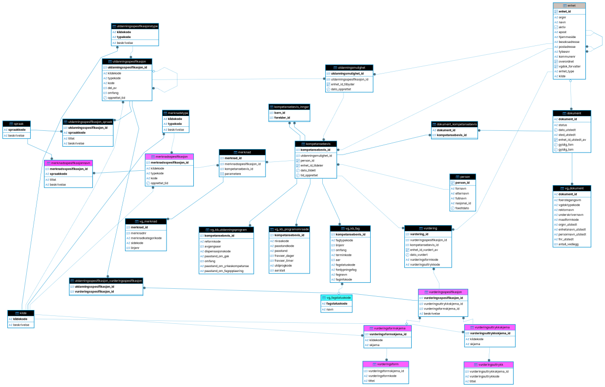
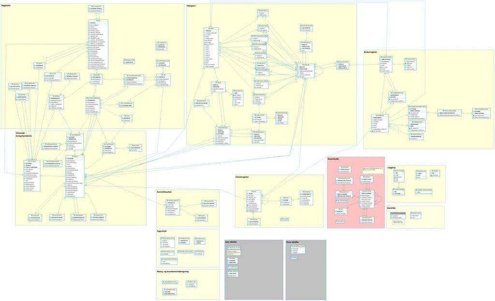

## 11. Semantic architecture

The transition from NVB to KREG is not just a system migration, but a change in how results from education are represented semantically. NVB's information model is built on specialised, distinct entities for upper secondary education. KREG's model, inspired by the international standard European Learning Model (ELM) v3 [8], uses a single generic and recursive entity, kompetansebevis (certificate of competence), which can represent anything from individual results to complete diplomas and degrees from higher education.

This chapter describes this difference and the consequences it has for the system vendors that currently deliver data to NVB. The work is part of what the Norwegian Digitalisation Agency's Framework for Digital Interoperability (Rammeverk for digital samhandling) defines as semantic interoperability – a shared understanding of the meaning of the data and of the format in which it is exchanged [4].

The description in this chapter is the normative, system-independent information model for results from education, anchored in the regulations and in ELM. KREG's data model (appendix A) and Sikt's validation service are implementations that must conform to it – not the other way round. This responds to the need, pointed out in the round of comments, for the answer key not to be a vendor's rule engine.

### 11.1 Models

Models used in this report:

| Model | Role | Scope | Reference |
|---|---|---|---|
| NVB | Today's source of truth for results from upper secondary education | Specialised for upper secondary education | [5][6], appendix B |
| KREG | Future receiving model for SAMT-BU | Generalised, cross-sectoral, ELM-inspired | [14], appendix A |
| Utdanningsregisteret | Future master data register for education; the model is synchronised with KREG's education entities | Cross-sectoral | [16] |
| FINT | County-level integration model for school administration data; designed for statistics and analysis, not long-lived credentials | Upper secondary education | [7][12: working meeting 8] |
| ELM v3 | International standard for achievements in education; framework for exchange across sectors and countries | All levels | [8] |

The models in FINT and the old NVB overlap considerably and describe diplomas and subjects for upper secondary education. It is important to carry this model forward semantically even though KREG does not use it as its main model – several of the subtypes in KREG (vg_kb_fag, vg_kb_programomraade, vg_kb_utdanningsprogram, vg_dokument) refer to it. KREG's data model is more generalised and draws inspiration from ELM, a model that is synchronised with the model of Utdanningsregisteret.

### 11.2 New semantics – certificates of competence within certificates of competence

In NVB, the document type is controlled by a code (VGDOKTYPEKODE) on a single flat entity. Diplomas and certificates of competence are rows in the same table, distinguished only by the code value, and the grades are stored as columns directly on the subject row [5][15].

In KREG/ELM v3, kompetansebevis is a single recursive entity. A diploma is a kompetansebevis with other kompetansebevis nested beneath it (the relation kompetansebevis_inngar, with child and parent). Assessment (vurdering) is separated out as its own entity, linked to the individual kompetansebevis, and can have a hierarchical structure in which several assessments belong to the same kompetansebevis – for a subject in upper secondary education it may contain both the examination grade and the overall achievement grade [14].

The same structure is used unchanged across sectors: a bachelor's degree is a kompetansebevis with course results nested beneath it, in exactly the same way as a diploma from upper secondary education has final assessments in subjects nested beneath it. This means that InSchool and VIGO must change the model of the data they submit.

![On the left, NVB with specialised types: VGDOK with VGDOKTYPEKODE = VM and the personal name as free text, VGDOKFAG rows with the overall achievement and examination grades as columns, and VGDOKMERKNAD/VGDOKPROMR, linked by the diploma number; the document type is a code value set by the vendor. On the right, KREG/ELM v3 with a recursive structure: a kompetansebevis (diploma, root without parent) with kompetansebevis for final assessments in subjects (NOR1211, MAT1013) beneath it via kompetansebevis_inngar, and separate assessments (overall achievement, examination) beneath each subject; the document type is the position in the hierarchy, with the same structure for degrees, trade certificates and primary school (figure in Norwegian)](fra-nvb-til-kreg-elm.png)

*Figure 4: From a flat, type-coded structure (NVB) to a recursive structure (KREG/ELM v3). Simplified; complete models in appendices A and B.*

The core of what vendors must deal with – given today's position-based file format ([chapter 5](../dagens-nvb-import/)) – is therefore not individual fields, but a shift in representation: from a position-based text file to structured objects in an API. This follows directly from the difference in paradigm above:

- The document type is derived from the structure (position in the hierarchy), not from a type code set by the vendor.
- Assessment is sent as a separate object, not as a column value on the subject. Among other things, this allows several assessments per result (resit examination, appeal).
- Fields are identified by name, not by column position in a line.
- The person is identified in a structured way (the entity person with a national ID), not as a free-text name in the document header.

### 11.3 Placement in ELM v3

ELM v3 makes a strict distinction between two disjoint branches [8]:

- **The claim side** – actual, individual events: Learning Achievement (that one specific person has achieved a learning outcome) and Learning Assessment (the assessment/grade). Both are linked to one learner.
- **The specification side** – templates and definitions: Learning Achievement Specification (what can be learned) with the subclass Qualification (formal type of qualification with EQF level etc.), and Learning Opportunity (a concrete offering of a specification by a provider).

An instance cannot be both a claim and a specification. The KREG model respects this distinction: it has separate entities for the specification side, and *kompetansebevis* represents only the claim side. The placement is then:

| KREG entity | ELM v3 class | Remark |
|---|---|---|
| kompetansebevis | Learning Achievement | Instance, per person. The recursion (kompetansebevis_inngar) corresponds to ELM's composition relations (hasPart/isPartOf). |
| vurdering | Learning Assessment | Separate entity with form of assessment and assessment scale. |
| utdanningsspesifikasjon | Learning Achievement Specification / Qualification | The definition side; linked to Utdanningsregisteret in the target picture. |
| utdanningsmulighet | Learning Opportunity | Links a specification to a provider (enhet). |
| dokument / vg_dokument | – (the documentation of a kompetansebevis) | Represents the issued document – paper diploma, signed PDF or eventually verifiable digital credentials (the «envelope» around the claims; in the ELM ecosystem, the European Digital Credential). |
| person | Learner (person) | – |
| enhet | Organisation / Awarding Body | Awarding body, issuer, assessor. |

There is a need to distinguish between the description of *what has been achieved* (kompetansebevis) and information about *how this is documented* (dokument) – which quickly brings in paper diplomas, signed PDFs and verifiable digital credentials, for example for digital wallets.

The naming of the entities *kompetansebevis* and *dokument* in the KREG model should be reconsidered before the model approaches production. This has not been discussed in the working group, and is therefore raised as an oversight. The entity currently called *kompetansebevis* in reality describes an achievement or completion. An alternative and more precise term could be *kompetanseoppnåelse* (competence achievement).

The internal data model need not be isomorphic with the exchange format – it is standard practice for the API layer to do the mapping. The consequence is that the API/export layer must know which ELM class a given kompetansebevis instance corresponds to (based on whether it is a leaf or has children, and what kind of utdanningsspesifikasjon it points to), instead of treating all instances alike. One checkpoint remains: ELM defines the domain and range of hasPart/isPartOf in the application profiles, not in the core model, so the nesting of Learning Achievement within Learning Achievement must be verified against the chosen profile [8].

![Placement of the KREG entities in ELM v3, with two disjoint branches where an instance cannot be both. The claim side (actual events): Learning Achievement (KREG: kompetansebevis, recursion = hasPart/isPartOf), Learning Assessment (KREG: vurdering), which assesses the Learning Achievement, and Learner/Organisation (KREG: person/enhet). The specification side (definitions): Learning Achievement Specification with the subclass Qualification (KREG: utdanningsspesifikasjon), by which the Learning Achievement is specified, and Learning Opportunity (KREG: utdanningsmulighet, specification + provider). Below both: dokument/vg_dokument, which documents one or more kompetansebevis – the «envelope»: paper, signed PDF, verifiable digital credential (figure in Norwegian)](mapping-kreg-elm-v3.png)

*Figure 5: Mapping from KREG to ELM v3.*

### 11.4 Mapping NVB → KREG

The table shows how today's NVB entities correspond to the KREG model, and what the change means for the vendor. Complete models are in appendix A (KREG) and B (NVB) [14][15].

| NVB | KREG | Consequence for the vendor |
|---|---|---|
| VGDOK with VGDOKTYPEKODE (VM/KB) | kompetansebevis (+ dokument/vg_dokument for the issuing) | The vendor stops setting a type code; the document type follows from the structure. Issuing information (head teacher, written language standard, signatory) moves to vg_dokument. |
| VGDOKFAG with overall achievement/examination grade as columns | vg_kb_fag + vurdering (separate instances per grade) | Assessment is sent as a separate object. Several assessments per subject are possible and modelled, not an exception. |
| VGDOKPROMR (programme area lines with assertion) | vg_kb_programomraade | Fairly direct mapping (level code, assertion, absence). |
| Reform/education programme information on the document | vg_kb_utdanningsprogram | Fairly direct mapping (reform code, year of completion, assertions on GSK/vocational competence/vocational training). |
| VGDOKMERKNAD (VMM codes) | merknad / merknadsspesifikasjon / vg_merknad | KREG separates remark instance from remark definition; the codes are managed as specifications. |
| Personal name and national identity number as fields in the ¤V line | person (separate entity) | Structured identification of persons. |
| School number/organisation number in ¤A/¤S lines | enhet (separate entity, with roles such as awarding body, issuer, assessor) | Organisation information is managed centrally, not per file. |
| Calculated control fields on the document (GSK status etc.) | Unresolved – validation is a separate service | Whether the validation result should have a counterpart in KREG is unresolved; quality state and the school's override must in any case be represented in the register ([chapter 9](../maalbilde-og-anbefalt-arkitektur/)). |
| ¤D cancellation | dokument (status) – handling unresolved | Changes after appeal and cancellation/replacement of issued documentation must be handled explicitly in KREG; unresolved (cf. R12). |
| ¤-separated file, position-based fields | Structured objects in an API (GraphQL) | The shift in representation described above. |

One choice of terms that is important for the semantics: *kompetansebevis* as a general KREG term collides with *kompetansebevis fra videregående opplæring* (certificate of competence from upper secondary education) as an established document type at the schools [10]. The report handles this by always writing «kompetansebevis fra videregående opplæring» when the document type is meant. When registered in the concept catalogue, they are separated as two concepts with an associative relation.

### 11.5 Further concretisation of the semantics

The figures and tables in this chapter are illustrations in a document. For the semantics to be reusable in other SAMT-BU cases, and for the differences between ELM, FINT, VIGO and InSchool to be mapped systematically, the models must be made concrete as actual, machine-readable artefacts:

- The concept catalogue as SKOS (cf. SKOS-AP-NO-Begrep [9]), published in the National Data Catalogue (Felles datakatalog), so that the concepts can be referenced with persistent identifiers from other cases.
- Model sources in a text-based diagram format (e.g. Mermaid/PlantUML) maintained in the project's GitHub, so that the figures can be versioned and reused instead of being redrawn.
- A structured mapping overview ELM ↔ KREG ↔ NVB with separate columns for FINT, VIGO and InSchool. The columns for ELM, KREG and NVB are filled in from this chapter; the FINT, VIGO and InSchool columns are filled in by Novari as part of clarifying the distribution of sources, turning the gap analysis from working meeting 6 into a concrete task that can be delegated.

## 12. Concept catalogue

The catalogue collects the concepts used in the report and in the series of working meetings. The structure follows the fields in SKOS-AP-NO-Begrep [9] in simplified table form (recommended term, definition, data structure term, remark/source), as a basis for registration in the National Data Catalogue at data.norge.no. Before registration, the responsible organisation must be determined for each concept (Udir for the regulatory concepts, Sikt for the register and model concepts), and the fields source type and allowed/discouraged term must be completed. The project's concepts should be registered as a separate concept collection for SAMT-BU; the information model is registered according to ModellDCAT-AP-NO and datasets/APIs according to DCAT-AP-NO. Where Udir's guidelines [10] or ELM [8] is the source, this is indicated.

The recommended terms are kept in Norwegian, as they will be registered, with an English equivalent in parentheses.

### 12.1 Assessments and results

| Recommended term | Definition | Data structure term | Remark / source |
|---|---|---|---|
| Sluttvurdering (final assessment) | Final assessment of the competence of the pupil, apprentice or adult in a subject: overall achievement grade, examination grade or grade for the trade, journeyman's and competence examination, cf. the regulations to the Education Act. Also includes grades that are not passed. The atomic unit in KREG; each grade is one assessment. | KREG: Kompetansebevis; ELM: Learning Achievement | Premise 1. Udir [10]. |
| Standpunktkarakter (overall achievement grade) | Final assessment set by the subject teacher at the end of the teaching in the subject. | vurdering (vurderingsformkode) | Udir [10]. |
| Eksamenskarakter (examination grade) | Final assessment from a centrally or locally administered examination in the subject. | vurdering (vurderingsformkode) | Udir [10]. |
| Underveisvurdering (formative assessment) | All assessment given during the course of education as a basis for further learning; mainly without grades. Broader concept for half-year assessment. | – | Udir [10]. |
| Halvårsvurdering (half-year assessment) | Part of formative assessment, given midway through the course of education; a half-year assessment with a grade may be entered on a certificate of competence from upper secondary education. Not to go into KREG in the pilot. | – | Clarification, working meeting 6 [12]; Udir [10]. |
| Fag- eller svenneprøve (trade or journeyman's examination) | Final examination in vocational training; a passed examination is documented with a trade or journeyman's certificate. Registered in VIGO. | KREG: Kompetansebevis; ELM: Learning Achievement | [12: working meeting 3]. |
| Vurderingsform (form of assessment) | The way an assessment has come about (e.g. overall achievement, examination). | vurderingsform / vurderingsformskjema | KREG [14]. |
| Vurderingsuttrykk (assessment scale) | The scale in which an assessment is expressed (e.g. numerical grade 1–6, pass/fail). | vurderingsuttrykk / vurderingsuttrykkskjema | KREG [14]. |

### 12.2 Documentation and qualifications

| Recommended term | Definition | Data structure term | Remark / source |
|---|---|---|---|
| Kompetansebevis (KREG) (certificate of competence, KREG sense) | Documentation of an achieved qualification or individual result from education or training. Recursive: may contain other kompetansebevis, and represents anything from a single individual result to a complete qualification. | KREG: kompetansebevis; ELM: Learning Achievement | Partitive relation: may consist of / be part of kompetansebevis. Collides with the document type below – separated as two concepts. |
| Kompetansebevis fra videregående opplæring (certificate of competence from upper secondary education) | Document type issued when the conditions for a diploma or a trade/journeyman's certificate are not met; documents completed education, individual subjects (e.g. for external candidates and adults) and approved assessment of prior learning. May contain half-year assessments with grades. In NVB: VGDOKTYPEKODE = KB. | KREG: dokument; NVB: VGDOK (KB) | Udir [10]. |
| Vitnemål (diploma) | For upper secondary education: documentation of a completed and passed course of education. For primary and lower secondary school: documentation of completed primary and lower secondary education (with no requirement to pass). Today a physical paper document signed by the head teacher. In NVB: VGDOKTYPEKODE = VM. | KREG: dokument/vg_dokument | The term denotes the document, not the service; cf. «utstedelse av kvalifikasjon» [12: working meeting 6]. Udir [10]. |
| Fagbrev / svennebrev (trade certificate / journeyman's certificate) | Documentation of a passed trade or journeyman's examination; shows the final competence. The holder also receives a diploma documenting the whole course of education. | KREG: kompetansebevis (+ dokument) | [12], round of comments and working meeting 7. |
| Kvalifikasjon (qualification) | Formal learning outcome achieved and confirmed by an authorised body. | KREG: Kvalifikasjon; ELM: Qualification (specification side) | ELM [8]. |
| Utstedelse av kvalifikasjon (issuing of a qualification) | The service in which an authorised body (the school owner) composes and issues documentation of an achieved qualification. Carried out by the schools, not by KREG. | – | Established term, working meeting 6 [12]. |
| Dokument (document) | Representation of the issued document that documents one or more kompetansebevis (paper, signed PDF, eventually verifiable digital credentials). | KREG: dokument, vg_dokument | KREG [14]. |
| Vedlegg (attachment) | Documentation without structural value that accompanies a kompetansebevis or a qualification (e.g. results attachment from Vitnemålsportalen / today's VIP attachment in ELMO). | dokument (antall_vedlegg) | [12: working meeting 7]. |
| Generell studiekompetanse, GSK (general university admissions certification) | Qualification requirement for admission to higher education; normally achieved by passing general studies upper secondary education or a supplementary programme for general university admissions certification, or under exception rules (e.g. the 23/5 rule). | vg_kb_utdanningsprogram (paastand_om_gsk) | [5][10]. |

### 12.3 Education and offerings

| Recommended term | Definition | Data structure term | Remark / source |
|---|---|---|---|
| Utdanningsspesifikasjon (education specification) | The definition of an education or training (what can be achieved), independent of time, place and person. | KREG: utdanningsspesifikasjon; ELM: Learning Achievement Specification | Linked to Utdanningsregisteret in the target picture [14][16]. |
| Utdanningsmulighet (education opportunity) | A concrete offering of an education specification by a provider. | KREG: utdanningsmulighet; ELM: Learning Opportunity | [14]. |
| Utdanningsprogram (education programme) | Structural element in upper secondary education (e.g. general studies, building and construction). | vg_kb_utdanningsprogram | Udir/Grep [10]. |
| Programområde (programme area) | Specialisation within an education programme per level (Vg1–Vg3). | vg_kb_programomraade | Udir/Grep [10]. NVB: ¤P line. |
| Fag (subject) | The smallest structural element in which a final assessment is given, identified by a subject code from Grep. Note: in tertiary vocational and higher education, «emne» (course) is the corresponding concept. | vg_kb_fag | Udir/Grep [10]. NVB: ¤F line. |
| Grep | Udir's management system for the national curriculum, with codes for subjects, education programmes, programme areas and competence aims. The codes on diplomas and certificates of competence are Grep codes; VIGO's additional codes are admission codes and are not entered on the documentation. | – | [12: working meeting 3]. |
| Kompetansemål (competence aim) | Aim in the curriculum for what the pupil should be able to do in a subject. Achieved competence aims may be documented in an attachment; not to go into KREG in the pilot. | – | Premise 5 [12]. |
| Modulkode (module code) | Code for a module in module-structured education for adults. Not to go into KREG; may appear on certificates of competence, but not on diplomas. | – | Premise 4 [10][12: working meeting 8]. |
| MVOV | Module-structured education for adults (modulstrukturert opplæring for voksne). Delivered today on paper/unvalidated, in high volumes. | – | [12: working meeting 4]. |

### 12.4 Actors, systems and registers

| Recommended term | Definition | Data structure term | Remark / source |
|---|---|---|---|
| KREG (Kompetanseregisteret, the competence register) | Future national register for results and qualifications from education and training, managed by Sikt. Name not finally decided. | – | [13][14]. |
| NVB (Nasjonal vitnemålsdatabase, the National Diploma Database) | Today's register at Sikt for diplomas and certificates of competence from upper secondary education; used by Samordna opptak. | – | [5][6][15]. |
| Utdanningsregisteret (the education register) | Future master data register for education (specifications and offerings); currently onboarding tertiary vocational and higher education. | – | [16][12: working meeting 8]. |
| Vitnemålsportalen (the Diploma Registry portal) | Sikt's service where citizens retrieve and share their own results. | – | [12: working meeting 1]. |
| FINT | Novari's common component and information model for data from the county authorities' school administration systems. | – | [7]. |
| InSchool | School administration system for public upper secondary schools (Visma). | – | [17]. |
| VIGO | The county authorities' system for admission and vocational training; produces diplomas for vocational training. | – | [17]. |
| Vigilo, Visma Flyt Skole, IST Everyday, iSkole | School administration systems in primary and lower secondary schools and at private schools. | – | [17]. |
| ODM (IBM Operational Decision Manager) | The rule engine on which Sikt's validation service is built; has replaced kontroll.exe in today's flow. | – | [12: working meetings 6 and 8]. |
| kontroll.exe | Discontinued control engine for the NVB format, distributed by Samordna opptak/Sikt. | – | [5]. |
| Soltegnfil («soltegn» file) | Informal name for the NVB exchange format: ¤-separated, position-based text file. | – | [5]. Being phased out. |
| ELM v3 (European Learning Model) | European standard model for learning data; the basis for KREG's semantics and for European exchange. | – | [8]. |
| ELMO | XML format for exchanging results in the EMREX network. | – | [12: working meetings 1 and 7]. |
| EMREX | European network for electronic exchange of study results. | – | [12: working meeting 1]. |
| OneRoster (Norwegian profile) | 1EdTech standard for exchanging administrative school data; supported by the primary school systems. | – | [11]. |
| SHACL | W3C language for expressing and validating structural constraints on data; candidate for machine-readable validation rules. | – | Chapter 8. |
| Grunnskolevitnemål (primary and lower secondary school diploma) | Diploma for completed primary and lower secondary school; simpler structure than diplomas from upper secondary education. Only the diploma, not individual subjects, is relevant for collection; all subjects are counted as year 10. | – | [12: working meeting 3]. |

## 15. Appendices

### 15.1 Appendix A – Information model, KREG

Note that this model is currently being adjusted somewhat to include results from tertiary vocational education and higher education. This does not affect the main features of the model.

Documentation of the education that the result concerns is described by utdanningsspesifikasjon (education specification) and utdanningsmulighet (education opportunity). These are entities that will be linked to Utdanningsregisteret (upper secondary education has not yet been included there, so they are therefore also set up in full in KREG in this phase).

Kompetansebevis is the central entity documenting a result. This may be an achieved qualification (which gives a diploma), an individual result for a subject or course, or a micro-credential.

The entity vurdering (assessment) contains documentation of each individual grade. It has a hierarchical structure (not shown in this model) in which several assessments may belong to the same kompetansebevis. For example, for a subject in upper secondary education it may contain both the examination grade and the overall achievement grade.

The model provides for subtyping information under kompetansebevis depending on what type of credential it is. For subjects in upper secondary education, vg_kb_fag will contain more information about what specifically applies to this type of result. For completion of upper secondary education (as a qualification), more information is placed under vg_kb_utdanningsprogram and vg_kb_programomraade. Information about the issuing of a document is placed in dokument, which in turn is subtyped by vg_dokument, containing additional information for diplomas and certificates of competence from upper secondary education.

*Appendix A1: Information model KREG (ER diagram) [14].*

*Appendix A2: Simplified model KREG.*

### 15.2 Appendix B – Information model, NVB2

The NVB2 model shows today's database behind the National Diploma Database, organised into the areas regulations, file import, diplomas/certificates of competence, control results, entity register, user register, requirement expressions, subject control, calculation of points and requirement sets, logging and statistics. The core for this report is the area diplomas/certificates of competence (VGDOK with subject, programme area and remark tables) and file import (receipt of the «soltegn» files), which together implement the format described in [chapter 5](../dagens-nvb-import/).

*Appendix B1: Information model NVB2 (ER diagram).*

*Appendix B2: Simplified model NVB 2.*
