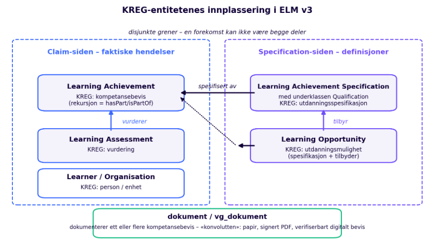

*This page reproduces the pilot's information package «Tilgjengeliggjøring av resultater fra opplæring – Pilot 4» (Making results from education available – Pilot 4, Sikt), the deliverable from work package 1. The package is meant for all parties affected by the digitalisation of diplomas and the transfer of data.*

## The dream journey – how we want it to work

- All diplomas and individual results from education are gathered in an extended National Diploma Database (NVB) – available throughout life.
- Data from the systems of municipalities and county authorities is delivered to the extended NVB, so that all results can be shared in the Diploma Portal (Vitnemålsportalen) and kept securely.
- Digital results are legally equivalent to paper documentation.
- Public agencies and private businesses can retrieve education results easily – with a legal basis or the citizen's consent.

## Background: why make results available?

- Today there is no coherent national overview of results from the whole course of education.
- Diplomas from upper secondary education are in the National Diploma Database (NVB), but individual results are not.
- Data in NVB is not valid in digital form.
- Citizens should have control over their own data and be able to share it themselves.
- Diplomas and individual results are partly scattered across individual schools and institutions.
- Employers, higher education and public agencies spend a long time collecting and verifying documentation.
- National registers and a common data infrastructure are a prerequisite for coherent digital services.

## About pilot 4

Pilot 4 was carried out May–August 2026 as part of the SAMT-BU project (Digdir, Novari, Sikt, Udir, municipalities, counties, KS). The pilot delivered:

- [information model and architecture](../arkitektur-og-informasjonsmodell/)
- [a legal overview of new needs](../juridiske-behov/)
- [a survey of system vendors](../systemleverandorer/)
- an information presentation (this page)

## What is to be shared – and from where?

### Results from education – what are we talking about?

- Diplomas and valid individual results from primary and lower secondary school, upper secondary education, tertiary vocational colleges and higher education.
- In time: certificates of competence, certifications, course certificates, assessments of prior learning and micro-credentials.
- Results must be structured according to a common information model to be shared across systems and levels of government.

### Extended NVB – a national collection point for results

- Further development of the National Diploma Database (NVB), which today is limited to diplomas from upper secondary education.
- The extended register includes results from the whole course of education – primary and lower secondary school, upper secondary education, tertiary vocational education and higher education.
- Also decisions on recognition of foreign education.
- Each citizen has all their competence documented in one place – available in the Diploma Portal.

### Digitalisation of diplomas and individual results

- Savings when paper diplomas are no longer printed. In higher education, 85 % of diplomas are now digital only.
- School administration systems are the source: diplomas and results must be produced in a machine-readable, structured form.
- Data is transferred directly from the systems to the Competence Register without manual handling.
- The Diploma Portal is being developed further to support all types of results and new international standards.

### The Diploma Portal and the European digital wallet

- The Diploma Portal lets citizens view, manage and share their documentation of competence digitally.
- Digital diplomas must have legal status as proof of completed education – on a par with the paper original.
- Legal validity is a prerequisite in the EU Digital Identity Wallet (EUDI).
- The EUDI wallet makes it possible to use documentation of education across EU/EEA countries.
- Requirement for vendors: diplomas from school administration systems must support digital signing and legal evidential value.
- Sikt is adapting the Diploma Portal to ELM (European Learning Model) and the requirements of the Single Digital Gateway.

## Data flow

### From municipal system to national service

- Municipalities and county authorities are primary sources – results and diplomas are produced in school administration systems.
- Data is transferred via standardised APIs to the extended NVB. Sikt manages the register.
- The register makes data available to the Diploma Portal, Samordna opptak (the Norwegian Universities and Colleges Admission Service), Lånekassen (the State Educational Loan Fund), employers and others.
- Citizens control who gets access to their data – data is shared with a legal basis or consent.
- Architecture and information model for this data flow are a key product of pilot 4.
- Later, Sikt will develop the API for the extended NVB further.

### Architecture and information model

- The pilot recommends that results from upper secondary education are delivered through direct integration with the Competence Register (KREG).
- Validation and submission are separated into two distinct concepts: KREG shall receive 100 % of the documentation – including what does not validate – with an explicit quality state, while the validation service is offered as a separate component.
- Today's file submission to NVB, with the position-based «soltegn» format, is phased out.
- [The report](../arkitektur-og-informasjonsmodell/) contains:
  - today's NVB import process with twelve identified risk factors
  - a recommended architecture and information model oriented towards European Learning Model v3
  - needs for primary and lower secondary school
  - an assessment against Digdir's architecture principles
  - a recommendation for the way forward to start implementation with Novari

### KREG and its placement in ELM v3

### Recommended architecture

### Three critical prerequisites for implementation

1. Funding and prioritisation at Novari and the county authorities (SAMT-BU funds possibly available until 2028?).
2. KREG must be made ready to receive data (Sikt's estimate: about one year).
3. Legal clarifications: legal basis for data from primary and lower secondary school, equal status for digital and paper diplomas.

## Privacy and legal clarifications

- New legal bases are needed to gather all diplomas and results, and for these to be an authoritative source, in:
  - opplæringslova (the Education Act)
  - fagskoleloven (the Tertiary Vocational Education Act)
  - universitets- og høyskoleloven (the Universities and University Colleges Act)
- To make digital results legally equivalent to paper, amendments to opplæringsforskrifta (the regulations to the Education Act) are needed.
- Alternatively, a new education regulation could be based on the relevant acts, so that there is only one place to make changes in the future.
- Data is shared only with a legal basis or the citizen's explicit consent.

### Legal basis – overview per level of education

Overview of current legal bases and those that are missing to establish a register of diplomas and results from education. See also [Legal needs](../juridiske-behov/).

| Level of education | Legal basis for storing results | The register as authoritative source of results | Legal basis for display in the Diploma Portal | Digital results are authoritative as evidence |
|---|---|---|---|---|
| Primary and lower secondary school | Needs legal basis | Needs legal basis | Needs legal basis | Opplæringsforskrifta § 9-45 |
| Upper secondary education | Opplæringslova § 25-2 | Needs legal basis | Opplæringslova § 25-2 | Opplæringsforskrifta § 9-54 |
| Tertiary vocational colleges | Fagskoleloven § 41 | Needs legal basis | Fagskoleloven § 41 | |
| Universities and university colleges | Needs legal basis | Needs legal basis | UH-loven § 15-1 | |

## Benefits and expectations

### Pupils and students

- All results and diplomas gathered digitally in one place in the Diploma Portal.
- Easier to apply for a study place, grants and jobs.
- Data can be retrieved automatically by those with a legal basis, for example Lånekassen and Samordna opptak.
- No manual collection and submission of documentation.
- Can share certificates of competence digitally with employers and authorities.
- Can get diplomas into the EU digital wallet when it is introduced in Norway.

### Schools

- No more manual routines for issuing, sending and copying paper diplomas and transcripts.
- Easier to produce diplomas.
- Estimated benefit: NOK 11 million per year (just over 12,400 working hours).
- Better data quality across systems and levels of government.

### Business

- Simple and reliable digital verification of candidates' education.
- Faster and more efficient recruitment processes.
- Access to structured data on competence in the labour market.
- For example digital HSE cards with up-to-date course and certification information (construction).

## Vendors of school administration systems

The overview is reproduced on the page [System vendors](../systemleverandorer/).

### Requirements and expectations for school administration systems

- The systems are the primary source of results and diplomas – data quality and completeness are essential.
- Issuers of diplomas can annul diplomas.
- Machine-readable export of diplomas and individual results in a standard format.
- Integration with the extended NVB via defined APIs – specifications are drawn up in pilot 4.
- Sikt will work closely with the vendors on the information model, standards and technical integration.

## The way forward – pilot 4 and collaboration

- Pilot 4 ran May–August 2026: information model, architecture, legal survey and overview of system vendors.
- Municipalities, counties and vendors are key partners – we need insight into what data exists and how it is structured.
- No technical implementation in this pilot – that comes in the next phase.
- Legal clarifications are under way in parallel – legislative amendments will determine when this goes into production.
- Contact Sikt (kontakt@sikt.no) to contribute to the survey work and make sure you are involved from the start.
