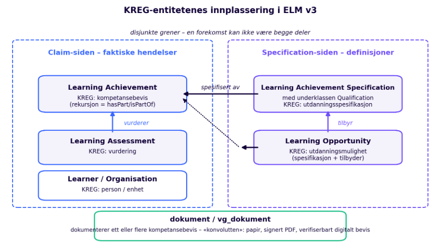
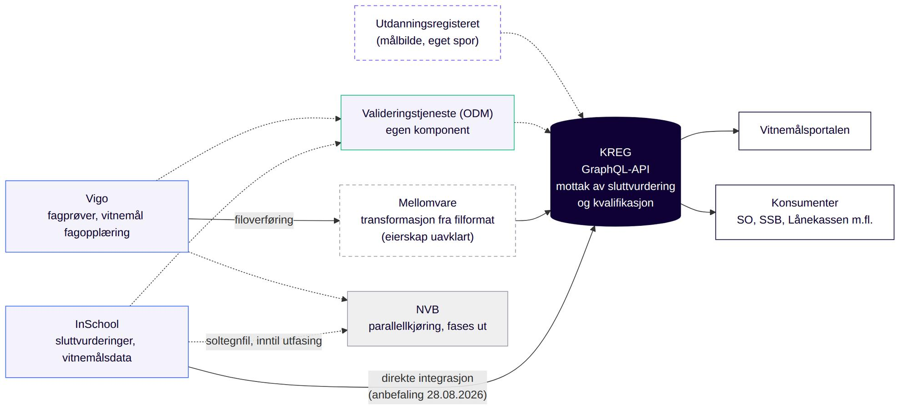

*Siden gjengir pilotens informasjonspakke «Tilgjengeliggjøring av resultater fra opplæring – Pilot 4» (Sikt), leveranse fra arbeidspakke 1. Pakken skal brukes overfor alle aktører som berøres av digitalisering av vitnemål og overføring av data.*

## Drømmereisen – slik ønsker vi at det skal fungere

- Alle vitnemål og enkeltresultater fra opplæring er samlet i utvidet Nasjonal vitnemålsdatabase (NVB) – tilgjengelig gjennom hele livsløpet.
- Data fra kommuners og fylkeskommuners systemer leveres til utvidet NVB, slik at alle resultater kan deles i Vitnemålsportalen og ivaretas på en sikker måte.
- Digitale resultater er juridisk likestilt med papirdokumentasjon.
- Offentlige etater og private virksomheter kan hente utdanningsresultater enkelt – med hjemmel eller samtykke fra innbyggeren.

## Bakgrunn: hvorfor tilgjengeliggjøre resultater?

- I dag finnes ingen sammenhengende nasjonal oversikt over resultater fra hele utdanningsløpet.
- Vitnemål fra videregående opplæring er i Nasjonal vitnemålsdatabase (NVB), men ikke enkeltresultater.
- Data i NVB er ikke gyldige i digital form.
- Innbyggeren bør ha kontroll på egne data og kunne dele dem selv.
- Vitnemål og enkeltresultater er dels spredt hos den enkelte skole og institusjon.
- Arbeidsliv, høyere utdanning og offentlige etater bruker lang tid på å innhente og verifisere dokumentasjon.
- Nasjonale registre og felles datainfrastruktur er forutsetningen for sammenhengende digitale tjenester.

## Om pilot 4

Pilot 4 ble gjennomført mai–august 2026 som en del av SAMT-BU-prosjektet (Digdir, Novari, Sikt, Udir, kommuner, fylker, KS). Piloten leverte:

- [informasjonsmodell og arkitektur](../arkitektur-og-informasjonsmodell/)
- [juridisk oversikt over nye behov](../juridiske-behov/)
- [kartlegging av systemleverandører](../systemleverandorer/)
- informasjonspresentasjon (denne siden)

## Hva skal deles – og fra hvor?

### Resultater fra opplæring – hva snakker vi om?

- Vitnemål og gyldige enkeltresultater fra grunnskole, videregående opplæring, fagskoler og høyere utdanning.
- På sikt: kompetanseattester, sertifiseringer, kursbevis, realkompetansevurderinger og mikrokvalifikasjoner.
- Resultater må struktureres etter en felles informasjonsmodell for å kunne deles på tvers av systemer og forvaltningsnivåer.

### Utvidet NVB – nasjonal samleplass for resultater

- Videreutvikling av Nasjonal vitnemålsdatabase (NVB), som i dag er begrenset til vitnemål fra videregående.
- Det utvidede registeret inkluderer resultater fra hele opplæringsløpet – grunnskole, videregående opplæring, fagskole og høyere utdanning.
- Også vedtak om godkjenning av utenlandsk utdanning.
- Den enkelte innbygger får all kompetanse dokumentert ett sted – tilgjengelig i Vitnemålsportalen.

### Digitalisering av vitnemål og enkeltresultater

- Innsparing når en slutter å skrive ut papirvitnemål. I universitets- og høyskolesektoren er nå 85 % av vitnemålene kun digitale.
- Skoleadministrative systemer er kilden: vitnemål og resultater må produseres maskinlesbart og strukturert.
- Data overføres direkte fra systemene til Kompetanseregisteret uten manuell behandling.
- Vitnemålsportalen videreutvikles for å støtte alle typer resultater og nye internasjonale standarder.

### Vitnemålsportalen og den europeiske digitale lommeboken

- Vitnemålsportalen lar innbyggeren se, administrere og dele sin kompetansedokumentasjon digitalt.
- Digitale vitnemål må ha juridisk status som bevis på gjennomført utdanning – på linje med papiroriginal.
- Juridisk gyldighet er en forutsetning i EUs digitale lommebok (EU Digital Identity Wallet, EUDI).
- EUDI-lommeboken gjør det mulig å bruke utdanningsdokumentasjon på tvers av EU/EØS-land.
- Krav til leverandørene: vitnemål fra skoleadministrative systemer må støtte digital signering og juridisk bevisverdi.
- Sikt tilpasser Vitnemålsportalen til ELM (European Learning Model) og krav om Single Digital Gateway.

## Dataflyt

### Fra kommunalt system til nasjonal tjeneste

- Kommuner og fylkeskommuner er primærkilder – resultater og vitnemål produseres i skoleadministrative systemer.
- Data overføres via standardiserte API-er til utvidet NVB. Sikt forvalter registeret.
- Registeret tilgjengeliggjør data videre til Vitnemålsportalen, Samordna opptak, Lånekassen, arbeidsgivere med flere.
- Innbyggeren kontrollerer hvem som får tilgang til egne data – datadeling skjer med hjemmel eller samtykke.
- Arkitektur og informasjonsmodell for denne dataflyten er et sentralt produkt i pilot 4.
- Senere vil Sikt videreutvikle API-et til utvidet NVB.

### Arkitektur og informasjonsmodell

- Piloten anbefaler at resultater fra videregående opplæring leveres gjennom direkte integrasjon mot Kompetanseregisteret (KREG).
- Validering og innsending skilles som to separate konsepter: KREG skal ta imot 100 % av dokumentasjonen – også den som ikke validerer – med eksplisitt kvalitetstilstand, mens valideringstjenesten tilbys som egen komponent.
- Dagens filinnsending til NVB, med det posisjonsbaserte soltegnformatet, fases ut.
- [Rapporten](../arkitektur-og-informasjonsmodell/) inneholder:
  - dagens NVB-importprosess med tolv identifiserte risikomomenter
  - en anbefalt arkitektur og informasjonsmodell orientert mot European Learning Model v3
  - behov for grunnskolen
  - en vurdering mot Digdirs arkitekturprinsipper
  - en anbefaling med veien videre for å starte realiseringen med Novari

### KREG og innplassering i ELM v3

### Anbefalt arkitektur

### Tre kritiske forutsetninger for realisering

1. Finansiering og prioritering hos Novari og fylkeskommunene (SAMT-BU-midler mulig fram til 2028?).
2. KREG må klargjøres for mottak (Sikts vurdering: ca. ett år).
3. Juridiske avklaringer: hjemmel for grunnskoledata, likestilling av digitale vitnemål og papirvitnemål.

## Personvern og juridiske avklaringer

- Det er behov for nye hjemler for å kunne samle alle vitnemål og resultater, og for at disse er autoritativ kilde, i:
  - opplæringslova
  - fagskoleloven
  - universitets- og høyskoleloven
- For å gjøre digitale resultater juridisk likeverdige med papir trengs det endringer i opplæringsforskrifta.
- Alternativt kan en ny utdanningsforskrift hjemles i de aktuelle lovene, slik at det bare er ett sted å gjøre endringer i framtiden.
- Datadeling skjer bare med hjemmel eller eksplisitt samtykke fra innbyggeren.

### Hjemmelsgrunnlag – oversikt per utdanningsnivå

Oversikt over dagens hjemler og hvilke som mangler for å få et register over vitnemål og resultater fra utdanning. Se også [Juridiske behov](../juridiske-behov/).

| Utdanningsnivå | Hjemmel for lagring av resultater | Registeret som autoritativ kilde for resultater | Hjemmel for framvisning i Vitnemålsportalen | Digitale resultater er autoritative som bevis |
|---|---|---|---|---|
| Grunnskole | Trenger hjemmel | Trenger hjemmel | Trenger hjemmel | Opplæringsforskrifta § 9-45 |
| Videregående opplæring | Opplæringslova § 25-2 | Trenger hjemmel | Opplæringslova § 25-2 | Opplæringsforskrifta § 9-54 |
| Fagskoler | Fagskoleloven § 41 | Trenger hjemmel | Fagskoleloven § 41 | |
| Universiteter og høyskoler | Trenger hjemmel | Trenger hjemmel | UH-loven § 15-1 | |

## Gevinster og forventninger

### Elever og studenter

- Alle resultater og vitnemål samlet digitalt på ett sted i Vitnemålsportalen.
- Enklere å søke studieplass, stipend og jobb.
- Data kan hentes automatisk av dem som har hjemmel, for eksempel Lånekassen og Samordna opptak.
- Ingen manuell innsamling og innsending av dokumentasjon.
- Kan dele kompetansebevis digitalt med arbeidsgivere og myndigheter.
- Kan få vitnemål inn i EUs digitale lommebok når den innføres i Norge.

### Skoler

- Slipper manuelle rutiner for utstedelse, utsending og kopier av papirbaserte vitnemål og karakterutskrifter.
- Enklere å lage vitnemål.
- Estimert gevinst: 11 millioner kroner per år (i overkant av 12 400 arbeidstimer).
- Bedre datakvalitet på tvers av systemer og forvaltningsnivåer.

### Næringsliv

- Enkel og pålitelig digital verifisering av kandidaters utdanning.
- Raskere og mer effektive rekrutteringsprosesser.
- Tilgang til strukturerte data om kompetanse i arbeidsmarkedet.
- For eksempel digitale HMS-kort med oppdatert kurs- og sertifiseringsinformasjon (bygg).

## Leverandører av skoleadministrative systemer

Oversikten er gjengitt på siden [Systemleverandører](../systemleverandorer/).

### Krav og forventninger til skoleadministrative systemer

- Systemene er primærkilden for resultater og vitnemål – datakvalitet og fullstendighet er avgjørende.
- Utstedere av vitnemål kan annullere vitnemål.
- Maskinlesbar eksport av vitnemål og enkeltresultater i standardformat.
- Integrasjon mot utvidet NVB via definerte API-er – spesifikasjoner utarbeides i pilot 4.
- Sikt vil samarbeide tett med leverandørene om informasjonsmodell, standarder og teknisk integrasjon.

## Veien videre – pilot 4 og samarbeid

- Pilot 4 pågikk mai–august 2026: informasjonsmodell, arkitektur, juridisk kartlegging og systemleverandøroversikt.
- Kommuner, fylker og leverandører er nøkkelpartnere – vi trenger innsikt i hvilke data som finnes og hvordan de er strukturert.
- Ingen teknisk implementering i denne piloten – det kommer i neste fase.
- Juridiske avklaringer pågår parallelt – lovendringer vil avgjøre når dette er i produksjon.
- Ta kontakt med Sikt (kontakt@sikt.no) for å bidra i kartleggingsarbeidet og sikre at dere er med fra start.
