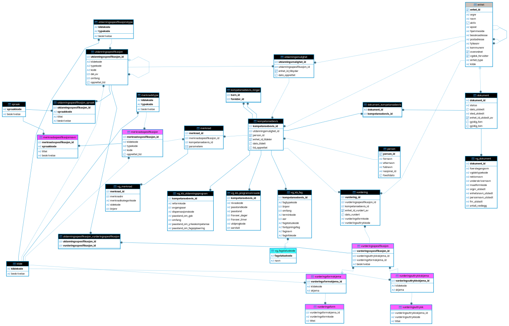
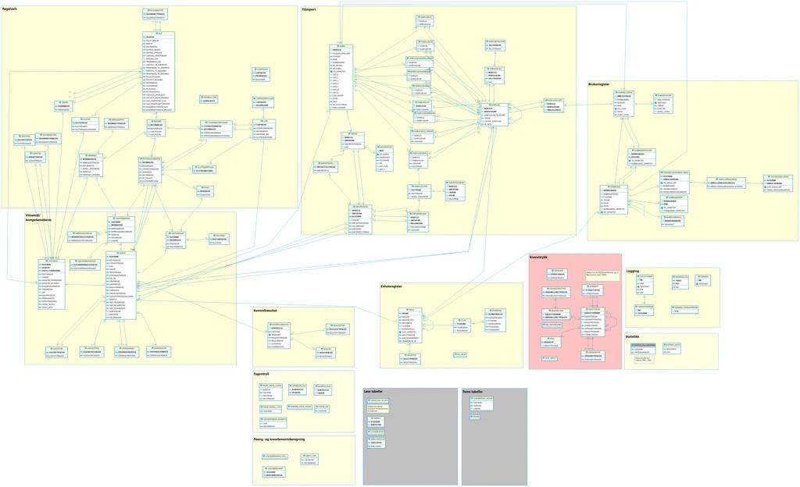

*This page reproduces the pilot's report «Arkitektur og informasjonsmodell – SAMT-BU Pilot 4. Dataflyt av resultater fra videregående opplæring til KREG» (Architecture and information model – SAMT-BU Pilot 4. Data flow of results from upper secondary education to KREG), 30 August 2026 (deliverable from work package 2).*

The report is the pilot's deliverable for work package 2, dated 30 August 2026. It was produced through the series of working meetings on architecture (working meetings 1–8, 22 May – 28 August 2026).

## About the architecture and information model

### Summary

The pilot recommends that results from upper secondary education be delivered through direct integration with the competence register Kompetanseregisteret (KREG), not via FINT (decision of the collaboration group on 28 August 2026; the formal decision rests with the system owners). Validation and submission are separated into two distinct concepts: KREG is to receive 100 % of the documentation – including documentation that does not validate – with an explicit quality state, while the validation service is offered as a separate component. Today's file submission to NVB, with its position-based «soltegn» format (fields separated by the ¤ character), is to be phased out entirely.

The report documents today's NVB import process with twelve identified risk factors ([Risk factors in today's process](#risk-factors-in-todays-process)), a recommended architecture and information model oriented towards European Learning Model v3 ([Architecture sketches for the pilot](#architecture-sketches-for-the-pilot) and [Semantic architecture](#semantic-architecture)), identified needs for primary and lower secondary school ([Primary and lower secondary school](#primary-and-lower-secondary-school-grunnskole)), an assessment against Digdir's architecture principles ([Assessment against Digdir's overarching architecture principles](#assessment-against-digdirs-overarching-architecture-principles)) and a recommendation with the way forward for starting the implementation with Novari ([Conclusion and the way forward](#conclusion-and-the-way-forward)). The three most important prerequisites for implementation are funding and prioritisation at Novari and the county authorities (SAMT-BU funds could potentially be used into 2028), that KREG is made ready to receive data (Sikt's estimate: a one-year horizon), and legal clarifications – a legal basis for primary school data, a basis for processing results that are not passed, and legal equivalence between digital diplomas and paper diplomas.

### Introduction

This document is the pilot's deliverable for work package 2: architecture and information model as the basis for the data flow of diplomas (vitnemål) and results from upper secondary education into the competence register Kompetanseregisteret (KREG). The name of the register has not yet been decided, and in this document we refer to it as KREG.

The report was produced through the series of working meetings on architecture (working meetings 1–8, 22 May – 28 August 2026) [12] and constitutes the pilot's milestone «architecture and information model completed» [13]. The work is anchored in the SAMT-BU case «Making results from education available» [13], with the concrete user situations of changing schools, admission, further follow-up of young people, and adults' need for documentation as the backdrop. The pilot delivers preparatory work, not technical products [13]; the architecture is implemented after the pilot period, as [The way forward after 1 September](#the-way-forward-after-1-september) describes.

The report documents today's process for NVB import and its risk factors ([Today's process for NVB import](#todays-process-for-nvb-import)), the target picture the work is aiming for ([Target picture](#target-picture)), the assessment of the architecture alternatives with the collaboration group's recommendation of direct integration with KREG ([What are we to solve in SAMT-BU?](#what-are-we-to-solve-in-samt-bu), [Architecture sketches for the pilot](#architecture-sketches-for-the-pilot) and [Technical target architecture](#technical-target-architecture)), identified needs for primary and lower secondary school ([Primary and lower secondary school](#primary-and-lower-secondary-school-grunnskole)), the semantic architecture with the transition from NVB's model to an ELM-oriented model ([Semantic architecture](#semantic-architecture)), a concept catalogue ([Concept catalogue](#concept-catalogue)) and a conclusion with the way forward ([Conclusion and the way forward](#conclusion-and-the-way-forward)).

The architecture choices have been assessed against the Norwegian Digitalisation Agency's (Digdir) overarching architecture principles for digitalisation of the public sector [1] and the Framework for Digital Interoperability (Rammeverk for digital samhandling) [4]; the assessment is collected in [Assessment against Digdir's overarching architecture principles](#assessment-against-digdirs-overarching-architecture-principles), and the principles are also referred to where they justify specific choices.

### Scope

The pilot covers upper secondary education first. The following has deliberately been kept outside the pilot:

**Primary and lower secondary school (grunnskole):** Part of SAMT-BU as a whole, but not included in the pilot. Identified needs, responsibilities and the prerequisites for a primary school track are collected under [Primary and lower secondary school](#primary-and-lower-secondary-school-grunnskole), so that they can be taken further even though they are not solved in the pilot [12: working meeting 8].

**Modernisation of VIGO:** Unplanned and not ready for the pilot. The architecture treats today's file transfer as an option, and the modernisation is included in the target picture. If SAMT-BU funds are made available, a limited modernisation of the export stage in VIGO may nevertheless be considered – this requires a separate prioritisation decision by Novari and the county authorities.

**Utdanningsregisteret (the education register):** Still onboarding tertiary vocational education (fagskole) and higher education. Not ready to take in upper secondary education. Included in the target picture, not in the pilot; its role and the separate track are described in [Technical target architecture](#technical-target-architecture).

**Legal validity of digital diplomas:** A separate workstream, belonging to work package 3 (legal needs).

**Module-structured education for adults (MVOV):** Delivered today on paper/unvalidated, in high volumes. The principle that the final assessment is the unit (see [Premises for the pilot](#premises-for-the-pilot)) also applies to MVOV, but the flow itself is not solved in the pilot.

Sikt has replaced the validation engine «kontroll.exe» with a new validation engine based on IBM Operational Decision Manager (ODM). Common machine-readable validation rules based on, or as input to, ODM are not part of the pilot, but are documented as a recommendation in [Technical target architecture](#technical-target-architecture).

### Premises for the pilot

The following is taken as given for the architecture work and is not treated as open questions going forward:

1. **The final assessment (sluttvurdering) in each subject is the atomic unit that is to go into KREG.** Final assessment comprises the overall achievement grade (standpunktkarakter), the examination grade (eksamenskarakter) and the grade for the trade, journeyman's and competence examination (fag-, svenne- og kompetanseprøve), cf. the regulations to the Education Act (forskrift til opplæringslova); grades that are not passed are also final assessments. In KREG each grade is one instance of assessment (vurdering).
2. **A certificate of competence (kompetansebevis) is a composition of final assessments.** A diploma (vitnemål) is a composition of final assessments that represents a completed education, which for example qualifies for general university admissions certification (GSK). Clarification from working meeting 6: according to the guidelines for completing diplomas (føringsskrivet) [10], a certificate of competence from upper secondary education may also contain half-year assessments with grades, and achieved competence aims may be documented in an attachment. The premise therefore applies to what is to go into KREG in the pilot, not to everything that may appear on an issued certificate of competence [12: working meeting 6].
3. **Final assessments are submitted to KREG continuously.** The working hypothesis from working meeting 4 was that only passed final assessments should go in; working meeting 8 clarified the scope: the pilot's goal is the technical transfer of the documentation regardless of whether it has been validated or checked manually – the goal is to get 100 % of the documentation in, including final assessments and certificates of competence for pupils who have not completed or passed [12: working meetings 4 and 8].
4. **Module codes are not to go into KREG – only final assessments.** Module codes may appear on certificates of competence that are issued, but not on diplomas, cf. Udir's guidelines [10][12: working meeting 8].
5. **Learning outcomes and achieved competence aims are not to be part of the pilot itself.** They may be included as an unresolved part of the target picture [12: working meetings 6 and 8].

The minutes of the series of working meetings on architecture, which the report builds on, are under [Meetings](../../moter/).

## Today's process for NVB import

To understand what the new architecture changes, today's process must be described. This chapter documents how results from upper secondary education currently enter the National Diploma Database (Nasjonal vitnemålsdatabase, NVB), and which risk factors lie in this process. The description builds on the format specification for the NVB control engine [5], the reviews in the series of working meetings [12] and NVB's own documentation [6].

### Actors and data flow

NVB is managed by Sikt and is today the source of truth for diplomas (vitnemål) and certificates of competence (kompetansebevis) from upper secondary education, used primarily by Samordna opptak (the Norwegian Universities and Colleges Admission Service) for admission to higher education [6].

The data flow into NVB is as follows (figure 1):

1. **The school registers final assessments in the school administration system.** For public upper secondary schools this is InSchool; private schools use, among others, iSkole and IST Everyday [17]. The teacher sets the overall achievement grade, and examination grades are added after marking.
2. **The school administration system generates diploma and certificate of competence data** as a character-separated text file («soltegnfil», see [The file format – the «soltegn» files](#the-file-format--the-soltegn-files)) according to the NVB specification [5].
3. **Vocational training (fagopplæringen) goes via VIGO.** Trade examinations are registered in VIGO, which produces the final diploma for apprentices and candidates in vocational training. VIGO exports a file in .nvb format which is later loaded into NVB again [12: working meetings 3 and 7].
4. **The file is validated before submission** (see [Validation and control today](#validation-and-control-today) on how validation is done today).
5. **NVB accepts documents that validate without errors.** Documents with error messages are rejected and returned for correction [5]. NVB does not accept diplomas that do not validate [12: working meeting 8].
6. **The school owner issues and signs the diploma on paper.** There is currently no digital signing of diplomas – the diploma is printed and signed by the head teacher, in addition to the data being submitted and validated [12: working meeting 8].

Primary and lower secondary school is not part of this flow. Primary school diplomas are stored as PDF in the pupil's file in the municipality's case management and archive system, and there is currently no way of extracting the data [12: working meetings 4 and 6]. See [Primary and lower secondary school](#primary-and-lower-secondary-school-grunnskole).

*Figure 1: Today's data flow into the National Diploma Database.*

### The file format – the «soltegn» files

The exchange format is a line-based text file in which the fields are separated by the «soltegn» character (¤, the currency sign), and in which the row type is determined by a type letter at the start of the line [5]:

| Row type | Content | Counterpart in NVB's data model |
|---|---|---|
| ¤A | Start line per file section: organisation number, school number (VIGO), counters | Filimport (file import) |
| ¤S | School information (optional): name, address, contact person | Enhetsregister (entity register) |
| ¤V | Document header for diploma or certificate of competence: document identifier, document type (VGDOKTYPEKODE: VM = vitnemål/diploma, KB = kompetansebevis/certificate of competence), national identity number, name as free text, year of completion, reform (KL/R94) | VGDOK |
| ¤P | One line per programme area (normally three for a diploma): programme area code, level code (VG1–VG3), assertion code (Bestått / Fullført / Fullført og bestått – passed / completed / completed and passed) | VGDOKPROMR |
| ¤F | One line per subject: subject code (Grep), subject type (FF/FP/VP), overall achievement and examination grade, scope, examination term, subject remark | VGDOKFAG |
| ¤M | Remarks on the document or individual subjects, with VMM remark codes from Grep | VGDOKMERKNAD |
| ¤D | Cancellation of a previously issued document, with reason code | – |

The format is position-based: the meaning of a field is determined by its column position in the line, not by field names. In practice the file is four different row schemas multiplexed into one stream, where a shared key (the diploma number) links the subject and remark lines to the document header. The document type is controlled by a code value (VGDOKTYPEKODE) set by the vendor – diplomas and certificates of competence are rows in the same table, distinguished only by the code value. This choice of representation is the core of the semantic shift to KREG, see [Semantic architecture](#semantic-architecture).

Sikt wants to phase out the «soltegn» files as a format and to remove file submission to NVB entirely; how the phase-out is to take place is described in [Technical target architecture](#technical-target-architecture) (coexistence and phase-out). Digdir's architecture principle 4, recommendation 4.5, warns precisely against locking data into systems with their own formats [2].

### Validation and control today

Validation checks that the combination of subjects in a document meets the requirements for a diploma, including the requirements for general university admissions certification (GSK), against code lists from Grep, Udir's guidelines for completing diplomas (føringsskrivet) and the circular on the distribution of subjects and teaching hours [5][10]. The check is also used along the way: from the autumn of the final school year it is run to check that the diploma will validate, which is important for giving pupils confidence that they will get their diploma in the end [12: working meeting 6].

Historically this was done with kontroll.exe, a binary command-line application distributed per operating system, run locally or against a central server at Samordna opptak [5]. Kontroll.exe has now been discontinued and replaced by Sikt's validation service based on IBM ODM. In InSchool, validation is built into the diploma generation itself (subjects against diploma number) and is used for all diplomas; in VIGO the control engine is used only for the trade examinations when a diploma is ready. The requirements for final assessment and documentation follow from the regulations to the Education Act (forskrift til opplæringslova); Udir manages the guidelines that operationalise how diplomas and certificates of competence are completed (a draft regulation on completing them, føringsforskrift, is under consideration in the Ministry of Education and Research), and the school owner is responsible for issuing them. The expertise on the checks nevertheless sits implicitly with Sikt today, through the ODM implementation [12: working meeting 8].

### Risk factors in today's process

The review in the series of working meetings has identified the following risk factors in today's NVB import. They form a substantial part of the justification for the new architecture.

**R1 – Lock-in to a proprietary format.** The position-based ¤ format without field names is fragile, requires specialist expertise at each vendor, and locks data into a system-specific format, contrary to Digdir's recommendation 4.5 [2][5].

**R2 – The register is incomplete.** NVB only accepts documentation that validates. Documentation that does not validate – including from module-structured education for adults, which amounts to hundreds to several thousand certificates a year – exists only on paper or as unvalidated documents outside the register [12: working meeting 4]. Pupils who do not complete do not get their results in either.

**R3 – Manual errors in the files.** When schools send files, grades may be missing or subject remarks may be entered incorrectly. The current format also allows only one subject remark per subject [12: working meeting 3].

**R4 – Batch delay in a time-critical chain.** There is very little time between the marking deadline (around 19 June) and the admission run at the beginning of July. File-based transfer means that in practice the results cannot be retrieved from the register during this period, resulting in manual follow-up work [12: working meeting 3]. Note that KREG will not be able to serve the admission chain in the near future either – today's direct flow to admission continues; the risk applies to all other consumers of the results.

**R5 – Round trip in the vocational training flow.** Each transformation step in the round trip VIGO → .nvb file → NVB (cf. [Actors and data flow](#actors-and-data-flow)) is a source of errors, and the flow has not been fully mapped [12: working meeting 7].

**R6 – Regulatory expertise and management are unevenly distributed.** The owner of the regulations (Udir) and those who understand and maintain the implemented validation rules (Sikt) are not the same party (cf. [Validation and control today](#validation-and-control-today)), and the validation service does not necessarily pick up all changes to the rules [12: working meeting 8].

**R7 – Structured primary school results are not preserved.** Structured results exist only temporarily in the school system and are lost as structure when the diploma is archived as PDF; there is no national access, and reuse requires manual deliveries from each municipality [12: working meetings 2 and 4].

**R8 – Weak semantics for person and content.** Personal names are entered as free text in the document header, and the meaning of fields is determined by position. The format gives no structural guarantee that the content is interpreted the same way by sender and recipient [5][15].

**R9 – Vendor and technology lock-in in the control step.** Kontroll.exe was a closed binary; the transition to ODM has reduced, but not removed, the lock-in. Digdir's recommendation 5.6 points to avoiding dependence on individual vendors [3]. See the recommendation on machine-readable validation rules in [Technical target architecture](#technical-target-architecture).

**R10 – Paper is the only legally valid form.** The school owner's signature on paper is what makes the diploma valid. Digital results do not have equal legal standing, and this limits the value of the register as a source. Followed up in work package 3 [12: working meeting 8][13].

**R11 – Data disappears when organisations cease to exist.** For private tertiary vocational schools (fagskoler), documentation currently disappears when the school goes bankrupt. This illustrates the risk of decentralised storage of documentation in general, and is part of the justification for a central register throughout the whole life course. Private tertiary vocational schools are outside Novari's responsibility; follow-up of these must be placed with Sikt or another party [12: working meeting 8].

**R12 – Changes and cancellations are poorly supported.** Overall achievement and examination grades are individual administrative decisions with a right of appeal; if an appeal is upheld, the grade is changed and a new document is issued. Today this is handled through cancellation lines (¤D) and a new submission. The life cycle changed final assessment → cancelled/replaced document must be handled explicitly in the KREG model; this is listed as an unresolved point in the mapping in [Mapping NVB → KREG](#mapping-nvb--kreg).

## Target picture

All diplomas and individual results from primary and secondary education are collected in KREG, which is available throughout the citizen's whole life course.

Data from the systems of municipalities and county authorities is delivered to KREG, so that all results can be shared and safeguarded securely.

School systems can themselves validate diplomas and final assessments along the way during the pupil's education.

When schools and county authorities issue diplomas and certificates of competence from upper secondary education, the certificates of competence in KREG are linked to a higher-level certificate of competence that documents the link. The composition is carried out in the school system by the schools, with the school owner as issuer responsible for the signature [12: working meetings 6 and 8].

Digital results have equal legal standing with paper documentation.

Public agencies and private organisations can retrieve education results easily – with a legal basis or the citizen's consent.

Citizens have all their results and diplomas from education collected in one place, from which they can be shared through Vitnemålsportalen (the Norwegian Diploma Registry).

Citizens in Norway are able to use their education across borders through EMREX, the EU Digital Identity Wallet and the Once-Only Technical System.

Utdanningsregisteret (the education register) is part of the target picture as the master data register for education offerings, and in the target picture it is to receive data about upper secondary education from Grep, InSchool and VIGO [12: working meeting 8].

Migration of historical documentation from municipal archives is not part of the target picture as currently defined.

Datasets, APIs, services, models and concepts that are established are to be registered in the National Data Catalogue (Felles datakatalog) at data.norge.no (see [Concept catalogue](#concept-catalogue)).

### Unresolved part of the target picture

Achieved learning outcomes and competence aims, as well as formative assessment, may be included in certificates of competence from upper secondary education. Today these are attached as appendices.

How the models fit into ELM: the main features are described in [Placement in ELM v3](#placement-in-elm-v3), but full placement – including the choice of application profile and checking the composition relations (hasPart/isPartOf) against the profile's rules – remains [8].

## What are we to solve in SAMT-BU?

The core of the pilot is the flow of one final assessment from source to KREG, illustrated in figure 2:

1. **The final assessment is set in the source system.** The teacher sets the overall achievement grade in InSchool, and examination grades are added after marking; trade and journeyman's examinations are registered in VIGO.
2. **The source system delivers the final assessment to KREG continuously.** InSchool delivers directly via API; VIGO delivers via file transfer, possibly through middleware.
3. **The validation service is used along the way** to check the combination of subjects during the course of education, and for diploma validation when all final assessments are available.
4. **KREG receives the documentation** with an explicit quality state.
5. **The school composes and issues the qualification;** the school system delivers the issuing of the qualification itself, while the final assessments it includes will already be in KREG.
6. **Vitnemålsportalen and the consumers retrieve the results from KREG.**

*Figure 2: The flow of one final assessment from source to KREG. Dotted lines are validation support.*

## Architecture sketches for the pilot

Common to both solutions:

- Validation is done against Sikt's ODM-based validation service, which has already replaced kontroll.exe in today's flow ([Validation and control today](#validation-and-control-today)).
- A flow of the type VIGO/InSchool → FINT → KREG → FINT → VIGO/InSchool may create distance from seamless services and may affect the teacher who sets final assessments in VIGO/InSchool [12: working meeting 7].
- The choice must be assessed against Digdir's architecture framework for seamless services [4]. The decision rests with those responsible for InSchool and VIGO, in line with Digdir's principle 2 on taking architecture decisions at the right level [1].

### Option 1, delivering final assessments via FINT

Key points:

- VIGO and InSchool are rebuilt to send final assessments to FINT continuously.
- FINT will be able to receive data on final assessments continuously. When something has received a final assessment in FINT, it is transferred to KREG [12: working meeting 6].
- This pattern can probably be reused for primary and lower secondary school.

### Option 2, delivering final assessments directly to KREG

Key points:

- InSchool sends final assessments directly to KREG's GraphQL API.
- For VIGO there are two options: build middleware to transform files from VIGO into GraphQL API calls with final assessments, or funds to modernise this part of VIGO so that it delivers directly.
- VIGO delivers final assessments and passed trade examinations all in one.

### Assessment and recommendation

Working meetings 7 and 8 reviewed FINT's information model [7] and assessed the two options. The working meeting's assessment was as follows [12: working meeting 8]:

- The FINT information model is designed for statistics and analysis. As of today the FINT information model cannot express all the concepts needed to transfer long-lived credentials. VIGO and InSchool are the source of the result information.
- VIGO and InSchool currently use services from Sikt to validate diplomas. Responsibility for validating the correctness of the diplomas lies with the schools.
- Data flow through FINT may potentially involve some delays, which may create challenges in some time-critical situations.
- As FINT and the FINT information model are designed today, final assessments could potentially go via FINT, while certificates of competence and diplomas must come from the school administration systems.
- If the FINT information model is to be used as a step in the transfer to KREG, work will probably have to be done to make the concepts in FINT match the concepts in KREG and ELM.

**Decision (working meeting 8, 28 August 2026): The collaboration group recommends that VIGO and InSchool transfer directly to KREG, in the same way as today's transfers to NVB.** The formal decision rests with the system owners – Novari and the county authorities [12: working meeting 7].

Authentication and authorisation in the various steps must be clarified further, cf. Digdir's principle 7 on trust in how tasks are carried out [1]. The starting point from the sketch work is Maskinporten for organisation authentication and Feide where user context is needed, with the national identity number of the user delivering data, for traceability [12: working meeting 1].

![Recommended architecture: InSchool delivers final assessments and diploma data directly to KREG's GraphQL API (recommendation of 28.08.2026); Vigo delivers via file transfer and middleware with unresolved ownership; the validation service (ODM) is a separate component; NVB runs in parallel with «soltegn» files until it is phased out; Utdanningsregisteret is target picture and a separate track; Vitnemålsportalen and consumers such as Samordna opptak, Statistics Norway and Lånekassen retrieve from KREG (figure in Norwegian)](anbefalt-arkitektur-direkte-kreg.jpeg)

*Figure 3: Recommended architecture for the pilot – direct integration with KREG. Dotted elements are unresolved or target picture.*

## Technical target architecture

The architecture for this pilot is one step towards the broader target picture for the integration architecture across school administration system – VIGO – FINT – KREG:

Utdanningsregisteret gets a central role in the target picture, but is not part of what is implemented during the pilot period. Its role should nevertheless be described in the architecture now, so that the recommended architecture does not build itself into a dead end. In the target picture, Utdanningsregisteret is to receive data about upper secondary education from GREP, InSchool and VIGO, and a separate track is established for codes that are created in VIGO and then in InSchool, and which must be consistent with Utdanningsregisteret [12: working meetings 6 and 8]. Sikt and Udir should look more closely at what role the register is to have. In KREG, the entities utdanningsspesifikasjon (education specification) and utdanningsmulighet (education opportunity) are prepared for linking to Utdanningsregisteret (see [Placement in ELM v3](#placement-in-elm-v3) and [Appendix A – Information model, KREG](#appendix-a--information-model-kreg)).

Primary and lower secondary school is eventually to be included in the same model – the prerequisites are described under [Primary and lower secondary school](#primary-and-lower-secondary-school-grunnskole).

**Validation and submission are split into two separate concepts** [12: working meetings 7 and 8]. The validation service is separated out as its own component in the architecture. There one can check whether the combination of subjects is correct during the course of education, and – when all final assessments are in place – validate whether there is a valid diploma. The consequences of the separation:

- KREG must be able to receive documentation that does not validate, as long as this is an accepted state. The school must be able to override the validity, so that the documentation stands as valid with the school's signature even though it does not validate automatically.
- Responsibility for validation in VIGO and InSchool lies with the school, not with Sikt. VIGO and InSchool must offer functionality for the school owner's manual checking of diplomas that are not validated automatically but are nevertheless valid.
- Udir manages the rules for completing diplomas (the guidelines, føringsskrivet [10]); what is missing is a governance model ensuring that the validation rules are kept in step with the regulations – the validation service does not necessarily pick up all changes to the rules.
- The dependence on IBM ODM as rule engine is accepted in the pilot because the implementation already exists and covers about 90 % of the cases.

**Machine-readable validation rules.** Validation in ODM is non-proprietary in how the rules are expressed, and in the target architecture it is desirable that the regulations – Grep, the distribution of subjects and teaching hours, and the guidelines for completing diplomas – can be expressed and checked in a way that can be reused across several systems, for example with SHACL. The need for machine-readable validation that can be used by Sikt, Udir, InSchool and VIGO was proposed as a separate SAMT-BU case [12: working meeting 7]. The expected effort and benefit must be assessed honestly if this is submitted as a need [12: working meeting 8]. A common, system-independent description of the information model for diplomas, which can be used both by subject-matter experts and by validation solutions, will make it easier to implement new rule engines, update validation when rules change and give subject-matter experts insight – today the rule engine is in practice the answer key.

**Replacing existing processes with KREG:** KREG enables new integration patterns that allow us to meet needs in a new way that can save costs in the public sector. There is a need for events in the architecture, so that systems can react to changes continuously [12: working meeting 6].

Ongoing development on KREG concerns tertiary vocational education (fagskole); the basic structure is considered good, and the needs of tertiary vocational education are not expected to impose unfortunate constraints on the APIs for upper secondary education [12: working meeting 8]. Sikt estimates that KREG will be ready to receive data within a one-year horizon, subject to funding and prioritisation.

**API interface:** KREG exposes a GraphQL API. For parties that do not support GraphQL, it may be considered whether Sikt should offer a REST connection [12: working meeting 1]; the final choice of interface will be settled in the API dialogue between Sikt, Novari and the system vendors. KREG also depends on code lists from Grep and on the VIGO code list [12: working meeting 1] – the latter is an ongoing delivery from Novari that must be included in the agreements.

**Coexistence and phase-out NVB → KREG:** During the parallel period, the solution means double delivery for the vendors («soltegn» file to NVB and API delivery to KREG). Duration, phase-out criteria and funding of the parallel operation must be clarified between Sikt, Novari and the system vendors. Phasing out file submission requires that the needs behind today's solution have been mapped by Sikt and Novari, that NVB's consumers – primarily Samordna opptak – have their needs met by KREG, and a clarification of whether historical NVB data is to be migrated to KREG or maintained as a historical register.

![Component sketch of the technical target architecture: the school systems (Visma InSchool, Visma Flyt Skole, IST, Vigilo) deliver final assessments, qualifications, the national identity number of the result owner and the national identity number of the user delivering data (for audit) to the FS GraphQL API, with authentication via Maskinporten, Feide and ID-porten; the front ends Min kompetanse and FS Admin use the same API; Kompetanseregisteret is linked to Utdanningsregisteret, to diploma validation (Grep API and ODM) and to Vitnemålsportalen, which has international integrations with Emrex, the Single Digital Gateway / Once-Only Technical System and the EUDI Wallet (figure in Norwegian)](teknisk-maalarkitektur.png)

*The figure has no number or caption in the report.*

### Assessment against Digdir's overarching architecture principles

The Norwegian Digitalisation Agency's seven overarching architecture principles are mandatory for central government agencies and recommended for the municipal sector [1]. The table summarises how the architecture in this document responds to each principle.

| Principle | How the architecture responds |
|---|---|
| 1. Start from the users' needs | The choice of flow has been assessed on the basis of the consequences for the pupil, the apprentice and the teacher who sets final assessments in InSchool/VIGO – an indirect flow via FINT was rejected partly because it creates distance to the user (see [Assessment and recommendation](#assessment-and-recommendation)). The target picture gives citizens all their documentation collected and shareable throughout their life course, also for groups that currently fall outside the register. |
| 2. Take architecture decisions at the right level | The decision on the integration pattern rests with those responsible for InSchool and VIGO; for primary and lower secondary school, the municipalities as school owners are the decision level; responsibility for the regulations lies with Udir. The collaboration group makes recommendations. |
| 3. Contribute to digitalisation-friendly regulations | The pilot is to deliver a proposal for what needs a legal basis for collecting primary school data, where a statutory basis is currently lacking (see [Primary and lower secondary school](#primary-and-lower-secondary-school-grunnskole)), and points to the need for legal bases for delivery/retrieval that follow the data flow. Legal equivalence of digital diplomas is followed up in work package 3. |
| 4. Share and reuse data | KREG is established as a common register with a defined receiving model, instead of lock-in to «soltegn» files and PDF archives (recommendation 4.5 [2]). Datasets, APIs, models and concepts are registered in the National Data Catalogue. |
| 5. Share and reuse solutions | Phasing out file submission reduces complexity and technical debt (5.9), and the receiving pattern is now being developed first for tertiary vocational education, with the intention of reuse for upper secondary education and eventually primary and lower secondary school [3]. Gap: the dependence on ODM as rule engine remains (5.6, cf. [Technical target architecture](#technical-target-architecture)), and event-driven architecture (5.7) has been identified as a need, not decided. |
| 6. Create digital solutions that support interoperability | The information model is oriented towards ELM v3 and thus European interoperability (EMREX, EU Digital Identity Wallet, Once-Only). FINT is following in the same direction [12: working meeting 7]. Semantic interoperability is treated as a separate architecture area (see [Semantic architecture](#semantic-architecture)), cf. the Framework for Digital Interoperability [4]. |
| 7. Ensure trust in how tasks are carried out | Authentication/authorisation is clarified per step (Maskinporten/Feide), submissions are traced to a user, the school owner's responsibility as issuer and signatory is explicit, and the separation of validation and submission makes the quality state of each document visible instead of keeping deviations outside the register. |

Measured against the four dimensions of the Framework for Digital Interoperability [4], the status is:

- semantic interoperability is covered in [Semantic architecture](#semantic-architecture).
- technical interoperability is covered by the architecture choices in [Architecture sketches for the pilot](#architecture-sketches-for-the-pilot) and [Technical target architecture](#technical-target-architecture).
- legal interoperability has three identified gaps – legal basis for primary school data, legal equivalence of digital diplomas, which must be clarified in work package 3 (AP3).
- organisational interoperability – a governance model for input to KREG from upper secondary education and primary and lower secondary school is lacking.

## Primary and lower secondary school (grunnskole)

Primary and lower secondary school is not part of the pilot's deliverable, but the needs have been mapped through the series of working meetings and are summarised here so that they can be taken further [12: working meeting 8].

**Current situation:** Primary and lower secondary schools use their own school administration systems (Vigilo, Visma Flyt Skole, IST Everyday, iSkole), which support the OneRoster 1.2 Norwegian profile [11][17]. Their diplomas are not part of NVB: they are archived as PDF in the municipality's case management and archive system, while structured data is only transferred to VIGO as CSV files for use in admission to upper secondary education – in other words, the structure is not preserved after archiving [12: working meetings 2, 4 and 6]. Udir has clarified that only the diploma is relevant, not individual subjects; all subjects are counted as year 10 [12: working meeting 3].

**Responsibility and legal basis:** Sikt lacks a statutory basis for collecting primary school data; one of the pilot's deliverables is a proposal for what needs a legal basis [12: working meeting 6]. Any obligation to deliver data would be directed at the municipality as school owner, and system support follows from the municipalities' own orders and funding with the vendors [12: working meetings 2 and 8]. Controller responsibility and data protection consequences will be clarified through the pilot's legal deliverable (work package 3).

**Benefits for the municipalities:** The CSV deliveries to VIGO can be discontinued when the admissions office retrieves data from KREG, structured results are preserved over time, and citizens get access and the ability to share through Vitnemålsportalen.

**Possible direction:** The pilot's integration pattern can probably be reused, with the complete diploma at the end of schooling as the unit of delivery [12: working meeting 6]. A separate track has been proposed in which primary and lower secondary schools deliver directly to KREG and the admissions office retrieves from there [12: working meeting 7]. The recommendation is to take primary and lower secondary school further as a separate track with three prerequisites in sequence: legal basis and legal clarifications, clarification of the division of roles in the admission flow and the funding model, and then reuse of the pilot's pattern and information model.

## Semantic architecture

The transition from NVB to KREG is not just a system migration, but a change in how results from education are represented semantically. NVB's information model is built on specialised, distinct entities for upper secondary education. KREG's model, inspired by the international standard European Learning Model (ELM) v3 [8], uses a single generic and recursive entity, kompetansebevis (certificate of competence), which can represent anything from individual results to complete diplomas and degrees from higher education.

This chapter describes this difference and the consequences it has for the system vendors that currently deliver data to NVB. The work is part of what the Norwegian Digitalisation Agency's Framework for Digital Interoperability (Rammeverk for digital samhandling) defines as semantic interoperability – a shared understanding of the meaning of the data and of the format in which it is exchanged [4].

The description in this chapter is the normative, system-independent information model for results from education, anchored in the regulations and in ELM. KREG's data model (appendix A) and Sikt's validation service are implementations that must conform to it – not the other way round. This responds to the need, pointed out in the round of comments, for the answer key not to be a vendor's rule engine.

### Models

Models used in this report:

| Model | Role | Scope | Reference |
|---|---|---|---|
| NVB | Today's source of truth for results from upper secondary education | Specialised for upper secondary education | [5][6], appendix B |
| KREG | Future receiving model for SAMT-BU | Generalised, cross-sectoral, ELM-inspired | [14], appendix A |
| Utdanningsregisteret | Future master data register for education; the model is synchronised with KREG's education entities | Cross-sectoral | [16] |
| FINT | County-level integration model for school administration data; designed for statistics and analysis, not long-lived credentials | Upper secondary education | [7][12: working meeting 8] |
| ELM v3 | International standard for achievements in education; framework for exchange across sectors and countries | All levels | [8] |

The models in FINT and the old NVB overlap considerably and describe diplomas and subjects for upper secondary education. It is important to carry this model forward semantically even though KREG does not use it as its main model – several of the subtypes in KREG (vg_kb_fag, vg_kb_programomraade, vg_kb_utdanningsprogram, vg_dokument) refer to it. KREG's data model is more generalised and draws inspiration from ELM, a model that is synchronised with the model of Utdanningsregisteret.

### New semantics – certificates of competence within certificates of competence

In NVB, the document type is controlled by a code (VGDOKTYPEKODE) on a single flat entity. Diplomas and certificates of competence are rows in the same table, distinguished only by the code value, and the grades are stored as columns directly on the subject row [5][15].

In KREG/ELM v3, kompetansebevis is a single recursive entity. A diploma is a kompetansebevis with other kompetansebevis nested beneath it (the relation kompetansebevis_inngar, with child and parent). Assessment (vurdering) is separated out as its own entity, linked to the individual kompetansebevis, and can have a hierarchical structure in which several assessments belong to the same kompetansebevis – for a subject in upper secondary education it may contain both the examination grade and the overall achievement grade [14].

The same structure is used unchanged across sectors: a bachelor's degree is a kompetansebevis with course results nested beneath it, in exactly the same way as a diploma from upper secondary education has final assessments in subjects nested beneath it. This means that InSchool and VIGO must change the model of the data they submit.

![On the left, NVB with specialised types: VGDOK with VGDOKTYPEKODE = VM and the personal name as free text, VGDOKFAG rows with the overall achievement and examination grades as columns, and VGDOKMERKNAD/VGDOKPROMR, linked by the diploma number; the document type is a code value set by the vendor. On the right, KREG/ELM v3 with a recursive structure: a kompetansebevis (diploma, root without parent) with kompetansebevis for final assessments in subjects (NOR1211, MAT1013) beneath it via kompetansebevis_inngar, and separate assessments (overall achievement, examination) beneath each subject; the document type is the position in the hierarchy, with the same structure for degrees, trade certificates and primary school (figure in Norwegian)](fra-nvb-til-kreg-elm.png)

*Figure 4: From a flat, type-coded structure (NVB) to a recursive structure (KREG/ELM v3). Simplified; complete models in appendices A and B.*

The core of what vendors must deal with – given today's position-based file format ([The file format – the «soltegn» files](#the-file-format--the-soltegn-files)) – is therefore not individual fields, but a shift in representation: from a position-based text file to structured objects in an API. This follows directly from the difference in paradigm above:

- The document type is derived from the structure (position in the hierarchy), not from a type code set by the vendor.
- Assessment is sent as a separate object, not as a column value on the subject. Among other things, this allows several assessments per result (resit examination, appeal).
- Fields are identified by name, not by column position in a line.
- The person is identified in a structured way (the entity person with a national ID), not as a free-text name in the document header.

### Placement in ELM v3

ELM v3 makes a strict distinction between two disjoint branches [8]:

- **The claim side** – actual, individual events: Learning Achievement (that one specific person has achieved a learning outcome) and Learning Assessment (the assessment/grade). Both are linked to one learner.
- **The specification side** – templates and definitions: Learning Achievement Specification (what can be learned) with the subclass Qualification (formal type of qualification with EQF level etc.), and Learning Opportunity (a concrete offering of a specification by a provider).

An instance cannot be both a claim and a specification. The KREG model respects this distinction: it has separate entities for the specification side, and *kompetansebevis* represents only the claim side. The placement is then:

| KREG entity | ELM v3 class | Remark |
|---|---|---|
| kompetansebevis | Learning Achievement | Instance, per person. The recursion (kompetansebevis_inngar) corresponds to ELM's composition relations (hasPart/isPartOf). |
| vurdering | Learning Assessment | Separate entity with form of assessment and assessment scale. |
| utdanningsspesifikasjon | Learning Achievement Specification / Qualification | The definition side; linked to Utdanningsregisteret in the target picture. |
| utdanningsmulighet | Learning Opportunity | Links a specification to a provider (enhet). |
| dokument / vg_dokument | – (the documentation of a kompetansebevis) | Represents the issued document – paper diploma, signed PDF or eventually verifiable digital credentials (the «envelope» around the claims; in the ELM ecosystem, the European Digital Credential). |
| person | Learner (person) | – |
| enhet | Organisation / Awarding Body | Awarding body, issuer, assessor. |

There is a need to distinguish between the description of *what has been achieved* (kompetansebevis) and information about *how this is documented* (dokument) – which quickly brings in paper diplomas, signed PDFs and verifiable digital credentials, for example for digital wallets.

The naming of the entities *kompetansebevis* and *dokument* in the KREG model should be reconsidered before the model approaches production. This has not been discussed in the working group, and is therefore raised as an oversight. The entity currently called *kompetansebevis* in reality describes an achievement or completion. An alternative and more precise term could be *kompetanseoppnåelse* (competence achievement).

The internal data model need not be isomorphic with the exchange format – it is standard practice for the API layer to do the mapping. The consequence is that the API/export layer must know which ELM class a given kompetansebevis instance corresponds to (based on whether it is a leaf or has children, and what kind of utdanningsspesifikasjon it points to), instead of treating all instances alike. One checkpoint remains: ELM defines the domain and range of hasPart/isPartOf in the application profiles, not in the core model, so the nesting of Learning Achievement within Learning Achievement must be verified against the chosen profile [8].

![Placement of the KREG entities in ELM v3, with two disjoint branches where an instance cannot be both. The claim side (actual events): Learning Achievement (KREG: kompetansebevis, recursion = hasPart/isPartOf), Learning Assessment (KREG: vurdering), which assesses the Learning Achievement, and Learner/Organisation (KREG: person/enhet). The specification side (definitions): Learning Achievement Specification with the subclass Qualification (KREG: utdanningsspesifikasjon), by which the Learning Achievement is specified, and Learning Opportunity (KREG: utdanningsmulighet, specification + provider). Below both: dokument/vg_dokument, which documents one or more kompetansebevis – the «envelope»: paper, signed PDF, verifiable digital credential (figure in Norwegian)](mapping-kreg-elm-v3.png)

*Figure 5: Mapping from KREG to ELM v3.*

### Mapping NVB → KREG

The table shows how today's NVB entities correspond to the KREG model, and what the change means for the vendor. Complete models are in appendix A (KREG) and B (NVB) [14][15].

| NVB | KREG | Consequence for the vendor |
|---|---|---|
| VGDOK with VGDOKTYPEKODE (VM/KB) | kompetansebevis (+ dokument/vg_dokument for the issuing) | The vendor stops setting a type code; the document type follows from the structure. Issuing information (head teacher, written language standard, signatory) moves to vg_dokument. |
| VGDOKFAG with overall achievement/examination grade as columns | vg_kb_fag + vurdering (separate instances per grade) | Assessment is sent as a separate object. Several assessments per subject are possible and modelled, not an exception. |
| VGDOKPROMR (programme area lines with assertion) | vg_kb_programomraade | Fairly direct mapping (level code, assertion, absence). |
| Reform/education programme information on the document | vg_kb_utdanningsprogram | Fairly direct mapping (reform code, year of completion, assertions on GSK/vocational competence/vocational training). |
| VGDOKMERKNAD (VMM codes) | merknad / merknadsspesifikasjon / vg_merknad | KREG separates remark instance from remark definition; the codes are managed as specifications. |
| Personal name and national identity number as fields in the ¤V line | person (separate entity) | Structured identification of persons. |
| School number/organisation number in ¤A/¤S lines | enhet (separate entity, with roles such as awarding body, issuer, assessor) | Organisation information is managed centrally, not per file. |
| Calculated control fields on the document (GSK status etc.) | Unresolved – validation is a separate service | Whether the validation result should have a counterpart in KREG is unresolved; quality state and the school's override must in any case be represented in the register ([Technical target architecture](#technical-target-architecture)). |
| ¤D cancellation | dokument (status) – handling unresolved | Changes after appeal and cancellation/replacement of issued documentation must be handled explicitly in KREG; unresolved (cf. R12). |
| ¤-separated file, position-based fields | Structured objects in an API (GraphQL) | The shift in representation described above. |

One choice of terms that is important for the semantics: *kompetansebevis* as a general KREG term collides with *kompetansebevis fra videregående opplæring* (certificate of competence from upper secondary education) as an established document type at the schools [10]. The report handles this by always writing «kompetansebevis fra videregående opplæring» when the document type is meant. When registered in the concept catalogue, they are separated as two concepts with an associative relation.

### Further concretisation of the semantics

The figures and tables in this chapter are illustrations in a document. For the semantics to be reusable in other SAMT-BU cases, and for the differences between ELM, FINT, VIGO and InSchool to be mapped systematically, the models must be made concrete as actual, machine-readable artefacts:

- The concept catalogue as SKOS (cf. SKOS-AP-NO-Begrep [9]), published in the National Data Catalogue (Felles datakatalog), so that the concepts can be referenced with persistent identifiers from other cases.
- Model sources in a text-based diagram format (e.g. Mermaid/PlantUML) maintained in the project's GitHub, so that the figures can be versioned and reused instead of being redrawn.
- A structured mapping overview ELM ↔ KREG ↔ NVB with separate columns for FINT, VIGO and InSchool. The columns for ELM, KREG and NVB are filled in from this chapter; the FINT, VIGO and InSchool columns are filled in by Novari as part of clarifying the distribution of sources, turning the gap analysis from working meeting 6 into a concrete task that can be delegated.

## Concept catalogue

The catalogue collects the concepts used in the report and in the series of working meetings. The structure follows the fields in SKOS-AP-NO-Begrep [9] in simplified table form (recommended term, definition, data structure term, remark/source), as a basis for registration in the National Data Catalogue at data.norge.no. Before registration, the responsible organisation must be determined for each concept (Udir for the regulatory concepts, Sikt for the register and model concepts), and the fields source type and allowed/discouraged term must be completed. The project's concepts should be registered as a separate concept collection for SAMT-BU; the information model is registered according to ModellDCAT-AP-NO and datasets/APIs according to DCAT-AP-NO. Where Udir's guidelines [10] or ELM [8] is the source, this is indicated.

The recommended terms are kept in Norwegian, as they will be registered, with an English equivalent in parentheses.

### Assessments and results

| Recommended term | Definition | Data structure term | Remark / source |
|---|---|---|---|
| Sluttvurdering (final assessment) | Final assessment of the competence of the pupil, apprentice or adult in a subject: overall achievement grade, examination grade or grade for the trade, journeyman's and competence examination, cf. the regulations to the Education Act. Also includes grades that are not passed. The atomic unit in KREG; each grade is one assessment. | KREG: Kompetansebevis; ELM: Learning Achievement | Premise 1. Udir [10]. |
| Standpunktkarakter (overall achievement grade) | Final assessment set by the subject teacher at the end of the teaching in the subject. | vurdering (vurderingsformkode) | Udir [10]. |
| Eksamenskarakter (examination grade) | Final assessment from a centrally or locally administered examination in the subject. | vurdering (vurderingsformkode) | Udir [10]. |
| Underveisvurdering (formative assessment) | All assessment given during the course of education as a basis for further learning; mainly without grades. Broader concept for half-year assessment. | – | Udir [10]. |
| Halvårsvurdering (half-year assessment) | Part of formative assessment, given midway through the course of education; a half-year assessment with a grade may be entered on a certificate of competence from upper secondary education. Not to go into KREG in the pilot. | – | Clarification, working meeting 6 [12]; Udir [10]. |
| Fag- eller svenneprøve (trade or journeyman's examination) | Final examination in vocational training; a passed examination is documented with a trade or journeyman's certificate. Registered in VIGO. | KREG: Kompetansebevis; ELM: Learning Achievement | [12: working meeting 3]. |
| Vurderingsform (form of assessment) | The way an assessment has come about (e.g. overall achievement, examination). | vurderingsform / vurderingsformskjema | KREG [14]. |
| Vurderingsuttrykk (assessment scale) | The scale in which an assessment is expressed (e.g. numerical grade 1–6, pass/fail). | vurderingsuttrykk / vurderingsuttrykkskjema | KREG [14]. |

### Documentation and qualifications

| Recommended term | Definition | Data structure term | Remark / source |
|---|---|---|---|
| Kompetansebevis (KREG) (certificate of competence, KREG sense) | Documentation of an achieved qualification or individual result from education or training. Recursive: may contain other kompetansebevis, and represents anything from a single individual result to a complete qualification. | KREG: kompetansebevis; ELM: Learning Achievement | Partitive relation: may consist of / be part of kompetansebevis. Collides with the document type below – separated as two concepts. |
| Kompetansebevis fra videregående opplæring (certificate of competence from upper secondary education) | Document type issued when the conditions for a diploma or a trade/journeyman's certificate are not met; documents completed education, individual subjects (e.g. for external candidates and adults) and approved assessment of prior learning. May contain half-year assessments with grades. In NVB: VGDOKTYPEKODE = KB. | KREG: dokument; NVB: VGDOK (KB) | Udir [10]. |
| Vitnemål (diploma) | For upper secondary education: documentation of a completed and passed course of education. For primary and lower secondary school: documentation of completed primary and lower secondary education (with no requirement to pass). Today a physical paper document signed by the head teacher. In NVB: VGDOKTYPEKODE = VM. | KREG: dokument/vg_dokument | The term denotes the document, not the service; cf. «utstedelse av kvalifikasjon» [12: working meeting 6]. Udir [10]. |
| Fagbrev / svennebrev (trade certificate / journeyman's certificate) | Documentation of a passed trade or journeyman's examination; shows the final competence. The holder also receives a diploma documenting the whole course of education. | KREG: kompetansebevis (+ dokument) | [12], round of comments and working meeting 7. |
| Kvalifikasjon (qualification) | Formal learning outcome achieved and confirmed by an authorised body. | KREG: Kvalifikasjon; ELM: Qualification (specification side) | ELM [8]. |
| Utstedelse av kvalifikasjon (issuing of a qualification) | The service in which an authorised body (the school owner) composes and issues documentation of an achieved qualification. Carried out by the schools, not by KREG. | – | Established term, working meeting 6 [12]. |
| Dokument (document) | Representation of the issued document that documents one or more kompetansebevis (paper, signed PDF, eventually verifiable digital credentials). | KREG: dokument, vg_dokument | KREG [14]. |
| Vedlegg (attachment) | Documentation without structural value that accompanies a kompetansebevis or a qualification (e.g. results attachment from Vitnemålsportalen / today's VIP attachment in ELMO). | dokument (antall_vedlegg) | [12: working meeting 7]. |
| Generell studiekompetanse, GSK (general university admissions certification) | Qualification requirement for admission to higher education; normally achieved by passing general studies upper secondary education or a supplementary programme for general university admissions certification, or under exception rules (e.g. the 23/5 rule). | vg_kb_utdanningsprogram (paastand_om_gsk) | [5][10]. |

### Education and offerings

| Recommended term | Definition | Data structure term | Remark / source |
|---|---|---|---|
| Utdanningsspesifikasjon (education specification) | The definition of an education or training (what can be achieved), independent of time, place and person. | KREG: utdanningsspesifikasjon; ELM: Learning Achievement Specification | Linked to Utdanningsregisteret in the target picture [14][16]. |
| Utdanningsmulighet (education opportunity) | A concrete offering of an education specification by a provider. | KREG: utdanningsmulighet; ELM: Learning Opportunity | [14]. |
| Utdanningsprogram (education programme) | Structural element in upper secondary education (e.g. general studies, building and construction). | vg_kb_utdanningsprogram | Udir/Grep [10]. |
| Programområde (programme area) | Specialisation within an education programme per level (Vg1–Vg3). | vg_kb_programomraade | Udir/Grep [10]. NVB: ¤P line. |
| Fag (subject) | The smallest structural element in which a final assessment is given, identified by a subject code from Grep. Note: in tertiary vocational and higher education, «emne» (course) is the corresponding concept. | vg_kb_fag | Udir/Grep [10]. NVB: ¤F line. |
| Grep | Udir's management system for the national curriculum, with codes for subjects, education programmes, programme areas and competence aims. The codes on diplomas and certificates of competence are Grep codes; VIGO's additional codes are admission codes and are not entered on the documentation. | – | [12: working meeting 3]. |
| Kompetansemål (competence aim) | Aim in the curriculum for what the pupil should be able to do in a subject. Achieved competence aims may be documented in an attachment; not to go into KREG in the pilot. | – | Premise 5 [12]. |
| Modulkode (module code) | Code for a module in module-structured education for adults. Not to go into KREG; may appear on certificates of competence, but not on diplomas. | – | Premise 4 [10][12: working meeting 8]. |
| MVOV | Module-structured education for adults (modulstrukturert opplæring for voksne). Delivered today on paper/unvalidated, in high volumes. | – | [12: working meeting 4]. |

### Actors, systems and registers

| Recommended term | Definition | Data structure term | Remark / source |
|---|---|---|---|
| KREG (Kompetanseregisteret, the competence register) | Future national register for results and qualifications from education and training, managed by Sikt. Name not finally decided. | – | [13][14]. |
| NVB (Nasjonal vitnemålsdatabase, the National Diploma Database) | Today's register at Sikt for diplomas and certificates of competence from upper secondary education; used by Samordna opptak. | – | [5][6][15]. |
| Utdanningsregisteret (the education register) | Future master data register for education (specifications and offerings); currently onboarding tertiary vocational and higher education. | – | [16][12: working meeting 8]. |
| Vitnemålsportalen (the Norwegian Diploma Registry) | Sikt's service where citizens retrieve and share their own results. | – | [12: working meeting 1]. |
| FINT | Novari's common component and information model for data from the county authorities' school administration systems. | – | [7]. |
| InSchool | School administration system for public upper secondary schools (Visma). | – | [17]. |
| VIGO | The county authorities' system for admission and vocational training; produces diplomas for vocational training. | – | [17]. |
| Vigilo, Visma Flyt Skole, IST Everyday, iSkole | School administration systems in primary and lower secondary schools and at private schools. | – | [17]. |
| ODM (IBM Operational Decision Manager) | The rule engine on which Sikt's validation service is built; has replaced kontroll.exe in today's flow. | – | [12: working meetings 6 and 8]. |
| kontroll.exe | Discontinued control engine for the NVB format, distributed by Samordna opptak/Sikt. | – | [5]. |
| Soltegnfil («soltegn» file) | Informal name for the NVB exchange format: ¤-separated, position-based text file. | – | [5]. Being phased out. |
| ELM v3 (European Learning Model) | European standard model for learning data; the basis for KREG's semantics and for European exchange. | – | [8]. |
| ELMO | XML format for exchanging results in the EMREX network. | – | [12: working meetings 1 and 7]. |
| EMREX | European network for electronic exchange of study results. | – | [12: working meeting 1]. |
| OneRoster (Norwegian profile) | 1EdTech standard for exchanging administrative school data; supported by the primary school systems. | – | [11]. |
| SHACL | W3C language for expressing and validating structural constraints on data; candidate for machine-readable validation rules. | – | [Technical target architecture](#technical-target-architecture). |
| Grunnskolevitnemål (primary and lower secondary school diploma) | Diploma for completed primary and lower secondary school; simpler structure than diplomas from upper secondary education. Only the diploma, not individual subjects, is relevant for collection; all subjects are counted as year 10. | – | [12: working meeting 3]. |

## Conclusion and the way forward

### The most important points

1. **Today's NVB import is a risk in itself.** A position-based, proprietary file format, a register that only contains what validates, batch delays in a time-critical chain, and regulatory expertise that sits implicitly in a single rule engine ([Risk factors in today's process](#risk-factors-in-todays-process)). This justifies the transition – not only as modernisation, but as risk reduction.
2. **Direct integration with KREG is the recommended flow** ([Architecture sketches for the pilot](#architecture-sketches-for-the-pilot)) – with a formal decision by the system owners as the first next step.
3. **Validation and submission are two separate concepts** ([Technical target architecture](#technical-target-architecture)) – the register reflects reality with an explicit quality state, instead of keeping deviations outside.
4. **The semantics change from type-coded rows to a recursive, ELM-oriented model** – for the vendors, a shift in representation more than a field mapping ([Semantic architecture](#semantic-architecture)).
5. **Primary and lower secondary school and Utdanningsregisteret are documented as separate tracks** ([Primary and lower secondary school](#primary-and-lower-secondary-school-grunnskole) and [Technical target architecture](#technical-target-architecture)).
6. **Implementation is within reach** – a one-year horizon for KREG, start of development at Novari within one year, and possible use of SAMT-BU funds into 2028, subject to funding and prioritisation decisions by the parties.

### The way forward after 1 September

The report is delivered as the pilot's milestone «architecture and information model completed» and handed over to SAMT-BU.

Based on the series of working meetings, the following architecture is recommended for the implementation:

1. **Direct integration with KREG, not via FINT** – InSchool directly against KREG's API, VIGO via file transfer with possible middleware until VIGO is modernised ([Architecture sketches for the pilot](#architecture-sketches-for-the-pilot)).
2. **Validation as a separate component, separated from submission,** based on Sikt's ODM service – whether it should be offered as a common validation component for several systems is to be subject to a cost/benefit assessment ([Technical target architecture](#technical-target-architecture)).
3. **File submission to NVB is phased out entirely,** together with the «soltegn» format, according to the prerequisites in [Technical target architecture](#technical-target-architecture) (coexistence and phase-out).
4. **Utdanningsregisteret is followed up in a separate track** ([Technical target architecture](#technical-target-architecture)), so that it neither blocks the pilot nor is designed out.
5. **Primary and lower secondary school is taken further as a separate track** according to the prerequisites under [Primary and lower secondary school](#primary-and-lower-secondary-school-grunnskole).

The implementation can follow three phases. The division into phases is a proposal and has not been discussed in the working group; the content of each phase will be specified once the system owners have made their decision.

**Autumn 2026 – clarification.** The system owners decide on the integration pattern, and Sikt and Novari carry out the mapping, start the API dialogue and clarify funding and prioritisation.

**Up to summer 2027 – preparation.** KREG is made ready to receive data, and development starts at Novari and the vendors.

**From the 2027/2028 school year at the earliest – implementation pilot.** InSchool and VIGO deliver to KREG for a limited selection, with NVB in parallel on the conditions in [Technical target architecture](#technical-target-architecture).

**Ongoing.** The legal clarifications in work package 3 are planned so that they do not block the implementation pilot, the primary school track is taken further according to the prerequisites under [Primary and lower secondary school](#primary-and-lower-secondary-school-grunnskole), and the proposals for an education person register (utdanningspersonregister) and machine-readable validation are submitted as candidates for new SAMT-BU cases.

## Appendices

### Appendix A – Information model, KREG

Note that this model is currently being adjusted somewhat to include results from tertiary vocational education and higher education. This does not affect the main features of the model.

Documentation of the education that the result concerns is described by utdanningsspesifikasjon (education specification) and utdanningsmulighet (education opportunity). These are entities that will be linked to Utdanningsregisteret (upper secondary education has not yet been included there, so they are therefore also set up in full in KREG in this phase).

Kompetansebevis is the central entity documenting a result. This may be an achieved qualification (which gives a diploma), an individual result for a subject or course, or a micro-credential.

The entity vurdering (assessment) contains documentation of each individual grade. It has a hierarchical structure (not shown in this model) in which several assessments may belong to the same kompetansebevis. For example, for a subject in upper secondary education it may contain both the examination grade and the overall achievement grade.

The model provides for subtyping information under kompetansebevis depending on what type of credential it is. For subjects in upper secondary education, vg_kb_fag will contain more information about what specifically applies to this type of result. For completion of upper secondary education (as a qualification), more information is placed under vg_kb_utdanningsprogram and vg_kb_programomraade. Information about the issuing of a document is placed in dokument, which in turn is subtyped by vg_dokument, containing additional information for diplomas and certificates of competence from upper secondary education.

*Appendix A1: Information model KREG (ER diagram) [14].*

*Appendix A2: Simplified model KREG.*

### Appendix B – Information model, NVB2

The NVB2 model shows today's database behind the National Diploma Database, organised into the areas regulations, file import, diplomas/certificates of competence, control results, entity register, user register, requirement expressions, subject control, calculation of points and requirement sets, logging and statistics. The core for this report is the area diplomas/certificates of competence (VGDOK with subject, programme area and remark tables) and file import (receipt of the «soltegn» files), which together implement the format described in [The file format – the «soltegn» files](#the-file-format--the-soltegn-files).

*Appendix B1: Information model NVB2 (ER diagram).*

*Appendix B2: Simplified model NVB 2.*

## Sources

1. Digitaliseringsdirektoratet: Overordnede arkitekturprinsipper for digitalisering av offentlig sektor (Overarching architecture principles for digitalisation of the public sector). <https://www.digdir.no/digital-samhandling/overordnede-arkitekturprinsipper/1065>
2. Digitaliseringsdirektoratet: Prinsipp 4 – Del og gjenbruk data (Principle 4 – Share and reuse data). <https://www.digdir.no/digital-samhandling/prinsipp-4-del-og-gjenbruk-data/1061>
3. Digitaliseringsdirektoratet: Prinsipp 5 – Del og gjenbruk løsninger (Principle 5 – Share and reuse solutions). <https://www.digdir.no/digital-samhandling/prinsipp-5-del-og-gjenbruk-losninger/1062>
4. Digitaliseringsdirektoratet: Rammeverk for digital samhandling (Framework for Digital Interoperability). <https://www.digdir.no/digital-samhandling/rammeverk-digital-samhandling/2148>
5. Samordna opptak / Sikt: NVB – Kontrollmotor kontroll.exe og filformat (NVB – the kontroll.exe control engine and file format) (January 2024). <https://nasjonal-vitnemalsdatabase.no/SO-NVB-kontrollmotor-202401.pdf>
6. Nasjonal vitnemålsdatabase (National Diploma Database). <https://nasjonal-vitnemalsdatabase.no/>
7. Novari IKS: FINT informasjonsmodell, pakken utdanning (FINT information model, the education package), v4.1.0. <https://informasjonsmodell.felleskomponent.no/docs/package_utdanning?v=v4.1.0>
8. European Commission: European Learning Model (ELM) v3. <https://europass.europa.eu/en/european-learning-model-stakeholders> and <https://github.com/european-commission-empl/European-Learning-Model>
9. Digitaliseringsdirektoratet: SKOS-AP-NO-Begrep – forvaltningsstandard for begrepsbeskrivelser (administrative standard for concept descriptions). <https://data.norge.no/specification/skos-ap-no-begrep>
10. Utdanningsdirektoratet: Føring av vitnemål og kompetansebevis for videregående opplæring i Kunnskapsløftet – 2026 (Completing diplomas and certificates of competence for upper secondary education under the Knowledge Promotion reform – 2026). <https://www.udir.no/eksamen-og-prover/vitnemal-og-kompetansebevis/foring-vitnemal-kompetansebevis-vgs-26/>
11. 1EdTech: OneRoster 1.2 Norwegian Profile. <https://www.imsglobal.org/spec/or-nor/v1p0>
12. SAMT-BU Pilot 4: Minutes of the working meetings on architecture 1–8 (22 May, 2 June, 12 June, 19 June, 26 June, 14 August, 21 August and 28 August 2026). Project documents.
13. SAMT-BU: Plan for gjennomføring av pilot 4 (Plan for carrying out pilot 4), v0.1, 15.04.2026. Project document. Case description: <https://docs.samt-bu.no/en/behov/use-cases/01-resultater-vgo/>
14. Sikt: Informasjonsmodell KREG (KREG information model, ER diagram). [Appendix A](#appendix-a--information-model-kreg).
15. Sikt: Informasjonsmodell NVB2 (NVB2 information model, ER diagram). [Appendix B](#appendix-b--information-model-nvb2).
16. Sikt: Informasjonsmodell Utdanningsregisteret (Utdanningsregisteret information model, ER diagram). Shared in the series of working meetings.
17. SAMT-BU AP4: Oversikt skoleadministrative systemer (Overview of school administration systems). Project document.
