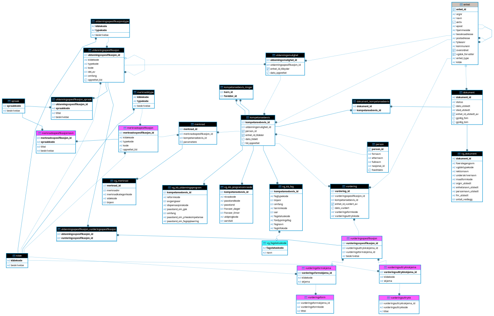
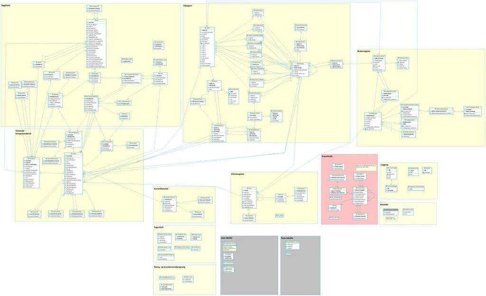

*Siden gjengir pilotens rapport «Arkitektur og informasjonsmodell – SAMT-BU Pilot 4. Dataflyt av resultater fra videregående opplæring til KREG», 30. august 2026 (leveranse fra arbeidspakke 2).*

Rapporten er pilotens leveranse på arbeidspakke 2, datert 30. august 2026. Den er utarbeidet gjennom arbeidsmøteserien om arkitektur (arbeidsmøte 1–8, 22. mai – 28. august 2026).

## Om arkitektur og informasjonsmodell

### Sammendrag

Piloten anbefaler at resultater fra videregående opplæring leveres gjennom direkte integrasjon mot Kompetanseregisteret (KREG), ikke via FINT (samarbeidsgruppas vedtak 28. august 2026; formell beslutning hos systemeierne). Validering og innsending skilles som to separate konsepter: KREG skal ta imot 100 % av dokumentasjonen – også den som ikke validerer – med eksplisitt kvalitetstilstand, mens valideringstjenesten tilbys som egen komponent. Dagens filinnsending til NVB, med det posisjonsbaserte soltegnformatet, ønskes faset ut i sin helhet.

Rapporten dokumenterer dagens NVB-importprosess med tolv identifiserte risikomomenter ([Risikomomenter i dagens prosess](#risikomomenter-i-dagens-prosess)), en anbefalt arkitektur og informasjonsmodell orientert mot European Learning Model v3 ([Arkitekturskisser for piloten](#arkitekturskisser-for-piloten) og [Semantisk arkitektur](#semantisk-arkitektur)), avdekkede behov for grunnskolen ([Grunnskole](#grunnskole)), en vurdering mot Digdirs arkitekturprinsipper ([Vurdering mot Digdirs overordnede arkitekturprinsipper](#vurdering-mot-digdirs-overordnede-arkitekturprinsipper)) og en anbefaling med veien videre for å starte realiseringen med Novari ([Konklusjon og veien videre](#konklusjon-og-veien-videre)). De tre viktigste forutsetningene for realisering er finansiering og prioritering hos Novari og fylkeskommunene (SAMT-BU-midler kan potensielt benyttes inn i 2028), at KREG gjøres klart for mottak (Sikts vurdering: et ettårsperspektiv), og juridiske avklaringer – hjemmel for grunnskoledata, behandlingsgrunnlag for ikke-beståtte resultater og likestilling av digitale vitnemål med papirvitnemål.

### Innledning

Dette dokumentet er pilotens leveranse på arbeidspakke 2: arkitektur og informasjonsmodell som grunnlag for dataflyt av vitnemål og resultater fra videregående opplæring inn i Kompetanseregisteret (KREG). Navnet på Kompetanseregisteret er ennå ikke bestemt, og i dette dokumentet refererer vi til det som KREG.

Rapporten er utarbeidet gjennom arbeidsmøteserien om arkitektur (arbeidsmøte 1–8, 22. mai – 28. august 2026) [12] og utgjør pilotens milepæl «arkitektur og informasjonsmodell er ferdigstilt» [13]. Arbeidet er forankret i SAMT-BUs case «Tilgjengeliggjøring av resultater fra opplæring» [13], med de konkrete brukersituasjonene skolebytte, opptak, videre oppfølging av unge og voksnes dokumentasjonsbehov som bakteppe. Piloten leverer forarbeid, ikke tekniske produkter [13]; realiseringen av arkitekturen skjer etter pilotperioden, slik [Veien videre etter 1. september](#veien-videre-etter-1-september) beskriver.

Rapporten dokumenterer dagens prosess for NVB-import med risikomomentene i den ([Dagens prosess for NVB-import](#dagens-prosess-for-nvb-import)), målbildet arbeidet styrer mot ([Målbilde](#målbilde)), vurderingen av arkitekturalternativene med samarbeidsgruppas anbefaling om direkte integrasjon mot KREG ([Hva skal vi løse i SAMT-BU?](#hva-skal-vi-løse-i-samt-bu), [Arkitekturskisser for piloten](#arkitekturskisser-for-piloten) og [Teknisk målarkitektur](#teknisk-målarkitektur)), avdekkede behov for grunnskolen ([Grunnskole](#grunnskole)), den semantiske arkitekturen med overgangen fra NVBs modell til en ELM-orientert modell ([Semantisk arkitektur](#semantisk-arkitektur)), en begrepskatalog ([Begrepskatalog](#begrepskatalog)) og konklusjon med veien videre ([Konklusjon og veien videre](#konklusjon-og-veien-videre)).

Arkitekturvalgene er vurdert opp mot Digitaliseringsdirektoratets overordnede arkitekturprinsipper for digitalisering av offentlig sektor [1] og Rammeverk for digital samhandling [4]; vurderingen er samlet i [Vurdering mot Digdirs overordnede arkitekturprinsipper](#vurdering-mot-digdirs-overordnede-arkitekturprinsipper), og prinsippene er i tillegg referert der de begrunner konkrete valg.

### Avgrensning

Piloten dekker videregående opplæring først. Følgende er bevisst holdt utenfor piloten:

**Grunnskole:** Del av SAMT-BUs helhet, men inngår ikke i piloten. Avdekkede behov, ansvarsforhold og forutsetningene for et grunnskolespor er samlet under [Grunnskole](#grunnskole), slik at de kan tas videre selv om de ikke løses i piloten [12: arbeidsmøte 8].

**VIGO-modernisering:** Uplanlagt og ikke klar til piloten. Arkitekturen forholder seg til dagens filoverføring som alternativ, og moderniseringen tas inn i målbildet. Dersom SAMT-BU-midler gjøres tilgjengelige, kan en avgrenset modernisering av eksportleddet i VIGO likevel vurderes – dette krever egen prioriteringsbeslutning hos Novari og fylkeskommunene.

**Utdanningsregisteret:** Holder fortsatt på å onboarde fagskole og høyere utdanning. Ikke klart for å ta inn videregående opplæring. Tas inn i målbildet, ikke i piloten; rollen og det egne sporet er beskrevet i [Teknisk målarkitektur](#teknisk-målarkitektur).

**Juridisk gyldighet av digitale vitnemål:** Egen arbeidsstrøm, hører til arbeidspakke 3 (juridiske behov).

**Modulstrukturert opplæring for voksne (MVOV):** Leveres i dag papirbasert/ikke-validert, med høyt volum. Prinsippet om at sluttvurdering er enheten (se [Premisser for piloten](#premisser-for-piloten)) gjelder også MVOV, men selve flyten løses ikke i piloten.

Sikt har erstattet valideringsmotoren «kontroll.exe» med en ny valideringsmotor basert på IBM Operational Decision Manager (ODM). Felles maskinlesbare valideringsregler basert på eller som input til ODM inngår ikke i piloten, men er dokumentert som anbefaling i [Teknisk målarkitektur](#teknisk-målarkitektur).

### Premisser for piloten

Følgende legges til grunn for arkitekturarbeidet og behandles ikke som åpne spørsmål videre:

1. **Sluttvurderingen i det enkelte fag er den atomære enheten som skal inn i KREG.** Sluttvurdering omfatter standpunktkarakter, eksamenskarakter og karakter til fag-, svenne- og kompetanseprøve, jf. forskrift til opplæringslova; også karakterer som ikke er bestått, er sluttvurderinger. I KREG er hver karakter én forekomst av vurdering.
2. **Kompetansebevis er en sammensetning av sluttvurderinger.** Vitnemål er en sammensetning av sluttvurderinger som representerer en fullført utdanning, som eksempelvis kvalifiserer til generell studiekompetanse (GSK). Presisering fra arbeidsmøte 6: et kompetansebevis fra videregående opplæring kan etter føringsskrivet [10] også inneholde halvårsvurderinger med karakter, og oppnådde kompetansemål kan dokumenteres i vedlegg. Premisset gjelder derfor det som skal inn i KREG i piloten, ikke alt som kan stå på et utstedt kompetansebevis [12: arbeidsmøte 6].
3. **Sluttvurderinger sendes inn i KREG fortløpende.** Arbeidshypotesen fra arbeidsmøte 4 var at kun beståtte sluttvurderinger skulle inn; arbeidsmøte 8 presiserte scopet: pilotens mål er teknisk overføring av dokumentasjonen uavhengig av om den er validert eller kontrollert manuelt – målet er å få inn 100 % av dokumentasjonen, også sluttvurderinger og kompetansebevis for elever som ikke har fullført eller bestått [12: arbeidsmøte 4 og 8].
4. **Modulkoder skal ikke inn i KREG – kun sluttvurderinger.** Modulkoder kan stå på kompetansebevis som blir utstedt, men ikke på vitnemål, jf. Udirs føringsskriv [10][12: arbeidsmøte 8].
5. **Læringsmål og oppnådde kompetansemål skal ikke inngå i selve piloten.** De kan tas med som uavklart del av målbildet [12: arbeidsmøte 6 og 8].

Referatene fra arbeidsmøteserien om arkitektur, som rapporten bygger på, står under [Møter](../../moter/).

## Dagens prosess for NVB-import

For å forstå hva den nye arkitekturen endrer, må dagens prosess beskrives. Dette kapittelet dokumenterer hvordan resultater fra videregående opplæring i dag kommer inn i Nasjonal vitnemålsdatabase (NVB), og hvilke risikomomenter som ligger i denne prosessen. Beskrivelsen bygger på formatspesifikasjonen for NVB-kontrollmotoren [5], gjennomgangene i arbeidsmøteserien [12] og NVBs egen dokumentasjon [6].

### Aktører og dataflyt

NVB forvaltes av Sikt og er i dag kilden til sannhet for vitnemål og kompetansebevis fra videregående opplæring, primært brukt av Samordna opptak ved opptak til høyere utdanning [6].

Dataflyten inn til NVB går slik (figur 1):

1. **Skolen registrerer sluttvurderinger i det skoleadministrative systemet.** For offentlige videregående skoler er dette InSchool; private skoler bruker blant annet iSkole og IST Everyday [17]. Læreren setter standpunktkarakter, og eksamenskarakterer kommer til etter sensur.
2. **Det skoleadministrative systemet genererer vitnemåls- og kompetansebevisdata** som en tegnseparert tekstfil («soltegnfil», se [Filformatet – soltegnfilene](#filformatet--soltegnfilene)) etter NVB-spesifikasjonen [5].
3. **Fagopplæringen går via VIGO.** Fagprøver registreres i VIGO, som produserer endelig vitnemål for lærlinger og kandidater i fagopplæringen. VIGO eksporterer en fil i .nvb-format som senere lastes inn i NVB igjen [12: arbeidsmøte 3 og 7].
4. **Filen valideres før innsending** (se [Validering og kontroll i dag](#validering-og-kontroll-i-dag) om hvordan valideringen skjer i dag).
5. **NVB tar imot dokumenter som validerer uten feil.** Dokumenter med feilmeldinger avvises og returneres for korreksjon [5]. NVB tar ikke imot vitnemål som ikke validerer [12: arbeidsmøte 8].
6. **Skoleeier utsteder og signerer vitnemålet på papir.** Det finnes i dag ingen digital signering av vitnemål – vitnemålet skrives ut og signeres av rektor, i tillegg til at dataene sendes inn og valideres [12: arbeidsmøte 8].

Grunnskolen er ikke en del av denne flyten. Grunnskolevitnemål lagres som PDF i elevmappen i kommunens saks- og arkivsystem, og det finnes i dag ingen måte å hente ut dataene på [12: arbeidsmøte 4 og 6]. Se [Grunnskole](#grunnskole).

*Figur 1: Dagens dataflyt inn til Nasjonal vitnemålsdatabase.*

### Filformatet – soltegnfilene

Utvekslingsformatet er en linjebasert tekstfil der feltene skilles med soltegn (¤), og der radtypen avgjøres av en typebokstav i starten av linjen [5]:

| Radtype | Innhold | Motsvar i NVBs datamodell |
|---|---|---|
| ¤A | Startlinje per filseksjon: organisasjonsnummer, skolenummer (VIGO), tellere | Filimport |
| ¤S | Skoleinformasjon (valgfri): navn, adresse, kontaktperson | Enhetsregister |
| ¤V | Dokumenthode for vitnemål eller kompetansebevis: dokumentidentifikator, dokumenttype (VGDOKTYPEKODE: VM = vitnemål, KB = kompetansebevis), fødselsnummer, navn som fritekst, avgangsår, reform (KL/R94) | VGDOK |
| ¤P | Én linje per programområde (normalt tre for et vitnemål): programområdekode, nivåkode (VG1–VG3), påstandskode (Bestått / Fullført / Fullført og bestått) | VGDOKPROMR |
| ¤F | Én linje per fag: fagkode (Grep), fagtype (FF/FP/VP), standpunkt- og eksamenskarakter, omfang, eksamenstermin, fagmerknad | VGDOKFAG |
| ¤M | Merknader til dokument eller enkeltfag, med VMM-merknadskoder fra Grep | VGDOKMERKNAD |
| ¤D | Annullering av tidligere utstedt dokument, med årsakskode | – |

Formatet er posisjonsbasert: feltenes betydning avgjøres av kolonneposisjon i linjen, ikke av feltnavn. Filen er i praksis fire ulike radskjemaer multiplekset inn i én strøm, der en delt nøkkel (vitnemålsnummeret) knytter fag- og merknadslinjene til dokumenthodet. Dokumenttypen styres av en kodeverdi (VGDOKTYPEKODE) satt av leverandøren – vitnemål og kompetansebevis er rader i samme tabell, skilt kun ved kodeverdi. Dette representasjonsvalget er kjernen i det semantiske skiftet til KREG, se [Semantisk arkitektur](#semantisk-arkitektur).

Sikt ønsker å fase ut soltegnfilene som format og å fjerne filinnsendingen til NVB i sin helhet; hvordan utfasingen skal skje, er beskrevet i [Teknisk målarkitektur](#teknisk-målarkitektur) (sameksistens og utfasing). Digdirs arkitekturprinsipp 4, anbefaling 4.5, advarer nettopp mot innlåsing av data i systemer med egne formater [2].

### Validering og kontroll i dag

Valideringen kontrollerer at fagsammensetningen i et dokument oppfyller kravene til vitnemål, blant annet kravene til generell studiekompetanse, mot kodeverk fra Grep, Udirs føringsskriv og rundskrivet om fag- og timefordeling [5][10]. Kontrollen brukes også underveis: fra høsten i siste skoleår kjøres den for å sjekke at vitnemålet vil validere, noe som er viktig for å gi elevene trygghet for at de får vitnemålet sitt til slutt [12: arbeidsmøte 6].

Historisk ble dette gjort med kontroll.exe, en binær kommandolinjeapplikasjon distribuert per operativsystem, kjørt lokalt eller mot sentral server hos Samordna opptak [5]. Kontroll.exe er nå avviklet og erstattet av Sikts valideringstjeneste basert på IBM ODM. I InSchool er valideringen bygget inn i selve vitnemålsgenereringen (fag mot vitnemålsnummer) og brukes for alle vitnemål; I VIGO brukes kontrollmotor kun for fagprøvene når et vitnemål er klar. Kravene til sluttvurdering og dokumentasjon følger av forskrift til opplæringslova; Udir forvalter føringsskrivet som operasjonaliserer føringen av vitnemål og kompetansebevis (et utkast til føringsforskrift er til behandling i Kunnskapsdepartementet), og skoleeier har ansvaret for utstedelsen. Kompetansen på kontrollene sitter i dag likevel implisitt hos Sikt gjennom ODM-implementasjonen [12: arbeidsmøte 8].

### Risikomomenter i dagens prosess

Gjennomgangen i arbeidsmøteserien har avdekket følgende risikomomenter ved dagens NVB-import. Disse utgjør en vesentlig del av begrunnelsen for den nye arkitekturen.

**R1 – Innlåsing i proprietært format.** Det posisjonsbaserte ¤-formatet uten feltnavn er skjørt, krever spesialkompetanse hos hver leverandør, og låser data inne i et systemspesifikt format, i strid med Digdirs anbefaling 4.5 [2][5].

**R2 – Registeret er ufullstendig.** NVB tar kun imot dokumentasjon som validerer. Dokumentasjon som ikke validerer – blant annet fra modulstrukturert opplæring for voksne, som utgjør hundrevis til flere tusen bevis i året – finnes bare på papir eller som ikke-validerte dokumenter utenfor registeret [12: arbeidsmøte 4]. Elever som ikke fullfører får heller ikke resultatene sine inn.

**R3 – Manuelle feil i filene.** Når skolene sender filer kan karakterer mangle eller fagmerknader være feilført. Dagens format tillater dessuten kun én fagmerknad per fag [12: arbeidsmøte 3].

**R4 – Batch-forsinkelse i en tidskritisk kjede.** Det er svært kort tid mellom sensurfrist (rundt 19. juni) og kjøring av inntak i begynnelsen av juli. Filbasert overføring gjør at resultatene i praksis ikke kan hentes fra registeret i denne perioden, med manuelt etterarbeid som konsekvens [12: arbeidsmøte 3]. Merk at heller ikke KREG vil kunne betjene inntakskjeden i nær framtid – dagens direkteflyt til inntaket videreføres; risikoen gjelder alle andre konsumenter av resultatene.

**R5 – Rundtur i fagopplæringsflyten.** Hvert transformasjonsledd i rundturen VIGO → .nvb-fil → NVB (jf. [Aktører og dataflyt](#aktører-og-dataflyt)) er en feilkilde, og flyten er ikke fullt kartlagt [12: arbeidsmøte 7].

**R6 – Regelverkskompetanse og forvaltning er skjevfordelt.** Regelverkseier (Udir) og de som forstår og vedlikeholder de implementerte valideringsreglene (Sikt) er ikke samme part (jf. [Validering og kontroll i dag](#validering-og-kontroll-i-dag)), og valideringstjenesten fanger ikke nødvendigvis opp alle regelendringer [12: arbeidsmøte 8].

**R7 – Strukturerte grunnskoleresultater bevares ikke.** Strukturerte resultater finnes kun midlertidig i skolesystemet og går tapt som struktur når vitnemålet arkiveres som PDF; det finnes ingen nasjonal tilgang, og gjenbruk krever manuelle leveranser fra hver kommune [12: arbeidsmøte 2 og 4].

**R8 – Svak semantikk for person og innhold.** Personnavn føres som fritekst i dokumenthodet, og feltbetydning avgjøres av posisjon. Formatet gir ingen strukturell garanti for at innholdet tolkes likt av avsender og mottaker [5][15].

**R9 – Leverandør- og teknologibinding i kontrolleddet.** Kontroll.exe var en lukket binær; overgangen til ODM har redusert, men ikke fjernet, bindingen. Digdirs anbefaling 5.6 peker på å unngå bindinger til enkeltleverandører [3]. Se anbefalingen om maskinlesbare valideringsregler i [Teknisk målarkitektur](#teknisk-målarkitektur).

**R10 – Papir er eneste juridisk gyldige form.** Skoleeiers papirsignatur er det som gjør vitnemålet gyldig. Digitale resultater er ikke juridisk likestilt, og dette begrenser verdien av registeret som kilde. Følges opp i arbeidspakke 3 [12: arbeidsmøte 8][13].

**R11 – Data forsvinner når virksomheter opphører.** For private fagskoler forsvinner dokumentasjon i dag når skolen går konkurs. Dette illustrerer risikoen ved desentral lagring av dokumentasjon generelt, og er en del av begrunnelsen for et sentralt register gjennom hele livsløpet. Private fagskoler ligger utenfor Novaris ansvar; oppfølgingen av disse må plasseres hos Sikt eller annen part [12: arbeidsmøte 8].

**R12 – Endring og annullering er svakt støttet.** Standpunkt- og eksamenskarakterer er enkeltvedtak med klagerett; ved medhold endres karakteren og nytt dokument utstedes. I dag håndteres dette gjennom annulleringslinjer (¤D) og ny innsending. Livssyklusen endret sluttvurdering → annullert/erstattet dokument må håndteres eksplisitt i KREG-modellen; dette står som uavklart punkt i mappingen i [Mapping NVB → KREG](#mapping-nvb--kreg).

## Målbilde

Alle vitnemål og enkeltresultater fra grunnopplæringen er samlet i KREG, som er tilgjengelig gjennom hele livsløpet til borgeren.

Data fra kommuners og fylkeskommuners systemer leveres til KREG, slik at alle resultater kan deles og ivaretas på en sikker måte.

Skolesystemer kan selv validere vitnemål og sluttvurderinger underveis i elevens løp.

Når skole og fylkeskommunene skal utstede vitnemål og kompetansebevis fra videregående opplæring, kobles kompetansebevis i KREG sammen mot et overordnet kompetansebevis som dokumenterer koblingen. Sammensetningen utføres i skolesystemet av skolene, der skoleeier står som utsteder med signaturansvar [12: arbeidsmøte 6 og 8].

Digitale resultater er juridisk likestilt med papirdokumentasjon.

Offentlige etater og private virksomheter kan hente utdanningsresultater enkelt – med hjemmel eller samtykke fra innbyggeren.

Innbyggeren har alle resultater og vitnemål fra utdanning samlet på ett sted som kan deles i Vitnemålsportalen.

Borgere i Norge blir i stand til å bruke utdanningen sin på tvers av landegrenser gjennom EMREX, EU Digital Identity Wallet og Once-Only Technical System.

Utdanningsregisteret inngår i målbildet som grunndataregister for utdanningstilbud, og skal i målbildet få data om videregående opplæring fra Grep, InSchool og VIGO [12: arbeidsmøte 8].

Migrering av historisk dokumentasjon fra kommunale arkiver inngår ikke i målbildet slik det nå er definert.

Datasett, API-er, tjenester, modeller og begreper som etableres, skal registreres i Felles datakatalog på data.norge.no (se [Begrepskatalog](#begrepskatalog)).

### Uavklart del av målbildet

Oppnådde læringsmål og kompetansemål, samt underveisvurdering, kan inkluderes i kompetansebevis fra videregående opplæring. Disse legges med som vedlegg i dag.

Hvordan modellene passer inn i ELM: hovedtrekkene er beskrevet i [Innplassering i ELM v3](#innplassering-i-elm-v3), men full innplassering – herunder valg av applikasjonsprofil og kontroll av sammensetningsrelasjonene (hasPart/isPartOf) mot profilens regler – gjenstår [8].

## Hva skal vi løse i SAMT-BU?

Kjernen i piloten er flyten av én sluttvurdering fra kilde til KREG, illustrert i figur 2:

1. **Sluttvurderingen settes i kildesystemet.** Læreren setter standpunktkarakter i InSchool, og eksamenskarakterer kommer til etter sensur; fag- og svenneprøver registreres i VIGO.
2. **Kildesystemet leverer sluttvurderingen til KREG fortløpende.** InSchool leverer direkte via API; VIGO leverer via filoverføring, eventuelt gjennom en mellomvare.
3. **Valideringstjenesten brukes underveis** for å kontrollere fagsammensetningen gjennom opplæringsløpet, og til vitnemålsvalidering når alle sluttvurderinger foreligger.
4. **KREG tar imot dokumentasjonen** med eksplisitt kvalitetstilstand.
5. **Skolen setter sammen og utsteder kvalifikasjonen;** skolesystemet leverer selve kvalifikasjonsutstedelsen, sluttvurderingene som inngår vil allerede være i KREG.
6. **Vitnemålsportalen og konsumentene henter resultatene fra KREG.**

*Figur 2: Flyten av én sluttvurdering fra kilde til KREG. Stiplede linjer er valideringsstøtte.*

## Arkitekturskisser for piloten

Felles for begge løsninger:

- Validering skjer mot Sikts ODM-baserte valideringstjeneste, som allerede har erstattet kontroll.exe i dagens flyt ([Validering og kontroll i dag](#validering-og-kontroll-i-dag)).
- En flyt av typen VIGO/InSchool → FINT → KREG → FINT → VIGO/InSchool kan skape avstand fra sammenhengende tjenester og kan påvirke læreren som sluttvurderer i VIGO/InSchool [12: arbeidsmøte 7].
- Valget må vurderes opp mot Digdirs arkitekturrammeverk for sammenhengende tjenester [4]. Beslutningen ligger hos de som har ansvar for InSchool og VIGO, i tråd med Digdirs prinsipp 2 om å ta arkitekturbeslutninger på rett nivå [1].

### Alternativ 1, levere sluttvurderinger via FINT

Nøkkelpunkt:

- VIGO og InSchool bygges om til å sende sluttvurderinger til FINT fortløpende.
- FINT vil kunne motta data fortløpende på sluttvurderinger. Når noe er sluttvurdert i FINT, overføres det til KREG [12: arbeidsmøte 6].
- Dette mønsteret kan trolig gjenbrukes for grunnskolen.

### Alternativ 2, levere sluttvurderinger direkte i KREG

Nøkkelpunkt:

- InSchool sender sluttvurderinger direkte til KREGs GraphQL-API.
- For VIGO er det to muligheter: bygge mellomvare for å transformere filer fra VIGO til GraphQL API-kall med sluttvurderinger, eller midler til å modernisere denne delen av VIGO for å levere direkte.
- VIGO leverer sluttvurderinger og bestått fagprøve alt-i-ett.

### Vurdering og anbefaling

Arbeidsmøte 7 og 8 gjennomgikk FINTs informasjonsmodell [7] og vurderte de to alternativene. Arbeidsmøtets vurdering var følgende [12: arbeidsmøte 8]:

- FINT-informasjonsmodellen er laget for statistikk og analyse. FINT informasjonsmodell kan per i dag ikke uttrykke alle konsepter nødvendig for å overføre langtidslevende bevis. VIGO og InSchool er kilden til resultatinformasjonen.
- VIGO og InSchool benytter i dag tjenester fra Sikt for validering av vitnemål. Ansvaret for validering av korrektheten i vitnemålene ligger hos skolene.
- Dataflyt gjennom FINT kan potensielt ha noen forsinkelser, noe som kan skape utfordringer i noen tidskritiske situasjoner.
- Slik FINT og FINT-informasjonsmodellen er designet i dag, kan sluttvurderinger potensielt gå via FINT, mens kompetansebevis og vitnemål må komme fra de skoleadministrative systemene.
- Hvis FINT informasjonsmodell skal benyttes som et steg i overføringen til KREG må det antagelig gjøres en jobb for at konseptene i FINT skal matche konseptene i KREG og ELM.

**Vedtak (arbeidsmøte 8, 28. august 2026): Samarbeidsgruppa anbefaler at VIGO og InSchool overfører direkte til KREG, tilsvarende dagens overføringer til NVB.** Den formelle beslutningen ligger hos systemeierne – Novari og fylkeskommunene [12: arbeidsmøte 7].

Autentisering og autorisering i de ulike leddene må avklares videre, jf. Digdirs prinsipp 7 om tillit til oppgaveløsningen [1]. Utgangspunktet fra skissearbeidet er Maskinporten for virksomhetsautentisering og Feide der brukerkontekst trengs, med fødselsnummer for brukeren som leverer data, for sporbarhet [12: arbeidsmøte 1].

*Figur 3: Anbefalt arkitektur for piloten – direkte integrasjon mot KREG. Stiplede elementer er uavklart eller målbilde.*

## Teknisk målarkitektur

Arkitekturen for denne piloten er ett steg mot det bredere målbildet for integrasjonsarkitekturen på tvers av skoleadministrativt system – VIGO – FINT – KREG:

Utdanningsregisteret får en sentral rolle i målbildet, men er ikke en del av det som realiseres i pilotperioden. Rollen bør likevel beskrives i arkitekturen nå, slik at den anbefalte arkitekturen ikke bygger seg inn i en blindvei. I målbildet skal Utdanningsregisteret få data om videregående opplæring fra GREP, InSchool og VIGO, og det etableres et eget spor knyttet til koder som opprettes i VIGO og deretter i InSchool, og som må henge sammen med Utdanningsregisteret [12: arbeidsmøte 6 og 8]. Sikt og Udir bør se nærmere på hvilken rolle registeret skal ha. I KREG er entitetene utdanningsspesifikasjon og utdanningsmulighet forberedt for kobling til Utdanningsregisteret (se [Innplassering i ELM v3](#innplassering-i-elm-v3) og [Vedlegg A – Informasjonsmodell, KREG](#vedlegg-a--informasjonsmodell-kreg)).

Grunnskole skal etter hvert inn i samme modell – forutsetningene er beskrevet under [Grunnskole](#grunnskole).

**Validering og innsending brytes opp til to separate konsepter** [12: arbeidsmøte 7 og 8]. Valideringstjenesten skilles ut som egen komponent i arkitekturen. Der kan man sjekke om fagsammensetningen er riktig underveis i opplæringsløpet, og – når alle sluttvurderinger er på plass – validere om det foreligger et gyldig vitnemål. Konsekvensene av skillet:

- KREG skal kunne ta imot dokumentasjon som ikke validerer, så lenge dette er en akseptert tilstand. Skolen skal ha mulighet til å overstyre gyldigheten slik at dokumentasjonen står som gyldig med skolens signatur, selv om den ikke validerer automatisk.
- Ansvaret for validering i VIGO og InSchool ligger hos skolen, ikke hos Sikt. VIGO og InSchool må tilby funksjonalitet for skoleeiers manuelle kontroll av vitnemål som ikke valideres automatisk, men som likevel er gyldige.
- Udir forvalter føringsregelverket (føringsskrivet [10]); det som mangler, er en forvaltningsmodell som sikrer at valideringsreglene holdes i takt med regelverket – valideringstjenesten fanger ikke nødvendigvis opp alle regelendringer.
- Bindingen til IBM ODM som regelmotor aksepteres i piloten fordi implementasjonen allerede finnes og dekker om lag 90 % av tilfellene.

**Maskinlesbare valideringsregler.** Valideringen i ODM er ikke-proprietær i regeluttrykket, og i målarkitekturen er det ønskelig at regelverket – Grep, fag- og timefordelingen og føringsskrivet – kan uttrykkes og kontrolleres på en måte som kan gjenbrukes i flere systemer, for eksempel med SHACL. Behovet for maskinlesbar validering som kan brukes av Sikt, Udir, InSchool og VIGO ble foreslått som egen SAMT-BU-case [12: arbeidsmøte 7]. Antatt innsats og gevinst må vurderes redelig dersom dette meldes inn som behov [12: arbeidsmøte 8]. En felles, systemuavhengig beskrivelse av informasjonsmodellen for vitnemål, som kan brukes av både fagpersoner og valideringsløsninger, vil gjøre det lettere å implementere nye regelmotorer, oppdatere validering ved regelendringer og gi fagpersoner innsikt – i dag er fasit i praksis regelmotoren.

**Erstatte eksisterende prosesser med KREG:** KREG muliggjør nye integrasjonsmønstre som gjør at vi kan løse ut behov på en ny måte som kan spare kostnader i offentlig sektor. Det er behov for hendelser (events) i arkitekturen, slik at systemer kan reagere på endringer fortløpende [12: arbeidsmøte 6].

Utvikling som pågår på KREG gjelder fagskole, grunnstrukturen anses som god, og fagskolens behov antas ikke å legge uheldige føringer for API-ene for videregående opplæring [12: arbeidsmøte 8]. Sikt vurderer at KREG er klar til å ta imot data i et ettårsperspektiv, med forbehold om finansiering og prioritering.

**API-grensesnitt:** KREG eksponerer et GraphQL-API. For parter som ikke støtter GraphQL, kan det vurderes om Sikt skal tilby en REST-kobling [12: arbeidsmøte 1]; endelig grensesnittvalg avklares i API-dialogen mellom Sikt, Novari og systemleverandørene. KREG er også avhengig av kodeverk fra Grep og VIGO-kodeverket [12: arbeidsmøte 1] – sistnevnte er en løpende leveranse fra Novari som må inngå i avtalene.

**Sameksistens og utfasing NVB → KREG:** I parallellperioden innebærer løsningen dobbel leveranse for leverandørene (soltegnfil til NVB og API-leveranse til KREG). Varighet, utfasingskriterier og finansiering av dobbeltdriften må avklares mellom Sikt, Novari og systemleverandørene. Utfasing av filinnsendingen forutsetter at behovene bak dagens løsning er kartlagt av Sikt og Novari, at NVBs konsumenter – primært Samordna opptak – får dekket sine behov av KREG, og en avklaring av om historiske NVB-data skal migreres til KREG eller forvaltes videre som historisk register.

![Komponentskisse for teknisk målarkitektur: skolesystemene (Visma InSchool, Visma Flyt Skole, IST, Vigilo) leverer sluttvurderinger, kvalifikasjoner, fødselsnummer for resultateier og fødselsnummer til bruker som leverer data (for audit) til FS GraphQL API, med autentisering via Maskinporten, Feide og ID-porten; frontendene Min kompetanse og FS Admin bruker samme API; Kompetanseregisteret er koblet til Utdanningsregisteret, til validering av vitnemål (Grep API og ODM) og til Vitnemålsportalen, som har internasjonale integrasjoner mot Emrex, Single Digital Gateway / Once only technical system og EUDI Wallet.](teknisk-maalarkitektur.png)

*Figuren har ikke nummer eller bildetekst i rapporten.*

### Vurdering mot Digdirs overordnede arkitekturprinsipper

Digitaliseringsdirektoratets syv overordnede arkitekturprinsipper er obligatoriske for statlige virksomheter og anbefalt for kommunal sektor [1]. Tabellen oppsummerer hvordan arkitekturen i dette dokumentet svarer på hvert prinsipp.

| Prinsipp | Hvordan arkitekturen svarer |
|---|---|
| 1. Ta utgangspunkt i brukernes behov | Flytvalget er vurdert ut fra konsekvensen for eleven, lærlingen og læreren som sluttvurderer i InSchool/VIGO – en indirekte flyt via FINT ble blant annet forkastet fordi den skaper avstand til brukeren (se [Vurdering og anbefaling](#vurdering-og-anbefaling)). Målbildet gir innbyggeren all dokumentasjon samlet og delbar gjennom hele livsløpet, også for grupper som i dag faller utenfor registeret. |
| 2. Ta arkitekturbeslutninger på rett nivå | Beslutningen om integrasjonsmønster ligger hos dem som har ansvar for InSchool og VIGO; for grunnskolen er kommunene som skoleeiere beslutningsnivået; regelverksansvar ligger hos Udir. Samarbeidsgruppa gir anbefalinger. |
| 3. Bidra til digitaliseringsvennlig regelverk | Piloten skal levere forslag til hva som må hjemles for innsamling av grunnskoledata, der det i dag mangler lovhjemmel (se [Grunnskole](#grunnskole)), og peker på behovet for leverings-/hentehjemler som følger dataflyten. Juridisk likestilling av digitale vitnemål følges opp i arbeidspakke 3. |
| 4. Del og gjenbruk data | KREG etableres som felles register med definert mottaksmodell, i stedet for innlåsing i soltegnfiler og PDF-arkiver (anbefaling 4.5 [2]). Datasett, API-er, modeller og begreper registreres i Felles datakatalog. |
| 5. Del og gjenbruk løsninger | Utfasing av filinnsendingen reduserer kompleksitet og teknisk gjeld (5.9), og mottaksmønsteret utvikles nå først for fagskole, med gjenbruk for videregående opplæring og på sikt grunnskole som intensjon [3]. Gap: bindingen til ODM som regelmotor består (5.6, jf. [Teknisk målarkitektur](#teknisk-målarkitektur)), og hendelsesbasert arkitektur (5.7) er identifisert som behov, ikke besluttet. |
| 6. Lag digitale løsninger som støtter samhandling | Informasjonsmodellen orienteres mot ELM v3 og dermed europeisk samhandling (EMREX, EU Digital Identity Wallet, Once-Only). FINT følger etter i samme retning [12: arbeidsmøte 7]. Semantisk samhandlingsevne er behandlet som eget arkitekturområde (se [Semantisk arkitektur](#semantisk-arkitektur)), jf. Rammeverk for digital samhandling [4]. |
| 7. Sørg for tillit til oppgaveløsningen | Autentisering/autorisering avklares per ledd (Maskinporten/Feide), innsendinger spores til bruker, skoleeiers utsteder- og signaturansvar er eksplisitt, og skillet validering/innsending gjør kvalitetstilstanden til hvert dokument synlig i stedet for at avvik holdes utenfor registeret. |

Sett mot Rammeverk for digital samhandlings fire dimensjoner [4] er status:

- semantisk samhandlingsevne dekt i [Semantisk arkitektur](#semantisk-arkitektur).
- teknisk samhandlingsevne dekkes av arkitekturvalgene i [Arkitekturskisser for piloten](#arkitekturskisser-for-piloten) og [Teknisk målarkitektur](#teknisk-målarkitektur).
- juridisk samhandlingsevne har tre identifiserte gap – hjemmel for grunnskoledata, likestilling av digitale vitnemål som må avklares i AP3.
- organisatorisk samhandlingsevne – mangler forvaltningsmodell for innspill til KREG fra videregående opplæring og grunnskole.

## Grunnskole

Grunnskolen inngår ikke i pilotens leveranse, men behovene er kartlagt gjennom arbeidsmøteserien og oppsummeres her slik at de kan tas videre [12: arbeidsmøte 8].

**Dagens situasjon:** Grunnskolen bruker egne skoleadministrative systemer (Vigilo, Visma Flyt Skole, IST Everyday, iSkole) som støtter OneRoster 1.2 norsk profil [11][17]. Vitnemålene inngår ikke i NVB: de arkiveres som PDF i kommunens saks- og arkivsystem, mens strukturerte data kun overføres til VIGO som CSV-filer til bruk i inntaket – strukturen bevares altså ikke etter arkivering [12: arbeidsmøte 2, 4 og 6]. Udir har presisert at kun vitnemål er aktuelt, ikke enkeltfag; alle fag regnes som 10. trinn [12: arbeidsmøte 3].

**Ansvar og hjemmel:** Sikt mangler lovhjemmel for å samle inn grunnskoledata; en av pilotens leveranser er et forslag til hva som må hjemles [12: arbeidsmøte 6]. En eventuell leveringsplikt vil rette seg mot kommunen som skoleeier, og systemstøtten følger av kommunenes egne bestillinger og finansiering hos leverandørene [12: arbeidsmøte 2 og 8]. Behandlingsansvar og personvernkonsekvenser avklares gjennom pilotens juridiske leveranse (arbeidspakke 3).

**Gevinster for kommunene:** CSV-leveransene til VIGO kan bortfalle når inntakskontoret henter fra KREG, strukturerte resultater bevares over tid, og innbyggerne får innsyn og deling gjennom Vitnemålsportalen.

**Mulig retning:** Pilotens integrasjonsmønster kan trolig gjenbrukes, med det komplette vitnemålet ved skoleslutt som leveranseenhet [12: arbeidsmøte 6]. Det er spilt inn et eget spor der grunnskolen leverer direkte til KREG og inntakskontoret henter derfra [12: arbeidsmøte 7]. Anbefalingen er å ta grunnskole videre som eget spor med tre forutsetninger i rekkefølge: hjemmel og juridiske avklaringer, avklaring av rollefordeling i inntaksflyten og finansieringsmodell, og deretter gjenbruk av pilotens mønster og informasjonsmodell.

## Semantisk arkitektur

Overgangen fra NVB til KREG er ikke bare en systemmigrering, men en endring i hvordan resultater fra opplæring representeres semantisk. NVBs informasjonsmodell bygger på spesialiserte, distinkte entiteter for videregående opplæring. KREGs modell, inspirert av den internasjonale standarden European Learning Model (ELM) v3 [8], bruker én generisk og rekursiv entitet, kompetansebevis, som kan representere alt fra enkeltresultater til fullstendige vitnemål og grader fra høyere utdanning.

Dette kapittelet beskriver denne forskjellen og hvilken konsekvens den har for systemleverandørene som i dag leverer data til NVB. Arbeidet inngår i det som Digitaliseringsdirektoratets Rammeverk for digital samhandling definerer som semantisk samhandlingsevne – felles forståelse av dataenes betydning og av formatet de utveksles i [4].

Beskrivelsen i dette kapittelet er den normative, systemuavhengige informasjonsmodellen for resultater fra opplæring, forankret i regelverket og ELM. KREGs datamodell (vedlegg A) og Sikts valideringstjeneste er implementasjoner som skal samsvare med den – ikke omvendt. Dette svarer på behovet, påpekt i kommentarrunden, for at fasit ikke skal være en leverandørs regelmotor.

### Modeller

Modeller som er brukt i denne rapporten:

| Modell | Rolle | Omfang | Referanse |
|---|---|---|---|
| NVB | Dagens kilde til sannhet for resultater fra videregående opplæring | Spesialisert for videregående opplæring | [5][6], vedlegg B |
| KREG | Fremtidig mottaksmodell for SAMT-BU | Generalisert, tverrsektoriell, ELM-inspirert | [14], vedlegg A |
| Utdanningsregisteret | Fremtidig grunndataregister for utdanninger; modellen er synkronisert med KREGs utdanningsentiteter | Tverrsektoriell | [16] |
| FINT | Fylkeskommunal integrasjonsmodell for skoleadministrative data; laget for statistikk og analyse, ikke langtidslevende bevis | Videregående opplæring | [7][12: arbeidsmøte 8] |
| ELM v3 | Internasjonal standard for oppnåelser innen utdanning; rammeverk for utveksling på tvers av sektor og land | Alle nivåer | [8] |

Modellen i FINT og gamle NVB er nokså overlappende og beskriver vitnemål og fag for videregående opplæring. Denne modellen er viktig å videreføre semantisk selv om KREG ikke har den som hovedmodell – flere av subtypene i KREG (vg_kb_fag, vg_kb_programomraade, vg_kb_utdanningsprogram, vg_dokument) refererer til den. KREGs datamodell er mer generalisert og henter inspirasjon fra ELM, en modell som er synkronisert med Utdanningsregisterets modell.

### Ny semantikk – kompetansebevis i kompetansebevis

I NVB styres dokumenttype av en kode (VGDOKTYPEKODE) på én flat entitet. Vitnemål og kompetansebevis er rader i samme tabell, skilt kun ved kodeverdi, og karakterene ligger som kolonner direkte på fagraden [5][15].

I KREG/ELM v3 er kompetansebevis én rekursiv entitet. Et vitnemål er et kompetansebevis med andre kompetansebevis nøstet under seg (relasjonen kompetansebevis_inngar, med barn og forelder). Vurdering er skilt ut som egen entitet, koblet til det enkelte kompetansebevis, og kan ha en hierarkisk struktur der flere vurderinger inngår i samme kompetansebevis – for et fag fra videregående opplæring vil den kunne inneholde både eksamens- og standpunktkarakter [14].

Samme struktur brukes uendret på tvers av sektor: en bachelorgrad er et kompetansebevis med emneresultater nøstet under seg, på nøyaktig samme måte som et vitnemål fra videregående opplæring har sluttvurderinger i fag nøstet under seg. Dette gjør at InSchool og VIGO må endre modellen for dataene som sendes inn.

![Til venstre NVB med spesialiserte typer: VGDOK med VGDOKTYPEKODE = VM og personnavn som fritekst, VGDOKFAG-rader med standpunkt- og eksamenskarakter som kolonner, og VGDOKMERKNAD/VGDOKPROMR, knyttet sammen med vitnemålsnummer; dokumenttype er en kodeverdi satt av leverandøren. Til høyre KREG/ELM v3 med rekursiv struktur: et kompetansebevis (vitnemål, rot uten forelder) med kompetansebevis for sluttvurderinger i fag (NOR1211, MAT1013) under seg via kompetansebevis_inngar, og egne vurderinger (standpunkt, eksamen) under hvert fag; dokumenttype er posisjon i hierarkiet, med samme struktur for grad, fagbrev og grunnskole.](fra-nvb-til-kreg-elm.png)

*Figur 4: Fra flat, typekodet struktur (NVB) til rekursiv struktur (KREG/ELM v3). Forenklet; fullstendige modeller i vedlegg A og B.*

Kjernen i det leverandøren må forholde seg til – gitt dagens posisjonsbaserte filformat ([Filformatet – soltegnfilene](#filformatet--soltegnfilene)) – er derfor ikke enkeltfelt, men et representasjonsskifte: fra posisjonsbasert tekstfil til strukturerte objekter i et API. Det følger direkte av paradigmeforskjellen over:

- Dokumenttype avledes av struktur (posisjon i hierarkiet), ikke av en typekode leverandøren selv setter.
- Vurdering sendes som eget objekt, ikke som kolonneverdi på faget. Det åpner blant annet for flere vurderinger per resultat (ny eksamen, klagebehandling).
- Felt identifiseres ved navn, ikke ved kolonneposisjon i en linje.
- Person identifiseres strukturert (entiteten person med nasjonal id), ikke som fritekstnavn i dokumenthodet.

### Innplassering i ELM v3

ELM v3 skiller strengt mellom to disjunkte grener [8]:

- **Claim-siden** – faktiske, individuelle hendelser: Learning Achievement (at én bestemt person har oppnådd et læringsresultat) og Learning Assessment (vurderingen/karakteren). Begge er knyttet til én lærende.
- **Specification-siden** – maler og definisjoner: Learning Achievement Specification (hva som kan læres) med underklassen Qualification (formell kvalifikasjonstype med EQF-nivå m.m.), og Learning Opportunity (et konkret tilbud av en spesifikasjon hos en tilbyder).

En instans kan ikke være både claim og spesifikasjon. KREG-modellen respekterer dette skillet: den har egne entiteter for spesifikasjonssiden, og *kompetansebevis* representerer bare claim-siden. Innplasseringen blir da:

| KREG-entitet | ELM v3-klasse | Merknad |
|---|---|---|
| kompetansebevis | Learning Achievement | Instans, per person. Rekursjonen (kompetansebevis_inngar) tilsvarer ELMs sammensetningsrelasjoner (hasPart/isPartOf). |
| vurdering | Learning Assessment | Egen entitet med vurderingsform og vurderingsuttrykk. |
| utdanningsspesifikasjon | Learning Achievement Specification / Qualification | Definisjonssiden; kobles til Utdanningsregisteret i målbildet. |
| utdanningsmulighet | Learning Opportunity | Kobler spesifikasjon til tilbyder (enhet). |
| dokument / vg_dokument | – (dokumentasjonen av et kompetansebevis) | Representerer det utstedte dokumentet – papirvitnemål, signert PDF eller på sikt verifiserbare digitale bevis («konvolutten» rundt claimene, i ELM-økosystemet European Digital Credential). |
| person | Learner (person) | – |
| enhet | Organisation / Awarding Body | Tildeler, utsteder, vurderer. |

Det er behov for å skille mellom beskrivelsen av *hva som er oppnådd* (kompetansebevis) og informasjon om *hvordan dette dokumenteres* (dokument) – her kommer man raskt inn på papirvitnemål, signerte PDF-er og verifiserbare digitale bevis, for eksempel til digitale lommebøker.

KREG-modellens navngivning av entitetene *kompetansebevis* og *dokument* bør vurderes på nytt før modellen nærmer seg produksjonssetting. Dette er ikke diskutert i arbeidsgruppen, og løftes derfor som en inkurie. Entiteten som i dag heter *kompetansebevis*, beskriver i realiteten en oppnåelse eller fullføring. Et alternativt og mer presist begrep kan være *kompetanseoppnåelse*.

Intern datamodell trenger ikke være isomorf med utvekslingsformatet – det er standard praksis at API-laget mapper. Konsekvensen er at API-/eksportlaget må vite hvilken ELM-klasse en gitt kompetansebevis-forekomst tilsvarer (basert på om den er blad eller har barn, og hva slags utdanningsspesifikasjon den peker på), i stedet for å behandle alle forekomster likt. Ett kontrollpunkt gjenstår: ELM definerer domenet og verdiområdet for hasPart/isPartOf i applikasjonsprofilene, ikke i grunnmodellen, så nøstingen av Learning Achievement i Learning Achievement må verifiseres mot valgt profil [8].

![KREG-entitetenes innplassering i ELM v3, med to disjunkte grener der en forekomst ikke kan være begge deler. Claim-siden (faktiske hendelser): Learning Achievement (KREG: kompetansebevis, rekursjon = hasPart/isPartOf), Learning Assessment (KREG: vurdering) som vurderer Learning Achievement, og Learner/Organisation (KREG: person/enhet). Specification-siden (definisjoner): Learning Achievement Specification med underklassen Qualification (KREG: utdanningsspesifikasjon), som Learning Achievement er spesifisert av, og Learning Opportunity (KREG: utdanningsmulighet, spesifikasjon + tilbyder). Under begge: dokument/vg_dokument, som dokumenterer ett eller flere kompetansebevis – «konvolutten»: papir, signert PDF, verifiserbart digitalt bevis.](mapping-kreg-elm-v3.png)

*Figur 5: Mapping fra KREG til ELM v3.*

### Mapping NVB → KREG

Tabellen viser hvordan dagens NVB-entiteter svarer til KREG-modellen, og hva endringen betyr for leverandøren. Fullstendige modeller ligger i vedlegg A (KREG) og B (NVB) [14][15].

| NVB | KREG | Konsekvens for leverandør |
|---|---|---|
| VGDOK med VGDOKTYPEKODE (VM/KB) | kompetansebevis (+ dokument/vg_dokument for utstedelsen) | Leverandøren slutter å sette typekode; dokumenttype følger av strukturen. Utstedelsesinformasjon (rektor, målform, underskriver) flyttes til vg_dokument. |
| VGDOKFAG med standpunkt-/eksamenskarakter som kolonner | vg_kb_fag + vurdering (egne forekomster per karakter) | Vurdering sendes som eget objekt. Flere vurderinger per fag er mulig og modellert, ikke et unntak. |
| VGDOKPROMR (programområdelinjer med påstand) | vg_kb_programomraade | Rimelig direkte mapping (nivåkode, påstand, fravær). |
| Reform-/utdanningsprograminformasjon på dokumentet | vg_kb_utdanningsprogram | Rimelig direkte mapping (reformkode, avgangsår, påstander om GSK/yrkeskompetanse/fagopplæring). |
| VGDOKMERKNAD (VMM-koder) | merknad / merknadsspesifikasjon / vg_merknad | KREG skiller merknadsforekomst fra merknadsdefinisjon; kodene forvaltes som spesifikasjoner. |
| Personnavn og fødselsnummer som felt i ¤V-linjen | person (egen entitet) | Strukturert personidentifikasjon. |
| Skolenummer/orgnr i ¤A/¤S-linjer | enhet (egen entitet, med roller som tildeler, utsteder, vurderer) | Enhetsinformasjon forvaltes sentralt, ikke per fil. |
| Beregnede kontrollfelt på dokumentet (GSK-status m.m.) | Uavklart – validering er egen tjeneste | Om valideringsresultat skal ha en motpart i KREG er uavklart; kvalitetstilstand og skolens overstyring må uansett representeres i registeret ([Teknisk målarkitektur](#teknisk-målarkitektur)). |
| ¤D-annullering | dokument (status) – håndtering uavklart | Endring etter klage og annullering/erstatning av utstedt dokumentasjon må håndteres eksplisitt i KREG; uavklart (jf. R12). |
| ¤-separert fil, posisjonsbaserte felt | Strukturerte objekter i API (GraphQL) | Representasjonsskiftet beskrevet over. |

Ett begrepsvalg som er viktig for semantikken: *kompetansebevis* som generell KREG-term kolliderer med *kompetansebevis fra videregående opplæring* som etablert dokumenttype hos skolene [10]. Rapporten håndterer dette ved alltid å skrive «kompetansebevis fra videregående opplæring» når dokumenttypen menes. Ved registrering i begrepskatalogen skilles de som to begreper med assosiativ relasjon.

### Videre konkretisering av semantikken

Figurene og tabellene i dette kapittelet er illustrasjoner i et dokument. For at semantikken skal kunne gjenbrukes i andre SAMT-BU-caser, og for at forskjellene mellom ELM, FINT, VIGO og InSchool skal kunne kartlegges systematisk, må modellene konkretiseres som faktiske, maskinlesbare artefakter:

- Begrepskatalogen som SKOS (jf. SKOS-AP-NO-Begrep [9]), publisert i Felles datakatalog, slik at begrepene kan refereres med varige identifikatorer fra andre caser.
- Modellkilder i tekstbasert diagramformat (f.eks. Mermaid/PlantUML) forvaltet i prosjektets GitHub, slik at figurene kan versjoneres og gjenbrukes i stedet for å tegnes på nytt.
- En strukturert mappingoversikt ELM ↔ KREG ↔ NVB med egne kolonner for FINT, VIGO og InSchool. Kolonnene for ELM, KREG og NVB fylles fra dette kapittelet; FINT-, VIGO- og InSchool-kolonnene fylles av Novari som del av avklaringen av kildefordelingen, og gjør differansekartleggingen fra arbeidsmøte 6 til en konkret, delegerbar oppgave.

## Begrepskatalog

Katalogen samler begrepene som er brukt i rapporten og i arbeidsmøteserien. Strukturen følger feltene i SKOS-AP-NO-Begrep [9] i forenklet tabellform (anbefalt term, definisjon, datastrukturterm, merknad/kilde), som grunnlag for registrering i Felles datakatalog på data.norge.no. Før registrering må ansvarlig virksomhet fastsettes per begrep (Udir for regelverksbegrepene, Sikt for register- og modellbegrepene), og feltene kildetype og tillatt/frarådet term kompletteres. Prosjektets begreper bør registreres som en egen begrepssamling for SAMT-BU; informasjonsmodellen registreres etter ModellDCAT-AP-NO og datasett/API-er etter DCAT-AP-NO. Der Udirs føringsskriv [10] eller ELM [8] er kilde, er dette angitt.

### Vurderinger og resultater

| Anbefalt term | Definisjon | Datastrukturterm | Merknad / kilde |
|---|---|---|---|
| Sluttvurdering | Endelig vurdering av elevens, lærlingens eller den voksnes kompetanse i et fag: standpunktkarakter, eksamenskarakter eller karakter til fag-, svenne- og kompetanseprøve, jf. forskrift til opplæringslova. Omfatter også karakterer som ikke er bestått. Den atomære enheten i KREG; hver karakter er én vurdering. | KREG: Kompetansebevis; ELM: Learning Achievement | Premiss 1. Udir [10]. |
| Standpunktkarakter | Sluttvurdering satt av faglæreren ved avslutningen av opplæringen i faget. | vurdering (vurderingsformkode) | Udir [10]. |
| Eksamenskarakter | Sluttvurdering fra sentralt eller lokalt gitt eksamen i faget. | vurdering (vurderingsformkode) | Udir [10]. |
| Underveisvurdering | All vurdering som gis underveis i opplæringen som grunnlag for videre læring; i hovedsak uten karakter. Overbegrep for halvårsvurdering. | – | Udir [10]. |
| Halvårsvurdering | Del av underveisvurderingen, gitt midtveis i opplæringen; halvårsvurdering med karakter kan føres på kompetansebevis fra videregående opplæring. Skal ikke inn i KREG i piloten. | – | Presisering arbeidsmøte 6 [12]; Udir [10]. |
| Fag- eller svenneprøve | Avsluttende prøve i fagopplæringen; bestått prøve dokumenteres med fag- eller svennebrev. Registreres i VIGO. | KREG: Kompetansebevis; ELM: Learning Achievement | [12: arbeidsmøte 3]. |
| Vurderingsform | Måten en vurdering er fremkommet på (f.eks. standpunkt, eksamen). | vurderingsform / vurderingsformskjema | KREG [14]. |
| Vurderingsuttrykk | Skalaen en vurdering uttrykkes i (f.eks. tallkarakter 1–6, bestått/ikke bestått). | vurderingsuttrykk / vurderingsuttrykkskjema | KREG [14]. |

### Dokumentasjon og kvalifikasjoner

| Anbefalt term | Definisjon | Datastrukturterm | Merknad / kilde |
|---|---|---|---|
| Kompetansebevis (KREG) | Dokumentasjon av oppnådd kvalifikasjon eller enkeltresultat fra opplæring eller utdanning. Rekursiv: kan inneholde andre kompetansebevis, og representerer alt fra ett enkeltresultat til fullstendig kvalifikasjon. | KREG: kompetansebevis; ELM: Learning Achievement | Partitiv relasjon: kan bestå av / inngå i kompetansebevis. Kolliderer med dokumenttypen under – skilles som to begreper. |
| Kompetansebevis fra videregående opplæring | Dokumenttype som utstedes når vilkårene for vitnemål eller fag-/svennebrev ikke er oppfylt; dokumenterer gjennomført opplæring, enkeltfag (bl.a. for privatister og voksne) og godkjent realkompetansevurdering. Kan inneholde halvårsvurderinger med karakter. I NVB: VGDOKTYPEKODE = KB. | KREG: dokument; NVB: VGDOK (KB) | Udir [10]. |
| Vitnemål | For videregående opplæring: dokumentasjon for fullført og bestått opplæringsløp. For grunnskolen: dokumentasjon for fullført grunnskoleopplæring (uten krav om bestått). I dag et fysisk papirdokument signert av rektor. I NVB: VGDOKTYPEKODE = VM. | KREG: dokument/vg_dokument | Begrepet betegner dokumentet, ikke tjenesten; jf. «utstedelse av kvalifikasjon» [12: arbeidsmøte 6]. Udir [10]. |
| Fagbrev / svennebrev | Dokumentasjon på bestått fag- eller svenneprøve; viser sluttkompetansen. Innehaveren får i tillegg vitnemål som dokumenterer hele opplæringsløpet. | KREG: kompetansebevis (+ dokument) | [12], kommentarrunde og arbeidsmøte 7. |
| Kvalifikasjon | Formelt læringsutbytte oppnådd og bekreftet av en autorisert myndighet. | KREG: Kvalifikasjon; ELM: Qualification (spesifikasjonssiden) | ELM [8]. |
| Utstedelse av kvalifikasjon | Tjenesten der autorisert myndighet (skoleeier) setter sammen og utsteder dokumentasjon for en oppnådd kvalifikasjon. Utføres av skolene, ikke av KREG. | – | Fastsatt term, arbeidsmøte 6 [12]. |
| Dokument | Representasjon av det utstedte dokumentet som dokumenterer ett eller flere kompetansebevis (papir, signert PDF, på sikt verifiserbare digitale bevis). | KREG: dokument, vg_dokument | KREG [14]. |
| Vedlegg | Dokumentasjon uten strukturell verdi som følger et kompetansebevis eller en kvalifikasjon (f.eks. resultatvedlegg fra Vitnemålsportalen / dagens VIP-vedlegg i ELMO). | dokument (antall_vedlegg) | [12: arbeidsmøte 7]. |
| Generell studiekompetanse (GSK) | Kvalifikasjonskrav for opptak til høyere utdanning; oppnås normalt ved bestått studieforberedende videregående opplæring eller påbygging til generell studiekompetanse, eller etter unntaksregler (bl.a. 23/5-regelen). | vg_kb_utdanningsprogram (paastand_om_gsk) | [5][10]. |

### Utdanning og tilbud

| Anbefalt term | Definisjon | Datastrukturterm | Merknad / kilde |
|---|---|---|---|
| Utdanningsspesifikasjon | Definisjonen av en utdanning eller opplæring (hva som kan oppnås), uavhengig av tid, sted og person. | KREG: utdanningsspesifikasjon; ELM: Learning Achievement Specification | Kobles til Utdanningsregisteret i målbildet [14][16]. |
| Utdanningsmulighet | Et konkret tilbud av en utdanningsspesifikasjon hos en tilbyder. | KREG: utdanningsmulighet; ELM: Learning Opportunity | [14]. |
| Utdanningsprogram | Strukturelement i videregående opplæring (f.eks. studiespesialisering, bygg- og anleggsteknikk). | vg_kb_utdanningsprogram | Udir/Grep [10]. |
| Programområde | Spesialisering innenfor et utdanningsprogram per trinn (Vg1–Vg3). | vg_kb_programomraade | Udir/Grep [10]. NVB: ¤P-linje. |
| Fag | Minste strukturelement det gis sluttvurdering i, identifisert med fagkode fra Grep. Merk: i fagskole og høyere utdanning er «emne» tilsvarende begrep. | vg_kb_fag | Udir/Grep [10]. NVB: ¤F-linje. |
| Grep | Udirs forvaltningssystem for læreplanverket, med koder for fag, utdanningsprogram, programområder og kompetansemål. Kodene på vitnemål og kompetansebevis er Grep-koder; VIGOs tilleggskoder er inntakskoder og føres ikke på dokumentasjonen. | – | [12: arbeidsmøte 3]. |
| Kompetansemål | Mål i læreplanen for hva eleven skal kunne i et fag. Oppnådde kompetansemål kan dokumenteres i vedlegg; skal ikke inn i KREG i piloten. | – | Premiss 5 [12]. |
| Modulkode | Kode for modul i modulstrukturert opplæring for voksne. Skal ikke inn i KREG; kan stå på kompetansebevis, men ikke på vitnemål. | – | Premiss 4 [10][12: arbeidsmøte 8]. |
| MVOV | Modulstrukturert opplæring for voksne. Leveres i dag papirbasert/ikke-validert med høyt volum. | – | [12: arbeidsmøte 4]. |

### Aktører, systemer og registre

| Anbefalt term | Definisjon | Datastrukturterm | Merknad / kilde |
|---|---|---|---|
| KREG (Kompetanseregisteret) | Fremtidig nasjonalt register for resultater og kvalifikasjoner fra opplæring og utdanning, forvaltet av Sikt. Navn ikke endelig fastsatt. | – | [13][14]. |
| NVB (Nasjonal vitnemålsdatabase) | Dagens register hos Sikt for vitnemål og kompetansebevis fra videregående opplæring; brukes av Samordna opptak. | – | [5][6][15]. |
| Utdanningsregisteret | Fremtidig grunndataregister for utdanninger (spesifikasjoner og tilbud); onboarder nå fagskole og høyere utdanning. | – | [16][12: arbeidsmøte 8]. |
| Vitnemålsportalen | Sikts tjeneste der innbyggeren henter og deler egne resultater. | – | [12: arbeidsmøte 1]. |
| FINT | Novaris felleskomponent og informasjonsmodell for data fra fylkeskommunale skoleadministrative systemer. | – | [7]. |
| InSchool | Skoleadministrativt system for offentlige videregående skoler (Visma). | – | [17]. |
| VIGO | Fylkeskommunenes system for inntak og fagopplæring; produserer vitnemål for fagopplæringen. | – | [17]. |
| Vigilo, Visma Flyt Skole, IST Everyday, iSkole | Skoleadministrative systemer i grunnskolen og hos private skoler. | – | [17]. |
| ODM (IBM Operational Decision Manager) | Regelmotoren Sikts valideringstjeneste er bygget på; har erstattet kontroll.exe i dagens flyt. | – | [12: arbeidsmøte 6 og 8]. |
| kontroll.exe | Avviklet kontrollmotor for NVB-formatet, distribuert av Samordna opptak/Sikt. | – | [5]. |
| Soltegnfil | Uformell betegnelse på NVB-utvekslingsformatet: ¤-separert, posisjonsbasert tekstfil. | – | [5]. Fases ut. |
| ELM v3 (European Learning Model) | Europeisk standardmodell for læringsdata; grunnlaget for KREGs semantikk og for europeisk utveksling. | – | [8]. |
| ELMO | XML-format for utveksling av resultater i EMREX-nettverket. | – | [12: arbeidsmøte 1 og 7]. |
| EMREX | Europeisk nettverk for elektronisk utveksling av studieresultater. | – | [12: arbeidsmøte 1]. |
| OneRoster (norsk profil) | 1EdTech-standard for utveksling av administrative skoledata; støttes av grunnskolesystemene. | – | [11]. |
| SHACL | W3C-språk for å uttrykke og validere strukturkrav til data; kandidat for maskinlesbare valideringsregler. | – | [Teknisk målarkitektur](#teknisk-målarkitektur). |
| Grunnskolevitnemål | Vitnemål for fullført grunnskole; enklere struktur enn vitnemål fra videregående opplæring. Kun vitnemål, ikke enkeltfag, er aktuelt for innsamling; alle fag regnes som 10. trinn. | – | [12: arbeidsmøte 3]. |

## Konklusjon og veien videre

### De viktigste momentene

1. **Dagens NVB-import er en risiko i seg selv.** Et posisjonsbasert, proprietært filformat, et register som bare inneholder det som validerer, batch-forsinkelser i en tidskritisk kjede, og regelverkskompetanse som sitter implisitt i én regelmotor ([Risikomomenter i dagens prosess](#risikomomenter-i-dagens-prosess)). Dette begrunner overgangen – ikke bare som modernisering, men som risikoreduksjon.
2. **Direkte integrasjon mot KREG er anbefalt flyt** ([Arkitekturskisser for piloten](#arkitekturskisser-for-piloten)) – med formell beslutning hos systemeierne som første steg videre.
3. **Validering og innsending er to separate konsepter** ([Teknisk målarkitektur](#teknisk-målarkitektur)) – registeret speiler virkeligheten med eksplisitt kvalitetstilstand, i stedet for å holde avvik utenfor.
4. **Semantikken endres fra typekodede rader til en rekursiv, ELM-orientert modell** – for leverandørene et representasjonsskifte mer enn en feltmapping ([Semantisk arkitektur](#semantisk-arkitektur)).
5. **Grunnskole og Utdanningsregisteret er dokumentert som egne spor** ([Grunnskole](#grunnskole) og [Teknisk målarkitektur](#teknisk-målarkitektur)).
6. **Realisering er innen rekkevidde** – ettårsperspektiv for KREG, utviklingsstart hos Novari innen ett år, og mulig bruk av SAMT-BU-midler inn i 2028, forutsatt finansierings- og prioriteringsbeslutninger hos partene.

### Veien videre etter 1. september

Rapporten leveres som pilotens milepæl «arkitektur og informasjonsmodell er ferdigstilt» og overleveres SAMT-BU.

Basert på arbeidsmøteserien anbefales følgende arkitektur for realiseringen:

1. **Direkte integrasjon mot KREG, ikke via FINT** – InSchool direkte mot KREGs API, VIGO via filoverføring med eventuell mellomvare inntil VIGO-modernisering ([Arkitekturskisser for piloten](#arkitekturskisser-for-piloten)).
2. **Validering som egen komponent, adskilt fra innsending,** basert på Sikts ODM-tjeneste – om den skal tilbys som felles valideringskomponent for flere systemer, kost/nytte-vurderes ([Teknisk målarkitektur](#teknisk-målarkitektur)).
3. **Filinnsendingen til NVB fases ut i sin helhet,** sammen med soltegnformatet, etter forutsetningene i [Teknisk målarkitektur](#teknisk-målarkitektur) (sameksistens og utfasing).
4. **Utdanningsregisteret følges opp i eget spor** ([Teknisk målarkitektur](#teknisk-målarkitektur)), slik at det verken blokkerer piloten eller bygges bort.
5. **Grunnskole tas videre som eget spor** etter forutsetningene under [Grunnskole](#grunnskole).

Realiseringen kan følge tre faser. Faseinndelingen er et forslag og er ikke behandlet i arbeidsgruppen; innholdet i hver fase konkretiseres når systemeierne har tatt sin beslutning.

**Høst 2026 – avklaring.** Systemeierne beslutter integrasjonsmønsteret, og Sikt og Novari gjennomfører kartleggingene, starter API-dialogen og avklarer finansiering og prioritering.

**Frem mot sommer 2027 – forberedelse.** KREG gjøres klar til mottak, utvikling igangsettes hos Novari og leverandørene.

**Tidligst fra skoleåret 2027/2028 – realiseringspilot.** InSchool og VIGO leverer mot KREG for et avgrenset utvalg, med NVB i parallell på vilkårene i [Teknisk målarkitektur](#teknisk-målarkitektur).

**Løpende.** De juridiske avklaringene i arbeidspakke 3 planlegges slik at de ikke blokkerer realiseringspiloten, grunnskolesporet tas videre etter forutsetningene under [Grunnskole](#grunnskole), og forslagene om utdanningspersonregister og maskinlesbar validering meldes inn som kandidater til nye SAMT-BU-case.

## Vedlegg

### Vedlegg A – Informasjonsmodell, KREG

Merk at denne modellen justeres noe nå for å inkludere resultater fra fagskoler og høyere utdanning. Dette berører ikke hovedtrekkene i modellen.

Dokumentasjon av utdanningen som resultatet gjelder, beskrives av utdanningsspesifikasjon og utdanningsmulighet. Dette er entiteter som vil få en kobling til Utdanningsregisteret (videregående opplæring er ikke tatt inn der ennå, og disse er derfor satt opp i sin helhet også i KREG i denne fasen).

Kompetansebevis er den sentrale entiteten som dokumenterer et resultat. Dette kan være en oppnådd kvalifikasjon (som gir vitnemål), et enkeltresultat for fag eller emne, eller en mikrokvalifikasjon.

Entiteten vurdering inneholder dokumentasjon av den enkelte karakter. Denne har en hierarkisk struktur (som ikke vises i denne modellen) der flere vurderinger kan inngå i samme kompetansebevis. For eksempel vil den for fag fra videregående opplæring kunne inneholde eksamens- og standpunktkarakter.

Modellen legger opp til å subtype informasjon under kompetansebevis avhengig av hvilken type bevis det er snakk om. For fag fra videregående opplæring vil vg_kb_fag inneholde mer informasjon om det som spesifikt gjelder denne typen resultater. For fullføring av videregående opplæring (som en kvalifikasjon) legges mer informasjon under vg_kb_utdanningsprogram og vg_kb_programomraade. Informasjon om utstedelse av dokument legges til dokument, som igjen er subtypet med vg_dokument, som inneholder ekstra informasjon for vitnemål og kompetansebevis fra videregående opplæring.

*Vedlegg A1: Informasjonsmodell KREG (ER-diagram) [14].*

*Vedlegg A2: Forenklet modell KREG.*

### Vedlegg B – Informasjonsmodell, NVB2

NVB2-modellen viser dagens database bak Nasjonal vitnemålsdatabase, organisert i områdene regelverk, filimport, vitnemål/kompetansebevis, kontrollresultat, enhetsregister, brukerregister, kravuttrykk, fagkontroll, poeng- og kravsmengdeberegning, logging og statistikk. Kjernen for denne rapporten er området vitnemål/kompetansebevis (VGDOK med fag-, programområde- og merknadstabeller) og filimport (mottak av soltegnfilene), som til sammen implementerer formatet beskrevet i [Filformatet – soltegnfilene](#filformatet--soltegnfilene).

*Vedlegg B1: Informasjonsmodell NVB2 (ER-diagram).*

*Vedlegg B2: Forenklet modell NVB 2.*

## Kilder

1. Digitaliseringsdirektoratet: Overordnede arkitekturprinsipper for digitalisering av offentlig sektor. <https://www.digdir.no/digital-samhandling/overordnede-arkitekturprinsipper/1065>
2. Digitaliseringsdirektoratet: Prinsipp 4 – Del og gjenbruk data. <https://www.digdir.no/digital-samhandling/prinsipp-4-del-og-gjenbruk-data/1061>
3. Digitaliseringsdirektoratet: Prinsipp 5 – Del og gjenbruk løsninger. <https://www.digdir.no/digital-samhandling/prinsipp-5-del-og-gjenbruk-losninger/1062>
4. Digitaliseringsdirektoratet: Rammeverk for digital samhandling. <https://www.digdir.no/digital-samhandling/rammeverk-digital-samhandling/2148>
5. Samordna opptak / Sikt: NVB – Kontrollmotor kontroll.exe og filformat (januar 2024). <https://nasjonal-vitnemalsdatabase.no/SO-NVB-kontrollmotor-202401.pdf>
6. Nasjonal vitnemålsdatabase. <https://nasjonal-vitnemalsdatabase.no/>
7. Novari IKS: FINT informasjonsmodell, pakken utdanning, v4.1.0. <https://informasjonsmodell.felleskomponent.no/docs/package_utdanning?v=v4.1.0>
8. European Commission: European Learning Model (ELM) v3. <https://europass.europa.eu/en/european-learning-model-stakeholders> og <https://github.com/european-commission-empl/European-Learning-Model>
9. Digitaliseringsdirektoratet: SKOS-AP-NO-Begrep – forvaltningsstandard for begrepsbeskrivelser. <https://data.norge.no/specification/skos-ap-no-begrep>
10. Utdanningsdirektoratet: Føring av vitnemål og kompetansebevis for videregående opplæring i Kunnskapsløftet – 2026. <https://www.udir.no/eksamen-og-prover/vitnemal-og-kompetansebevis/foring-vitnemal-kompetansebevis-vgs-26/>
11. 1EdTech: OneRoster 1.2 Norwegian Profile. <https://www.imsglobal.org/spec/or-nor/v1p0>
12. SAMT-BU Pilot 4: Referater fra arbeidsmøter om arkitektur 1–8 (22. mai, 2. juni, 12. juni, 19. juni, 26. juni, 14. august, 21. august og 28. august 2026). Prosjektdokumenter.
13. SAMT-BU: Plan for gjennomføring av pilot 4, v0.1, 15.04.2026. Prosjektdokument. Casebeskrivelse: <https://docs.samt-bu.no/behov/use-cases/01-resultater-vgo/>
14. Sikt: Informasjonsmodell KREG (ER-diagram). [Vedlegg A](#vedlegg-a--informasjonsmodell-kreg).
15. Sikt: Informasjonsmodell NVB2 (ER-diagram). [Vedlegg B](#vedlegg-b--informasjonsmodell-nvb2).
16. Sikt: Informasjonsmodell Utdanningsregisteret (ER-diagram). Delt i arbeidsmøteserien.
17. SAMT-BU AP4: Oversikt skoleadministrative systemer. Prosjektdokument.
