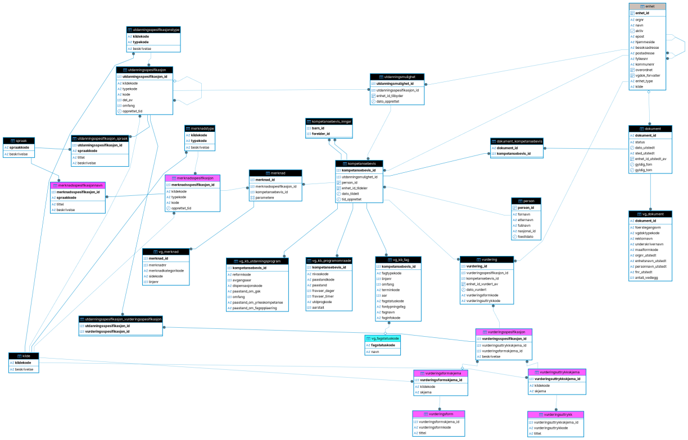
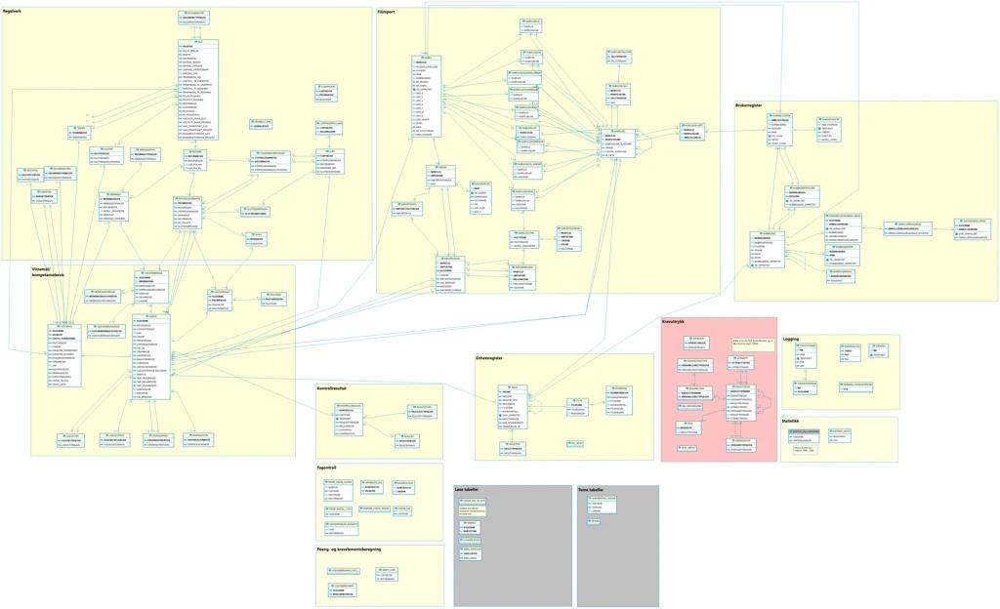

## Semantisk arkitektur

Overgangen fra NVB til KREG er ikke bare en systemmigrering, men en endring i hvordan resultater fra opplæring representeres semantisk. NVBs informasjonsmodell bygger på spesialiserte, distinkte entiteter for videregående opplæring. KREGs modell, inspirert av den internasjonale standarden European Learning Model (ELM) v3 [8], bruker én generisk og rekursiv entitet, kompetansebevis, som kan representere alt fra enkeltresultater til fullstendige vitnemål og grader fra høyere utdanning.

Dette kapittelet beskriver denne forskjellen og hvilken konsekvens den har for systemleverandørene som i dag leverer data til NVB. Arbeidet inngår i det som Digitaliseringsdirektoratets Rammeverk for digital samhandling definerer som semantisk samhandlingsevne – felles forståelse av dataenes betydning og av formatet de utveksles i [4].

Beskrivelsen i dette kapittelet er den normative, systemuavhengige informasjonsmodellen for resultater fra opplæring, forankret i regelverket og ELM. KREGs datamodell (vedlegg A) og Sikts valideringstjeneste er implementasjoner som skal samsvare med den – ikke omvendt. Dette svarer på behovet, påpekt i kommentarrunden, for at fasit ikke skal være en leverandørs regelmotor.

### Modeller

Modeller som er brukt i denne rapporten:

| Modell | Rolle | Omfang | Referanse |
|---|---|---|---|
| NVB | Dagens kilde til sannhet for resultater fra videregående opplæring | Spesialisert for videregående opplæring | [5][6], vedlegg B |
| KREG | Fremtidig mottaksmodell for SAMT-BU | Generalisert, tverrsektoriell, ELM-inspirert | [14], vedlegg A |
| Utdanningsregisteret | Fremtidig grunndataregister for utdanninger; modellen er synkronisert med KREGs utdanningsentiteter | Tverrsektoriell | [16] |
| FINT | Fylkeskommunal integrasjonsmodell for skoleadministrative data; laget for statistikk og analyse, ikke langtidslevende bevis | Videregående opplæring | [7][12: arbeidsmøte 8] |
| ELM v3 | Internasjonal standard for oppnåelser innen utdanning; rammeverk for utveksling på tvers av sektor og land | Alle nivåer | [8] |

Modellen i FINT og gamle NVB er nokså overlappende og beskriver vitnemål og fag for videregående opplæring. Denne modellen er viktig å videreføre semantisk selv om KREG ikke har den som hovedmodell – flere av subtypene i KREG (vg_kb_fag, vg_kb_programomraade, vg_kb_utdanningsprogram, vg_dokument) refererer til den. KREGs datamodell er mer generalisert og henter inspirasjon fra ELM, en modell som er synkronisert med Utdanningsregisterets modell.

### Ny semantikk – kompetansebevis i kompetansebevis

I NVB styres dokumenttype av en kode (VGDOKTYPEKODE) på én flat entitet. Vitnemål og kompetansebevis er rader i samme tabell, skilt kun ved kodeverdi, og karakterene ligger som kolonner direkte på fagraden [5][15].

I KREG/ELM v3 er kompetansebevis én rekursiv entitet. Et vitnemål er et kompetansebevis med andre kompetansebevis nøstet under seg (relasjonen kompetansebevis_inngar, med barn og forelder). Vurdering er skilt ut som egen entitet, koblet til det enkelte kompetansebevis, og kan ha en hierarkisk struktur der flere vurderinger inngår i samme kompetansebevis – for et fag fra videregående opplæring vil den kunne inneholde både eksamens- og standpunktkarakter [14].

Samme struktur brukes uendret på tvers av sektor: en bachelorgrad er et kompetansebevis med emneresultater nøstet under seg, på nøyaktig samme måte som et vitnemål fra videregående opplæring har sluttvurderinger i fag nøstet under seg. Dette gjør at InSchool og VIGO må endre modellen for dataene som sendes inn.

![Til venstre NVB med spesialiserte typer: VGDOK med VGDOKTYPEKODE = VM og personnavn som fritekst, VGDOKFAG-rader med standpunkt- og eksamenskarakter som kolonner, og VGDOKMERKNAD/VGDOKPROMR, knyttet sammen med vitnemålsnummer; dokumenttype er en kodeverdi satt av leverandøren. Til høyre KREG/ELM v3 med rekursiv struktur: et kompetansebevis (vitnemål, rot uten forelder) med kompetansebevis for sluttvurderinger i fag (NOR1211, MAT1013) under seg via kompetansebevis_inngar, og egne vurderinger (standpunkt, eksamen) under hvert fag; dokumenttype er posisjon i hierarkiet, med samme struktur for grad, fagbrev og grunnskole.](fra-nvb-til-kreg-elm.png)

*Figur 4: Fra flat, typekodet struktur (NVB) til rekursiv struktur (KREG/ELM v3). Forenklet; fullstendige modeller i vedlegg A og B.*

Kjernen i det leverandøren må forholde seg til – gitt dagens posisjonsbaserte filformat ([Filformatet – soltegnfilene](../dagens-nvb-import/#filformatet--soltegnfilene)) – er derfor ikke enkeltfelt, men et representasjonsskifte: fra posisjonsbasert tekstfil til strukturerte objekter i et API. Det følger direkte av paradigmeforskjellen over:

- Dokumenttype avledes av struktur (posisjon i hierarkiet), ikke av en typekode leverandøren selv setter.
- Vurdering sendes som eget objekt, ikke som kolonneverdi på faget. Det åpner blant annet for flere vurderinger per resultat (ny eksamen, klagebehandling).
- Felt identifiseres ved navn, ikke ved kolonneposisjon i en linje.
- Person identifiseres strukturert (entiteten person med nasjonal id), ikke som fritekstnavn i dokumenthodet.

### Innplassering i ELM v3

ELM v3 skiller strengt mellom to disjunkte grener [8]:

- **Claim-siden** – faktiske, individuelle hendelser: Learning Achievement (at én bestemt person har oppnådd et læringsresultat) og Learning Assessment (vurderingen/karakteren). Begge er knyttet til én lærende.
- **Specification-siden** – maler og definisjoner: Learning Achievement Specification (hva som kan læres) med underklassen Qualification (formell kvalifikasjonstype med EQF-nivå m.m.), og Learning Opportunity (et konkret tilbud av en spesifikasjon hos en tilbyder).

En instans kan ikke være både claim og spesifikasjon. KREG-modellen respekterer dette skillet: den har egne entiteter for spesifikasjonssiden, og *kompetansebevis* representerer bare claim-siden. Innplasseringen blir da:

| KREG-entitet | ELM v3-klasse | Merknad |
|---|---|---|
| kompetansebevis | Learning Achievement | Instans, per person. Rekursjonen (kompetansebevis_inngar) tilsvarer ELMs sammensetningsrelasjoner (hasPart/isPartOf). |
| vurdering | Learning Assessment | Egen entitet med vurderingsform og vurderingsuttrykk. |
| utdanningsspesifikasjon | Learning Achievement Specification / Qualification | Definisjonssiden; kobles til Utdanningsregisteret i målbildet. |
| utdanningsmulighet | Learning Opportunity | Kobler spesifikasjon til tilbyder (enhet). |
| dokument / vg_dokument | – (dokumentasjonen av et kompetansebevis) | Representerer det utstedte dokumentet – papirvitnemål, signert PDF eller på sikt verifiserbare digitale bevis («konvolutten» rundt claimene, i ELM-økosystemet European Digital Credential). |
| person | Learner (person) | – |
| enhet | Organisation / Awarding Body | Tildeler, utsteder, vurderer. |

Det er behov for å skille mellom beskrivelsen av *hva som er oppnådd* (kompetansebevis) og informasjon om *hvordan dette dokumenteres* (dokument) – her kommer man raskt inn på papirvitnemål, signerte PDF-er og verifiserbare digitale bevis, for eksempel til digitale lommebøker.

KREG-modellens navngivning av entitetene *kompetansebevis* og *dokument* bør vurderes på nytt før modellen nærmer seg produksjonssetting. Dette er ikke diskutert i arbeidsgruppen, og løftes derfor som en inkurie. Entiteten som i dag heter *kompetansebevis*, beskriver i realiteten en oppnåelse eller fullføring. Et alternativt og mer presist begrep kan være *kompetanseoppnåelse*.

Intern datamodell trenger ikke være isomorf med utvekslingsformatet – det er standard praksis at API-laget mapper. Konsekvensen er at API-/eksportlaget må vite hvilken ELM-klasse en gitt kompetansebevis-forekomst tilsvarer (basert på om den er blad eller har barn, og hva slags utdanningsspesifikasjon den peker på), i stedet for å behandle alle forekomster likt. Ett kontrollpunkt gjenstår: ELM definerer domenet og verdiområdet for hasPart/isPartOf i applikasjonsprofilene, ikke i grunnmodellen, så nøstingen av Learning Achievement i Learning Achievement må verifiseres mot valgt profil [8].

![KREG-entitetenes innplassering i ELM v3, med to disjunkte grener der en forekomst ikke kan være begge deler. Claim-siden (faktiske hendelser): Learning Achievement (KREG: kompetansebevis, rekursjon = hasPart/isPartOf), Learning Assessment (KREG: vurdering) som vurderer Learning Achievement, og Learner/Organisation (KREG: person/enhet). Specification-siden (definisjoner): Learning Achievement Specification med underklassen Qualification (KREG: utdanningsspesifikasjon), som Learning Achievement er spesifisert av, og Learning Opportunity (KREG: utdanningsmulighet, spesifikasjon + tilbyder). Under begge: dokument/vg_dokument, som dokumenterer ett eller flere kompetansebevis – «konvolutten»: papir, signert PDF, verifiserbart digitalt bevis.](mapping-kreg-elm-v3.png)

*Figur 5: Mapping fra KREG til ELM v3.*

### Mapping NVB → KREG

Tabellen viser hvordan dagens NVB-entiteter svarer til KREG-modellen, og hva endringen betyr for leverandøren. Fullstendige modeller ligger i vedlegg A (KREG) og B (NVB) [14][15].

| NVB | KREG | Konsekvens for leverandør |
|---|---|---|
| VGDOK med VGDOKTYPEKODE (VM/KB) | kompetansebevis (+ dokument/vg_dokument for utstedelsen) | Leverandøren slutter å sette typekode; dokumenttype følger av strukturen. Utstedelsesinformasjon (rektor, målform, underskriver) flyttes til vg_dokument. |
| VGDOKFAG med standpunkt-/eksamenskarakter som kolonner | vg_kb_fag + vurdering (egne forekomster per karakter) | Vurdering sendes som eget objekt. Flere vurderinger per fag er mulig og modellert, ikke et unntak. |
| VGDOKPROMR (programområdelinjer med påstand) | vg_kb_programomraade | Rimelig direkte mapping (nivåkode, påstand, fravær). |
| Reform-/utdanningsprograminformasjon på dokumentet | vg_kb_utdanningsprogram | Rimelig direkte mapping (reformkode, avgangsår, påstander om GSK/yrkeskompetanse/fagopplæring). |
| VGDOKMERKNAD (VMM-koder) | merknad / merknadsspesifikasjon / vg_merknad | KREG skiller merknadsforekomst fra merknadsdefinisjon; kodene forvaltes som spesifikasjoner. |
| Personnavn og fødselsnummer som felt i ¤V-linjen | person (egen entitet) | Strukturert personidentifikasjon. |
| Skolenummer/orgnr i ¤A/¤S-linjer | enhet (egen entitet, med roller som tildeler, utsteder, vurderer) | Enhetsinformasjon forvaltes sentralt, ikke per fil. |
| Beregnede kontrollfelt på dokumentet (GSK-status m.m.) | Uavklart – validering er egen tjeneste | Om valideringsresultat skal ha en motpart i KREG er uavklart; kvalitetstilstand og skolens overstyring må uansett representeres i registeret ([Teknisk målarkitektur](../maalbilde-og-anbefalt-arkitektur/#teknisk-målarkitektur)). |
| ¤D-annullering | dokument (status) – håndtering uavklart | Endring etter klage og annullering/erstatning av utstedt dokumentasjon må håndteres eksplisitt i KREG; uavklart (jf. R12). |
| ¤-separert fil, posisjonsbaserte felt | Strukturerte objekter i API (GraphQL) | Representasjonsskiftet beskrevet over. |

Ett begrepsvalg som er viktig for semantikken: *kompetansebevis* som generell KREG-term kolliderer med *kompetansebevis fra videregående opplæring* som etablert dokumenttype hos skolene [10]. Rapporten håndterer dette ved alltid å skrive «kompetansebevis fra videregående opplæring» når dokumenttypen menes. Ved registrering i begrepskatalogen skilles de som to begreper med assosiativ relasjon.

### Videre konkretisering av semantikken

Figurene og tabellene i dette kapittelet er illustrasjoner i et dokument. For at semantikken skal kunne gjenbrukes i andre SAMT-BU-caser, og for at forskjellene mellom ELM, FINT, VIGO og InSchool skal kunne kartlegges systematisk, må modellene konkretiseres som faktiske, maskinlesbare artefakter:

- Begrepskatalogen som SKOS (jf. SKOS-AP-NO-Begrep [9]), publisert i Felles datakatalog, slik at begrepene kan refereres med varige identifikatorer fra andre caser.
- Modellkilder i tekstbasert diagramformat (f.eks. Mermaid/PlantUML) forvaltet i prosjektets GitHub, slik at figurene kan versjoneres og gjenbrukes i stedet for å tegnes på nytt.
- En strukturert mappingoversikt ELM ↔ KREG ↔ NVB med egne kolonner for FINT, VIGO og InSchool. Kolonnene for ELM, KREG og NVB fylles fra dette kapittelet; FINT-, VIGO- og InSchool-kolonnene fylles av Novari som del av avklaringen av kildefordelingen, og gjør differansekartleggingen fra arbeidsmøte 6 til en konkret, delegerbar oppgave.

## Begrepskatalog

Katalogen samler begrepene som er brukt i rapporten og i arbeidsmøteserien. Strukturen følger feltene i SKOS-AP-NO-Begrep [9] i forenklet tabellform (anbefalt term, definisjon, datastrukturterm, merknad/kilde), som grunnlag for registrering i Felles datakatalog på data.norge.no. Før registrering må ansvarlig virksomhet fastsettes per begrep (Udir for regelverksbegrepene, Sikt for register- og modellbegrepene), og feltene kildetype og tillatt/frarådet term kompletteres. Prosjektets begreper bør registreres som en egen begrepssamling for SAMT-BU; informasjonsmodellen registreres etter ModellDCAT-AP-NO og datasett/API-er etter DCAT-AP-NO. Der Udirs føringsskriv [10] eller ELM [8] er kilde, er dette angitt.

### Vurderinger og resultater

| Anbefalt term | Definisjon | Datastrukturterm | Merknad / kilde |
|---|---|---|---|
| Sluttvurdering | Endelig vurdering av elevens, lærlingens eller den voksnes kompetanse i et fag: standpunktkarakter, eksamenskarakter eller karakter til fag-, svenne- og kompetanseprøve, jf. forskrift til opplæringslova. Omfatter også karakterer som ikke er bestått. Den atomære enheten i KREG; hver karakter er én vurdering. | KREG: Kompetansebevis; ELM: Learning Achievement | Premiss 1. Udir [10]. |
| Standpunktkarakter | Sluttvurdering satt av faglæreren ved avslutningen av opplæringen i faget. | vurdering (vurderingsformkode) | Udir [10]. |
| Eksamenskarakter | Sluttvurdering fra sentralt eller lokalt gitt eksamen i faget. | vurdering (vurderingsformkode) | Udir [10]. |
| Underveisvurdering | All vurdering som gis underveis i opplæringen som grunnlag for videre læring; i hovedsak uten karakter. Overbegrep for halvårsvurdering. | – | Udir [10]. |
| Halvårsvurdering | Del av underveisvurderingen, gitt midtveis i opplæringen; halvårsvurdering med karakter kan føres på kompetansebevis fra videregående opplæring. Skal ikke inn i KREG i piloten. | – | Presisering arbeidsmøte 6 [12]; Udir [10]. |
| Fag- eller svenneprøve | Avsluttende prøve i fagopplæringen; bestått prøve dokumenteres med fag- eller svennebrev. Registreres i VIGO. | KREG: Kompetansebevis; ELM: Learning Achievement | [12: arbeidsmøte 3]. |
| Vurderingsform | Måten en vurdering er fremkommet på (f.eks. standpunkt, eksamen). | vurderingsform / vurderingsformskjema | KREG [14]. |
| Vurderingsuttrykk | Skalaen en vurdering uttrykkes i (f.eks. tallkarakter 1–6, bestått/ikke bestått). | vurderingsuttrykk / vurderingsuttrykkskjema | KREG [14]. |

### Dokumentasjon og kvalifikasjoner

| Anbefalt term | Definisjon | Datastrukturterm | Merknad / kilde |
|---|---|---|---|
| Kompetansebevis (KREG) | Dokumentasjon av oppnådd kvalifikasjon eller enkeltresultat fra opplæring eller utdanning. Rekursiv: kan inneholde andre kompetansebevis, og representerer alt fra ett enkeltresultat til fullstendig kvalifikasjon. | KREG: kompetansebevis; ELM: Learning Achievement | Partitiv relasjon: kan bestå av / inngå i kompetansebevis. Kolliderer med dokumenttypen under – skilles som to begreper. |
| Kompetansebevis fra videregående opplæring | Dokumenttype som utstedes når vilkårene for vitnemål eller fag-/svennebrev ikke er oppfylt; dokumenterer gjennomført opplæring, enkeltfag (bl.a. for privatister og voksne) og godkjent realkompetansevurdering. Kan inneholde halvårsvurderinger med karakter. I NVB: VGDOKTYPEKODE = KB. | KREG: dokument; NVB: VGDOK (KB) | Udir [10]. |
| Vitnemål | For videregående opplæring: dokumentasjon for fullført og bestått opplæringsløp. For grunnskolen: dokumentasjon for fullført grunnskoleopplæring (uten krav om bestått). I dag et fysisk papirdokument signert av rektor. I NVB: VGDOKTYPEKODE = VM. | KREG: dokument/vg_dokument | Begrepet betegner dokumentet, ikke tjenesten; jf. «utstedelse av kvalifikasjon» [12: arbeidsmøte 6]. Udir [10]. |
| Fagbrev / svennebrev | Dokumentasjon på bestått fag- eller svenneprøve; viser sluttkompetansen. Innehaveren får i tillegg vitnemål som dokumenterer hele opplæringsløpet. | KREG: kompetansebevis (+ dokument) | [12], kommentarrunde og arbeidsmøte 7. |
| Kvalifikasjon | Formelt læringsutbytte oppnådd og bekreftet av en autorisert myndighet. | KREG: Kvalifikasjon; ELM: Qualification (spesifikasjonssiden) | ELM [8]. |
| Utstedelse av kvalifikasjon | Tjenesten der autorisert myndighet (skoleeier) setter sammen og utsteder dokumentasjon for en oppnådd kvalifikasjon. Utføres av skolene, ikke av KREG. | – | Fastsatt term, arbeidsmøte 6 [12]. |
| Dokument | Representasjon av det utstedte dokumentet som dokumenterer ett eller flere kompetansebevis (papir, signert PDF, på sikt verifiserbare digitale bevis). | KREG: dokument, vg_dokument | KREG [14]. |
| Vedlegg | Dokumentasjon uten strukturell verdi som følger et kompetansebevis eller en kvalifikasjon (f.eks. resultatvedlegg fra Vitnemålsportalen / dagens VIP-vedlegg i ELMO). | dokument (antall_vedlegg) | [12: arbeidsmøte 7]. |
| Generell studiekompetanse (GSK) | Kvalifikasjonskrav for opptak til høyere utdanning; oppnås normalt ved bestått studieforberedende videregående opplæring eller påbygging til generell studiekompetanse, eller etter unntaksregler (bl.a. 23/5-regelen). | vg_kb_utdanningsprogram (paastand_om_gsk) | [5][10]. |

### Utdanning og tilbud

| Anbefalt term | Definisjon | Datastrukturterm | Merknad / kilde |
|---|---|---|---|
| Utdanningsspesifikasjon | Definisjonen av en utdanning eller opplæring (hva som kan oppnås), uavhengig av tid, sted og person. | KREG: utdanningsspesifikasjon; ELM: Learning Achievement Specification | Kobles til Utdanningsregisteret i målbildet [14][16]. |
| Utdanningsmulighet | Et konkret tilbud av en utdanningsspesifikasjon hos en tilbyder. | KREG: utdanningsmulighet; ELM: Learning Opportunity | [14]. |
| Utdanningsprogram | Strukturelement i videregående opplæring (f.eks. studiespesialisering, bygg- og anleggsteknikk). | vg_kb_utdanningsprogram | Udir/Grep [10]. |
| Programområde | Spesialisering innenfor et utdanningsprogram per trinn (Vg1–Vg3). | vg_kb_programomraade | Udir/Grep [10]. NVB: ¤P-linje. |
| Fag | Minste strukturelement det gis sluttvurdering i, identifisert med fagkode fra Grep. Merk: i fagskole og høyere utdanning er «emne» tilsvarende begrep. | vg_kb_fag | Udir/Grep [10]. NVB: ¤F-linje. |
| Grep | Udirs forvaltningssystem for læreplanverket, med koder for fag, utdanningsprogram, programområder og kompetansemål. Kodene på vitnemål og kompetansebevis er Grep-koder; VIGOs tilleggskoder er inntakskoder og føres ikke på dokumentasjonen. | – | [12: arbeidsmøte 3]. |
| Kompetansemål | Mål i læreplanen for hva eleven skal kunne i et fag. Oppnådde kompetansemål kan dokumenteres i vedlegg; skal ikke inn i KREG i piloten. | – | Premiss 5 [12]. |
| Modulkode | Kode for modul i modulstrukturert opplæring for voksne. Skal ikke inn i KREG; kan stå på kompetansebevis, men ikke på vitnemål. | – | Premiss 4 [10][12: arbeidsmøte 8]. |
| MVOV | Modulstrukturert opplæring for voksne. Leveres i dag papirbasert/ikke-validert med høyt volum. | – | [12: arbeidsmøte 4]. |

### Aktører, systemer og registre

| Anbefalt term | Definisjon | Datastrukturterm | Merknad / kilde |
|---|---|---|---|
| KREG (Kompetanseregisteret) | Fremtidig nasjonalt register for resultater og kvalifikasjoner fra opplæring og utdanning, forvaltet av Sikt. Navn ikke endelig fastsatt. | – | [13][14]. |
| NVB (Nasjonal vitnemålsdatabase) | Dagens register hos Sikt for vitnemål og kompetansebevis fra videregående opplæring; brukes av Samordna opptak. | – | [5][6][15]. |
| Utdanningsregisteret | Fremtidig grunndataregister for utdanninger (spesifikasjoner og tilbud); onboarder nå fagskole og høyere utdanning. | – | [16][12: arbeidsmøte 8]. |
| Vitnemålsportalen | Sikts tjeneste der innbyggeren henter og deler egne resultater. | – | [12: arbeidsmøte 1]. |
| FINT | Novaris felleskomponent og informasjonsmodell for data fra fylkeskommunale skoleadministrative systemer. | – | [7]. |
| InSchool | Skoleadministrativt system for offentlige videregående skoler (Visma). | – | [17]. |
| VIGO | Fylkeskommunenes system for inntak og fagopplæring; produserer vitnemål for fagopplæringen. | – | [17]. |
| Vigilo, Visma Flyt Skole, IST Everyday, iSkole | Skoleadministrative systemer i grunnskolen og hos private skoler. | – | [17]. |
| ODM (IBM Operational Decision Manager) | Regelmotoren Sikts valideringstjeneste er bygget på; har erstattet kontroll.exe i dagens flyt. | – | [12: arbeidsmøte 6 og 8]. |
| kontroll.exe | Avviklet kontrollmotor for NVB-formatet, distribuert av Samordna opptak/Sikt. | – | [5]. |
| Soltegnfil | Uformell betegnelse på NVB-utvekslingsformatet: ¤-separert, posisjonsbasert tekstfil. | – | [5]. Fases ut. |
| ELM v3 (European Learning Model) | Europeisk standardmodell for læringsdata; grunnlaget for KREGs semantikk og for europeisk utveksling. | – | [8]. |
| ELMO | XML-format for utveksling av resultater i EMREX-nettverket. | – | [12: arbeidsmøte 1 og 7]. |
| EMREX | Europeisk nettverk for elektronisk utveksling av studieresultater. | – | [12: arbeidsmøte 1]. |
| OneRoster (norsk profil) | 1EdTech-standard for utveksling av administrative skoledata; støttes av grunnskolesystemene. | – | [11]. |
| SHACL | W3C-språk for å uttrykke og validere strukturkrav til data; kandidat for maskinlesbare valideringsregler. | – | [Teknisk målarkitektur](../maalbilde-og-anbefalt-arkitektur/#teknisk-målarkitektur). |
| Grunnskolevitnemål | Vitnemål for fullført grunnskole; enklere struktur enn vitnemål fra videregående opplæring. Kun vitnemål, ikke enkeltfag, er aktuelt for innsamling; alle fag regnes som 10. trinn. | – | [12: arbeidsmøte 3]. |

## Vedlegg

### Vedlegg A – Informasjonsmodell, KREG

Merk at denne modellen justeres noe nå for å inkludere resultater fra fagskoler og høyere utdanning. Dette berører ikke hovedtrekkene i modellen.

Dokumentasjon av utdanningen som resultatet gjelder, beskrives av utdanningsspesifikasjon og utdanningsmulighet. Dette er entiteter som vil få en kobling til Utdanningsregisteret (videregående opplæring er ikke tatt inn der ennå, og disse er derfor satt opp i sin helhet også i KREG i denne fasen).

Kompetansebevis er den sentrale entiteten som dokumenterer et resultat. Dette kan være en oppnådd kvalifikasjon (som gir vitnemål), et enkeltresultat for fag eller emne, eller en mikrokvalifikasjon.

Entiteten vurdering inneholder dokumentasjon av den enkelte karakter. Denne har en hierarkisk struktur (som ikke vises i denne modellen) der flere vurderinger kan inngå i samme kompetansebevis. For eksempel vil den for fag fra videregående opplæring kunne inneholde eksamens- og standpunktkarakter.

Modellen legger opp til å subtype informasjon under kompetansebevis avhengig av hvilken type bevis det er snakk om. For fag fra videregående opplæring vil vg_kb_fag inneholde mer informasjon om det som spesifikt gjelder denne typen resultater. For fullføring av videregående opplæring (som en kvalifikasjon) legges mer informasjon under vg_kb_utdanningsprogram og vg_kb_programomraade. Informasjon om utstedelse av dokument legges til dokument, som igjen er subtypet med vg_dokument, som inneholder ekstra informasjon for vitnemål og kompetansebevis fra videregående opplæring.

*Vedlegg A1: Informasjonsmodell KREG (ER-diagram) [14].*

*Vedlegg A2: Forenklet modell KREG.*

### Vedlegg B – Informasjonsmodell, NVB2

NVB2-modellen viser dagens database bak Nasjonal vitnemålsdatabase, organisert i områdene regelverk, filimport, vitnemål/kompetansebevis, kontrollresultat, enhetsregister, brukerregister, kravuttrykk, fagkontroll, poeng- og kravsmengdeberegning, logging og statistikk. Kjernen for denne rapporten er området vitnemål/kompetansebevis (VGDOK med fag-, programområde- og merknadstabeller) og filimport (mottak av soltegnfilene), som til sammen implementerer formatet beskrevet i [Filformatet – soltegnfilene](../dagens-nvb-import/#filformatet--soltegnfilene).

*Vedlegg B1: Informasjonsmodell NVB2 (ER-diagram).*

*Vedlegg B2: Forenklet modell NVB 2.*
