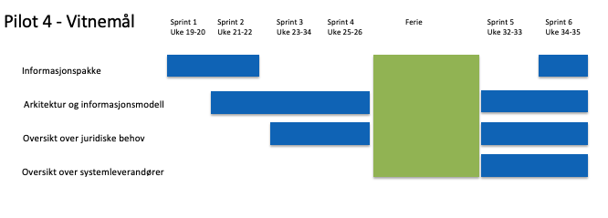

*This page is based on «Plan for gjennomføring av pilot 4» (plan for carrying out pilot 4), version 0.1 (15.04.2026). The pilot was carried out May–August 2026. The deliverables are listed under [What the pilot delivered](#what-the-pilot-delivered) at the bottom of the page.*

## INTRODUCTION

The purpose of SAMT-BU is to establish a common foundation for collaboration and knowledge about data-driven service development and seamless user journeys across levels of government and sectors, piloted in the domain of children and young people – from kindergarten to higher education. Through practical experimentation and competence building, the project shall lay the groundwork for the common foundation to be mature and well known, so that it is used and built upon, in other domains as well.

One of the project's most central deliverables is to provide MVPs and piloting of information models and services. The project also aims to take an agile approach to its work, based on curiosity and learning through experimentation in short iterations, so that we can quickly demonstrate real value and also quickly discover what does not work (fail fast). We will do this through pilot projects covering prioritised use cases.

This document describes the plan for carrying out the pilot. Although the pilot is described here as a phase-driven process, we assume that we will work iteratively, with individual phases repeated as needed.

## SCOPE AND DELIMITATION

### Background

The work takes as its starting point [case 1 – Making results from education available](https://docs.samt-bu.no/en/behov/use-cases/01-resultater-vgo/).

The case addresses how results from primary and lower secondary education and from upper secondary education can be made available in a better and more coherent way for actors who need the information in their further follow-up of young people. Results may for example be the status of completed education, completion, competence, assessments or documentation of the level attained.

### Objective of the pilot

The objective of the pilot is to do the groundwork ahead of a technical implementation. That is, to produce an architecture, an information model and an overview of which systems hold data on results from education, and to begin mapping the legal requirements for sharing this data.

### Deliverables of the pilot

The pilot has the following deliverables:

- An architecture and information model forming the basis for the data flow of diplomas and results from education.
- An overview of the system vendors that hold diplomas and results from primary, lower secondary and upper secondary education. This shall give us points of contact with all the actors that are to supply data to the competence register.
- An overview of the legal requirements relating both to the digitalisation of diplomas and to supplying diplomas and results from primary, lower secondary and upper secondary education.
- An understanding of what the digitalisation of diplomas entails. Preparation of an information package to be used towards all actors affected by the digitalisation of diplomas and the transfer of data.

Carrying out the pilot shall also form the basis for updating the project's "playbook" for running this type of project.

### Delimitation

This pilot contains no technical deliverables, only preparations relating to the later development of an API, connection to that API and an interface for viewing the education results.

## STAFFING

### The pilot project

Anne Kathrine Haugen, Project manager, [Anne.kathrine.haugen@sikt.no,](mailto:Anne.kathrine.haugen@sikt.no) Sikt\
Geir Vangen, Architect/Professional director, [geir.vangen@sikt.no,](mailto:geir.vangen@sikt.no) Sikt\
Martin Skurtveit, Tech lead, [martin.skurtveit@sikt.no,](mailto:martin.skurtveit@sikt.no) Sikt\
Sarah Renså-Skogesal, Lawyer, [sarah.rensa.skogesal@sikt.no,](mailto:sarah.rensa.skogesal@sikt.no) Sikt\
Katarina Parteka Aarsnes, Lawyer, [katarina.aarsnes@sikt.no,](mailto:katarina.aarsnes@sikt.no) Sikt\
Øystein Nilsen, [Oystein.Nilsen@udir.no,](mailto:Oystein.Nilsen@udir.no) Udir

## EXECUTION

### Duration of the pilot

The pilot runs from 02.05.2026 to 30.08.2026.

### Work packages

The following work packages have been defined:

1. Information package for everyone involved and for system vendors. An understanding of what the digitalisation of diplomas entails.
2. Architecture and information model
3. Overview of legal requirements
4. Overview of system vendors

### Key milestones

The pilot has the following key milestones:

- When the information package is ready
- When the architecture and information model are completed
- When an overview of the legal requirements has been produced
- When the system vendor overview is complete

### Practical execution

The pilot is carried out iteratively according to agile principles, in sprints of two or three weeks. Each sprint starts with a planning meeting and ends with a demo. Running a joint demo for all pilots under SAMT-BU will be considered.

Initially it is desirable to hold stand-ups for the whole pilot together every other day, but in time it may be sufficient to coordinate the work within each work package.

At least one retrospective should be held during the pilot period.

A dedicated GitHub solution is set up for the project and shall be used in the pilot.

## OVERALL PLAN

The pilot follows the project's playbook for carrying out pilots:

The plan for the four work packages, spread over six sprints with a holiday break in July:

## GOALS (KPI/OKR)

The following preliminary OKRs, linked to the main project's goals, apply to the pilot:

| Objective | Key results |
|---|---|
| **1. Lay a solid professional foundation for digital sharing of education results**  Link to project goals: common information models, better data quality and reuse, reduced risk of errors and duplicated work | **KR1:** The architecture and information model for the data flow of diplomas and results is completed and professionally reviewed by relevant stakeholders by the end of the pilot.  **KR2:** An overview of system vendors with contact points for all actors that are to supply data is *(the text ends here in the plan)*  **KR3:** Legal needs relating to the sharing of diplomas and results from primary, lower secondary and upper secondary education are fully mapped and documented. |
| **2. Ensure a common understanding among all actors involved of what the digitalisation of diplomas entails**  Link to project goals: increased ability to collaborate, sharing of experience and spreading of competence | **KR1:** An information package on the digitalisation of diplomas is completed and distributed to all affected system vendors and actors by the end of the pilot.  **KR2:** No significant misunderstandings about scope or responsibility among the actors involved are identified in the pilot's final evaluation. |
| **3. Help mature the project's working methods and framework**  Link to project goals: framework completed and tested in pilots, sharing of experience, final report and plan for continuation | **KR1:** The project's playbook is updated with concrete experience and lessons learned from the pilot by 30.08.2026.  **KR2:** At least one retrospective has been held, with documented findings shared with the SAMT-BU project.  **KR3:** The pilot's experience has been presented at a joint SAMT-BU demo and made available to the other pilot teams. |

## WHAT THE PILOT DELIVERED

One deliverable per work package:

1. [Information package](../informasjonspakke/) – what the digitalisation of diplomas entails, for all affected actors
2. [Architecture and information model](../arkitektur-og-informasjonsmodell/) – the report from work package 2, with [minutes of the working meetings](../arkitektur-og-informasjonsmodell/arbeidsmoter/)
3. [Legal needs](../juridiske-behov/) – legal assessment
4. [System vendors](../systemleverandorer/) – overview of school administration systems
