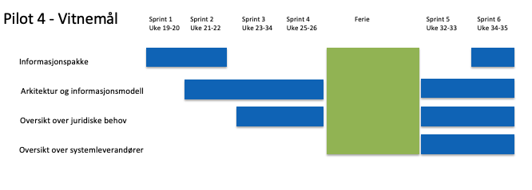

*Siden bygger på «Plan for gjennomføring av pilot 4», versjon 0.1 (15.04.2026). Piloten ble gjennomført mai–august 2026. Leveransene står under [Pilotens leveranser](#pilotens-leveranser) nederst på siden.*

## INNLEDNING

Formålet med SAMT-BU er å etablere et felles fundament for samarbeid og kunnskap om datadrevet tjenesteutvikling og sømløse brukerreiser på tvers av forvaltningsnivåer og sektorer, med pilotering ut fra området barn og unge – fra barnehage til høyere utdanning. Gjennom praktisk utprøving og kompetansebygging skal prosjektet legge grunnlag for at felles fundamentet er modent og kjent, slik at det blir brukt og bygget videre på, også på andre områder.

Et av prosjektets mest sentrale produkter er å levere MVP-er og pilotering av informasjonsmodeller og tjenester. Prosjektet ønsker også å ha en smidig tilnærming til oppgavene basert på nysgjerrighet og læring gjennom utprøving i korte iterasjoner, slik at vi raskt kan vise reell verdi og også raskt finner ut hva som ikke fungerer (fail fast). Vi vil gjøre dette gjennom pilotprosjekter som dekker prioriterte use cases

Dette dokumentet inneholder en beskrivelse av plan for gjennomføring av pilot . Selv om vi i dette dokumentet har beskrevet gjennomføring av pilot som en fasedreven prosess, forutsettes det at vi kommer til å arbeide iterativt der enkelte faser gjentas ved behov.

## OMFANG OG AVGRENSNING

### Bakgrunn

Arbeidet tar utgangspunkt i [case 1 – Tilgjengeliggjøring av resultater fra opplæring](/behov/use-cases/01-resultater-vgo/).

Caset tar for seg hvordan resultater fra grunnskole og videregående opplæring kan gjøres tilgjengelige på en bedre og mer sammenhengende måte for aktører som har behov for informasjonen i videre oppfølging av unge. Resultater kan for eksempel være status for gjennomført opplæring, fullføring, kompetanse, vurderinger eller dokumentasjon av oppnådd nivå.

### Pilotens målsetning

Målsettingen for piloten er å gjøre forarbeidet før en teknisk implementering. Det vil si få utarbeidet arkitektur, informasjonsmodell, oversikt over hvilke systemer som inneholder data om resultater fra utdanning og starte kartlegging av juridiske behov for å kunne dele disse dataene.

### Pilotens produkter

Piloten har følgende produkter:

- Arkitektur og informasjonsmodell som danner grunnlag for dataflyt av vitnemål og resultater fra utdanning.
- Oversikt over systemleverandører som har vitnemål og resultater fra grunn- og videregående opplæring. Den skal gi oss kontaktpunkter til alle aktører som skal avgi data til kompetanseregisteret.
- Oversikt over juridiske behov knyttet til både digitalisering av vitnemål og å avgi vitnemål og resultater fra grunn- og videregående opplæring.
- Forståelse av hva digitalisering av vitnemål innebærer. Utarbeidelse av informasjonspakke som skal benyttes overfor alle aktører berørt av digitalisering av vitnemål og overføring av data.

Selve gjennomføringen av piloten skal også danne grunnlag for oppdatering av prosjektets «dreiebok» for gjennomføring av denne typen prosjekter.

### Avgrensning

I denne piloten er det ingen tekniske produkter, kun forberedelser knyttet til senere utvikling av API, oppkobling til API-et og grensesnitt for innsyn i utdanningsresultatene.

## BEMANNING

### Pilotprosjektet

Anne Kathrine Haugen, Prosjektleder, [Anne.kathrine.haugen@sikt.no, ](mailto:Anne.kathrine.haugen@sikt.no)Sikt\
Geir Vangen, Arkitekt/Fagdirektør, [geir.vangen@sikt.no,](mailto:geir.vangen@sikt.no) Sikt\
Martin Skurtveit,Tech-leder, [martin.skurtveit@sikt.no,](mailto:martin.skurtveit@sikt.no) Sikt\
Sarah Renså-Skogesal, Jurist, [sarah.rensa.skogesal@sikt.no,](mailto:sarah.rensa.skogesal@sikt.no) Sikt\
Katarina Parteka Aarsnes, Jurist, [katarina.aarsnes@sikt.no,](mailto:katarina.aarsnes@sikt.no) Sikt\
Øystein Nilsen, [Oystein.Nilsen@udir.no, ](mailto:Oystein.Nilsen@udir.no)Udir

## GJENNOMFØRING

### Pilotens varighet

Piloten varer fra 02.05.2026 – 30.08.2026.

### Pilotens arbeidspakker

Det er definert følgende arbeidspakker:

1. Infopakke til alle involverte og systemleverandører. Forståelse av hva digitalisering av vitnemål innebærer.
2. Arkitektur og informasjonsmodell
3. Oversikt over juridiske behov
4. Oversikt over systemleverandører

### Viktige milepæler

Piloten har følgende viktige milepæler:

- Når informasjonspakken er klar
- Når arkitektur og informasjonsmodell er ferdigstilt
- Når det er utarbeidet en oversikt over de juridiske behovene
- Når systemleverandøroversikten er komplett

### Praktisk gjennomføring

Piloten gjennomføres iterativt etter smidige prinsipper og i sprinter på 2 eller 3 uker. Hver sprint starter med et planleggingsmøte og avsluttes med en demo. Det vil bli vurdert å kjøre felles demo i SAMT-BU regi for alle piloter.

I utgangspunktet er det ønskelig å gjennomføre standups for hele piloten samlet annenhver dag, men etter hvert kan det være tilstrekkelig at arbeidet koordineres i hver av arbeidspakkene.

Det bør gjennomføres minst en retrospektiv i løpet av pilotperioden.

Det settes opp en egen GitHub-løsning for prosjektet som skal benyttes i Piloten.

## OVERORDNET PLAN

Piloten følger prosjektets dreiebok for gjennomføring av piloter:

Planen for de fire arbeidspakkene, fordelt på seks sprinter med ferie i juli:

## MÅL (KPI/OKR)

Følgende foreløpige OKR-er, koblet til hovedprosjektets mål, gjelder for piloten:

| Objective | Key results |
|---|---|
| **1. Legge et solid faglig grunnlag for digital deling av utdanningsresultater**  Kobling til prosjektmål: felles informasjonsmodeller, bedre datakvalitet og gjenbruk, redusert risiko for feil og dobbeltarbeid | **KR1:** Arkitektur og informasjonsmodell for dataflyt av vitnemål og resultater er ferdigstilt og faglig gjennomgått av relevante interessenter innen pilotens slutt.  **KR2:** Oversikt over systemleverandører med kontaktpunkter for alle aktører som skal avgi data, er *(teksten slutter her i planen)*  **KR3:** Juridiske behov knyttet til deling av vitnemål og resultater fra grunn- og videregående opplæring er kartlagt og dokumentert i sin helhet. |
| **2. Sikre felles forståelse blant alle involverte aktører om hva digitalisering av vitnemål innebærer**  Kobling til prosjektmål: økt samhandlingsevne, erfaringsdeling og kompetansespredning | **KR1:** Informasjonspakke om digitalisering av vitnemål er ferdigstilt og distribuert til alle berørte systemleverandører og aktører innen pilotens slutt.  **KR2:** Ingen vesentlige misforståelser om scope eller ansvar blant involverte aktører er identifisert i pilotens avsluttende evaluering. |
| **3. Bidra til å modne prosjektets arbeidsmetodikk og rammeverk**  Kobling til prosjektmål: rammeverk ferdigstilt og testet i piloter, erfaringsdeling, sluttrapport og plan for videreføring | **KR1:** Prosjektets dreiebok er oppdatert med konkrete erfaringer og læringspunkter fra piloten innen 30.08.2026.  **KR2:** Minst én retrospektiv er gjennomført med dokumenterte funn som deles med SAMT-BU-prosjektet.  **KR3:** Pilotens erfaringer er presentert på felles SAMT-BU-demo og gjort tilgjengelig for øvrige pilotteam. |

## PILOTENS LEVERANSER

Én leveranse per arbeidspakke:

1. [Informasjonspakke](../informasjonspakke/) – hva digitalisering av vitnemål innebærer, til alle berørte aktører
2. [Arkitektur og informasjonsmodell](../arkitektur-og-informasjonsmodell/) – rapporten fra arbeidspakke 2, med [referater fra arbeidsmøtene](../arkitektur-og-informasjonsmodell/arbeidsmoter/)
3. [Juridiske behov](../juridiske-behov/) – juridisk vurdering
4. [Systemleverandører](../systemleverandorer/) – oversikt over skoleadministrative systemer
