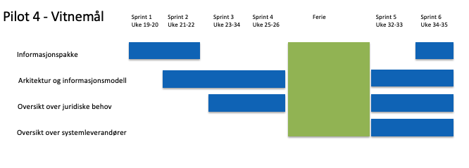

The tasks of pilot 4 are issues in [samt-bu-pilot-4](https://github.com/samt-x/samt-bu-pilot-4/issues) and on the board [SAMT-BU Pilot 4 – Vitnemål](https://github.com/orgs/samt-x/projects/3) (Project 3). This page shows where the work stands.

| View | Shows |
|---|---|
| [Board](https://github.com/orgs/samt-x/projects/3/views/1) | All tasks by status |
| [By responsible](https://github.com/orgs/samt-x/projects/3/views/2) | The tasks grouped by who is responsible |
| [Open tasks](https://github.com/orgs/samt-x/projects/3/views/3) | Open tasks in a table |
| [My tasks](https://github.com/orgs/samt-x/projects/3/views/5) | Your tasks (requires login) |
| [Timeline](https://github.com/orgs/samt-x/projects/3/views/4) | GitHub's own timeline, without dependencies |

## Original plan

The pilot ran from 2 May to 30 August 2026. The plan spread the four work packages over six sprints, with a holiday break in July:

## Timeline

All tasks on the board, with arrows showing which tasks wait for each other. What has happened is dark. Missing dates are calculated and dashed. The chart is generated from the board every hour. How to read it, and how a task gets into it: see [Timeline](/en/prosjektleveranser/loesninger/samhandlingsplattform/oppgavestyring/tidslinje/) in task management.


